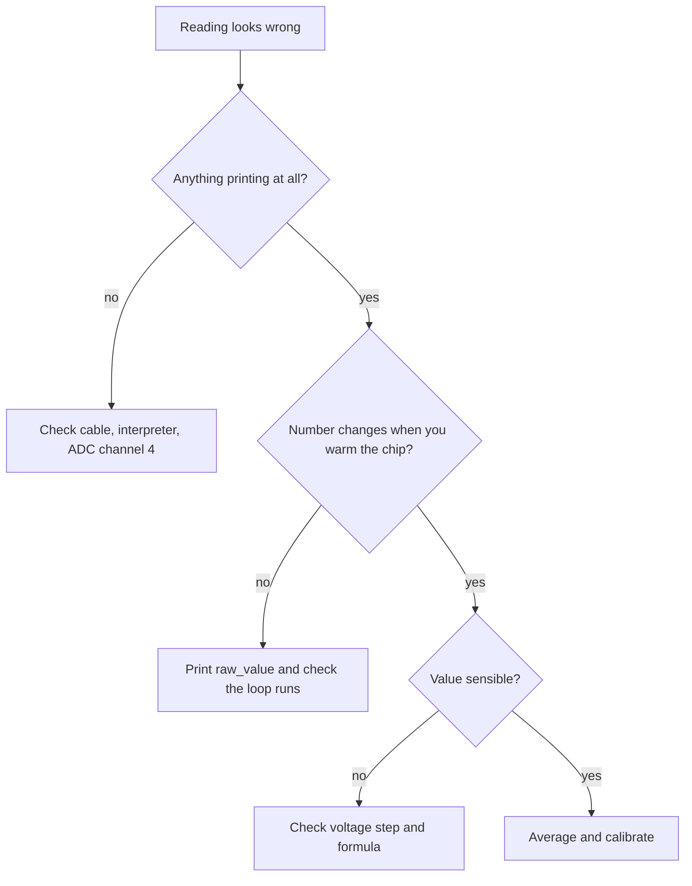

{:class="cover"}

---

By the end of this lesson you will be able to work through a temperature problem step by step, from the cable to the formula.

Even the best-designed project misbehaves sometimes, and that is part of making. The trick is to stop guessing and check things in order, from the outside in. This lesson is your toolbox.



---

## Problem 1: Inaccurate temperature readings

**Symptoms:** values are much higher or lower than expected, or they fluctuate.

**What to check:**

- The sensor reads the chip's own temperature, which is normally a few degrees above the room.
- Make sure the Pico is not busy with heavy work while you measure.
- Check the formula uses the **voltage**, not the raw ADC value:

```python
voltage = raw_value * 3.3 / 65535
temperature = 27 - (voltage - 0.706) / 0.001721
```
{: .no-snakie }

- Average several readings. Readings naturally jump in steps of about half a degree, because each ADC step is about 0.47°C.
- Apply a calibration offset measured against a thermometer (see lesson 9). The formula assumes a perfect 3.3 V reference, and a 1% error there shifts the result by about 4°C.

## Problem 2: No readings displayed

**Symptoms:** the Thonny Shell shows no output, or an error.

**What to check:**

- The ADC channel. The temperature sensor is channel 4, not a GPIO pin:

```python
sensor_adc = machine.ADC(4)
```
{: .no-snakie }

- The interpreter. Thonny must be set to MicroPython, not your computer's own Python.
- The last line of any error message. For example, `AttributeError: 'tuple' object has no attribute 'tm_hour'` means the code was written for Python on a PC: in MicroPython `time.localtime()` returns a tuple, so use `timestamp[3]` for the hour.

## Problem 3: Readings do not change

Add a debug print to see whether the ADC value moves, and run a tiny loop on its own to prove the loop works:

```python
import time

count = 0
while True:
    print(f"The loop is running {count}")
    count += 1  # Increment the count
    time.sleep(1)  # without this the loop floods the Shell
```

If the count rises, the loop is fine and the problem is in your sensor code. If nothing prints, the problem is the connection or the interpreter.

## Problem 4: Voltage conversion issues

If the voltage looks wrong, check the formula:

```python
voltage = raw_value * 3.3 / 65535
```
{: .no-snakie }

To test the ADC on its own, connect a known voltage between 0 V and 3.3 V to GP26 (ADC channel 0) and read it with `machine.ADC(26).read_u16()`. Never connect more than 3.3 V to an ADC pin, as it can damage the Pico.

## A debugging routine that works

1. **Use debugging prints.** Print `raw_value`, `voltage` and `temperature` to find which step goes wrong.
2. **Simplify the script.** Strip it back to just the ADC read and a print.
3. **Check the connection.** Confirm the USB cable carries data and Thonny shows the MicroPython `>>>` prompt.
4. **Restart.** Unplug and reconnect the Pico to reset it.

> **Teachers**: debugging is a skill worth teaching on purpose. A good classroom activity is to hand out copies of the formula script with one deliberate bug each, such as feeding the raw value into the formula, and have pairs find and fix them using the flowchart above. It also works with no hardware if you show the printed Shell output.

---

## What you've learned

- How to identify and fix common issues with temperature readings.
- Debugging techniques for MicroPython scripts.
- Best practices for ensuring accurate and reliable temperature monitoring.

The last lesson pulls the whole course together into one finished program.

---

## Try it Yourself

1. Break the script on purpose by passing `raw_value` into the formula, run it, and read the answer. Then fix it.
2. Remove `time.sleep(1)` from the loop in a copy of your program and see what the Shell does, then put it back.
3. Challenge: write a short program that prints `raw_value`, `voltage` and `temperature` side by side, so you can spot a bad step at a glance.

## Common Issues

- **Problem**: The Shell floods with lines and Thonny becomes slow.
- **Solution**: Add `time.sleep(1)` inside the loop and press Stop.
- **Why**: A loop with no delay prints thousands of lines a second faster than Thonny can draw them.

- **Problem**: The Pico does not respond at all.
- **Solution**: Press Stop, then unplug and replug the Pico. If it still fails, reinstall the firmware from lesson 3.
- **Why**: A stuck program or a corrupt install can stop the board from answering Thonny.

- **Problem**: You fixed one thing and the reading is still wrong.
- **Solution**: Change one thing at a time and re-run after each change.
- **Why**: Several changes at once make it impossible to tell which one helped.

## Check your understanding


? A temperature reads about minus eight million degrees. What is the likely cause?
- [ ] The Pico is frozen
- [x] The raw ADC value was passed into the formula instead of the voltage
- [ ] The cable is faulty
> The formula expects a voltage near 0.7 V, so a raw number in the thousands gives a huge negative answer.

? You see `AttributeError: 'tuple' object has no attribute 'tm_hour'`. What is the fix?
- [ ] Reinstall Thonny
- [x] Use `timestamp[3]` instead of `timestamp.tm_hour`
- [ ] Change the ADC channel
> MicroPython's `localtime()` returns a plain tuple, so you use positions.

? What should you do before applying a calibration offset?
- [ ] Nothing
- [x] Compare the Pico with a trusted thermometer once the chip has settled
- [ ] Switch to Fahrenheit
> The offset is the thermometer reading minus the Pico reading, taken when both are stable.

