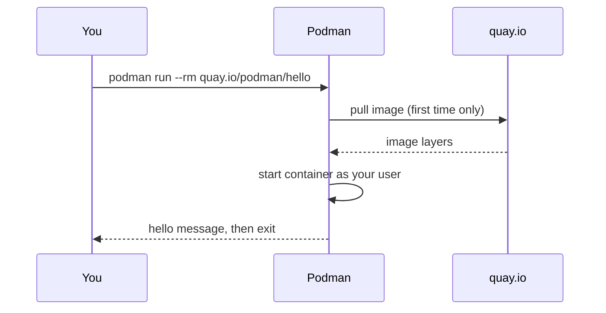

{:class="cover"}

---

By the end of this lesson you will be able to install Podman on a Raspberry Pi, check that rootless mode is set up, and run a container as your normal user.

Podman is in the standard package repositories of Raspberry Pi OS, Debian and Ubuntu, so installing it is one command. This course assumes a Raspberry Pi 4 or 5 running 64-bit Raspberry Pi OS.

## Step 1: Install

```bash
sudo apt update
sudo apt install -y podman
```

This is the **only** time we need `sudo` for Podman. Afterwards everything runs as your normal user.

## Step 2: Check the version

```bash
podman --version
```

The version depends on your Raspberry Pi OS release. Older releases ship Podman 4.3, and newer ones ship a later 5.x release. Write yours down, because some features in this course need a recent version:

| Feature | Needs |
| --- | --- |
| Everything in lessons 3 to 9 | Any version in the standard repositories |
| Quadlet (`.container` files) in lesson 10 | Podman 4.4 or newer |
| `podman compose` wrapper in lesson 8 | Podman 4.7 or newer |
{:class="table table-single"}

If your version is too old for a feature, the lesson shows a fallback.

## Step 3: Check rootless mode is ready

Rootless containers need a range of spare user IDs set aside for you. Check that you have one:

```bash
grep "$USER" /etc/subuid /etc/subgid
```

You should see a line in each file naming your user, for example `pi:100000:65536`. On Raspberry Pi OS these are created when the user is made, so you normally do not need to do anything.

## Step 4: Run your first container

```bash
podman run --rm quay.io/podman/hello
```

Podman downloads a tiny image from the Quay registry, runs it, prints a hello message and removes the container (`--rm`). Notice there was no `sudo` anywhere.

We wrote the image name in full (`quay.io/podman/hello`). Registries are explained in lesson 4, and it matters.



## Other computers

- **Fedora, CentOS, RHEL**: `sudo dnf install podman`
- **Arch Linux**: `sudo pacman -S podman`
- **macOS and Windows**: Podman runs containers inside a small Linux virtual machine. Install Podman Desktop, or the `podman` command, then create the VM with `podman machine init` and `podman machine start`. **These two commands are for macOS and Windows only.** On a Raspberry Pi you do not need `podman machine` at all

## Optional: a Docker-style shortcut

If you have lots of old scripts that say `docker`, Debian offers a package that provides a `docker` command which calls Podman:

```bash
sudo apt install -y podman-docker
```

It is handy, but in this course we type `podman` so you always know which tool is running.

## Try it Yourself

1. Run `podman info` and find your Podman version, the storage location, and whether `rootless` is `true`
2. Run `podman run --rm docker.io/library/alpine cat /etc/os-release` to see which Linux the container is using. It is not the same as your Pi's
3. Challenge: run `whoami` on your Pi and `podman run --rm docker.io/library/alpine whoami`. Why are the answers different?

## Common Issues

- **Problem**: `podman: command not found`.
- **Solution**: Run `sudo apt update` and then `sudo apt install -y podman` again, and check for errors in the output.
- **Why**: The package was not installed, often because the package list was out of date or the network dropped.

- **Problem**: A rootless container fails with a message about `subuid`, `subgid` or `newuidmap`.
- **Solution**: Run `sudo apt install -y uidmap`, then check `grep "$USER" /etc/subuid /etc/subgid` shows your user. If the line is missing, ask an administrator to add one.
- **Why**: Rootless mode needs the `uidmap` helpers and a reserved block of user IDs to build the user namespace.

- **Problem**: Pulling an image fails with a network or timeout error.
- **Solution**: Check the Pi is online with `ping -c 3 quay.io`, then try again.
- **Why**: Images are downloaded from the internet, so any network problem shows up as a pull failure.

> **Teachers**: The install needs `sudo` once per machine, so install in advance on shared or school-managed Pis. Pulling images needs access to registries such as `quay.io` and `docker.io`, which some school filters block, so test this before the lesson. Images are stored in each user's own home folder, so a class of 30 learners will each download their own copy; plan for SD card space and bandwidth.

## Check your understanding


? Which command installs Podman on Raspberry Pi OS?
- [ ] `pip install podman`
- [x] `sudo apt install podman`
- [ ] `podman machine init`
> Podman is a package in the standard repositories, so `apt` installs it.

? When do you need `sudo` with rootless Podman?
- [ ] Every time you run a container
- [x] Only for the one-off install
- [ ] Only when pulling images
> Rootless containers run as your own user, so `sudo` is only for installing the package.

? What is `podman machine` used for?
- [ ] Creating pods on a Raspberry Pi
- [x] Running Podman's Linux virtual machine on macOS and Windows
- [ ] Checking the Podman version
> Linux runs containers natively, so on a Pi there is no VM to manage.

? What does `--rm` do in `podman run --rm quay.io/podman/hello`?
- [ ] Runs the container as root
- [x] Removes the container when it exits
- [ ] Removes the image
> `--rm` deletes the finished container so it does not pile up in `podman ps -a`.

