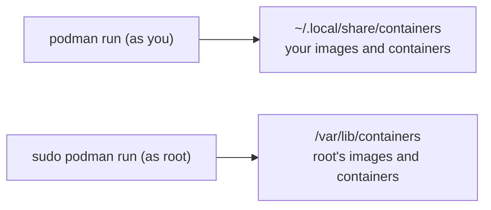

{:class="cover"}

---

By the end of this lesson you will be able to run your everyday Docker commands with Podman, and spot the three places where they behave differently.

One of Podman's best features is its **Docker-compatible command line**. For the commands you use every day, you really can swap the word `docker` for `podman`.

## The same commands

| Task | Docker | Podman |
| --- | --- | --- |
| Run a container | `docker run -it alpine` | `podman run -it alpine` |
| List running containers | `docker ps` | `podman ps` |
| List all containers | `docker ps -a` | `podman ps -a` |
| Build an image | `docker build -t myapp .` | `podman build -t myapp .` |
| View logs | `docker logs NAME` | `podman logs NAME` |
| Stop a container | `docker stop NAME` | `podman stop NAME` |
| Remove a container | `docker rm NAME` | `podman rm NAME` |
| Remove an image | `docker rmi IMAGE` | `podman rmi IMAGE` |
{:class="table table-single"}

Flags such as `-d`, `-p`, `-v`, `-e`, `--name` and `--rm` all work the same way too.

## Difference 1: image names must say where they come from

Docker quietly assumes images come from Docker Hub. Podman is more careful, because it can search several registries. If you type a short name like `alpine`, Podman may ask you which registry you meant, or stop with an error such as `short-name resolution enforced but cannot prompt without a TTY`.

The fix is to write the image's full name: registry, then path, then tag.

```bash
podman run --rm docker.io/library/alpine echo "Hello from Alpine"
```

Official Docker Hub images live under `docker.io/library/`, so `redis` becomes `docker.io/library/redis`. We use full names for the rest of this course so nothing prompts or surprises you.

## Difference 2: ports below 1024 are blocked

Let's run a tiny web server to see ports in action. `-d` runs it in the background, and `-p 8080:80` publishes the container's port 80 on port 8080 of your Pi:

```bash
podman run -d --name web -p 8080:80 docker.io/library/nginx:alpine
curl http://localhost:8080
```

You should see the nginx welcome page. Now try `-p 80:80`. A rootless container cannot use port 80 on the host, so you get an error mentioning `rootlessport` and a privileged port. Stick with higher ports, or ask an administrator about the `net.ipv4.ip_unprivileged_port_start` setting if you really need one.

Clean up:

```bash
podman stop web
podman rm web
```

## Difference 3: where things live

In rootless mode, your images, containers and volumes live in your home folder (under `~/.local/share/containers/`), not in a system-wide folder. That has two effects:

- **Separate stores.** Images pulled by you are invisible to `sudo podman`, and the other way round. They are two completely different stores
- **No shared state.** Two users on the same Pi each have their own images and containers



## Cleaning up

`docker system prune` has a Podman twin, so this works too:

```bash
podman system prune
```

It removes stopped containers, unused networks and dangling images. Add `--volumes` to also remove unused volumes, so read the prompt before you say yes.

## Aliasing docker to podman

If you want your muscle memory to keep working, either use `alias docker=podman` in your shell, or install the `podman-docker` package from lesson 3. Do not assume every Docker command works unchanged. Anything that talks to the Docker daemon directly, such as mounting `/var/run/docker.sock`, has no Podman equivalent without extra set-up.

## Try it Yourself

1. Run `podman run -it --rm docker.io/library/alpine sh`, type `echo $HOSTNAME`, then `exit`. What does the hostname look like?
2. Start the nginx example on a different host port, such as 9090, and check it with `curl`
3. Challenge: run `sudo podman images` and `podman images`. Why are the lists different?

## Common Issues

- **Problem**: `short-name resolution enforced but cannot prompt without a TTY`, or a prompt asking you to choose a registry.
- **Solution**: Use the full image name, for example `docker.io/library/alpine`.
- **Why**: Podman will not guess which registry to trust, which protects you from pulling a look-alike image.

- **Problem**: `rootlessport cannot expose privileged port 80`.
- **Solution**: Publish a port of 1024 or higher, for example `-p 8080:80`.
- **Why**: Normal users may not open privileged ports, and a rootless container is a normal user.

- **Problem**: An image you pulled with `sudo` is missing when you run `podman images`.
- **Solution**: Pull it again as your own user without `sudo`.
- **Why**: Root and rootless users each keep their own separate image store.

## Check your understanding


? Why should you write `docker.io/library/alpine` rather than `alpine` in Podman?
- [ ] Short names are not valid in any container tool
- [x] Podman does not assume a default registry, so the full name avoids prompts and errors
- [ ] It makes the image run faster
> Podman can search several registries, so it asks or stops unless you name the one you want.

? Which command publishes container port 80 on host port 8080?
- [ ] `podman run -v 8080:80 ...`
- [x] `podman run -p 8080:80 ...`
- [ ] `podman run -e 8080:80 ...`
> `-p host:container` publishes a port.

? You pulled an image with `sudo podman pull` but `podman images` does not show it. Why?
- [ ] The pull failed silently
- [x] Root and rootless Podman use separate image stores
- [ ] Podman deletes images after an hour
> Rootless images live in your home folder; root's live in `/var/lib/containers`.

? Does `podman system prune` exist?
- [x] Yes, it works like `docker system prune`
- [ ] No, only `podman image prune` exists
> Podman has `system prune` as well as `image prune` and `container prune`.

