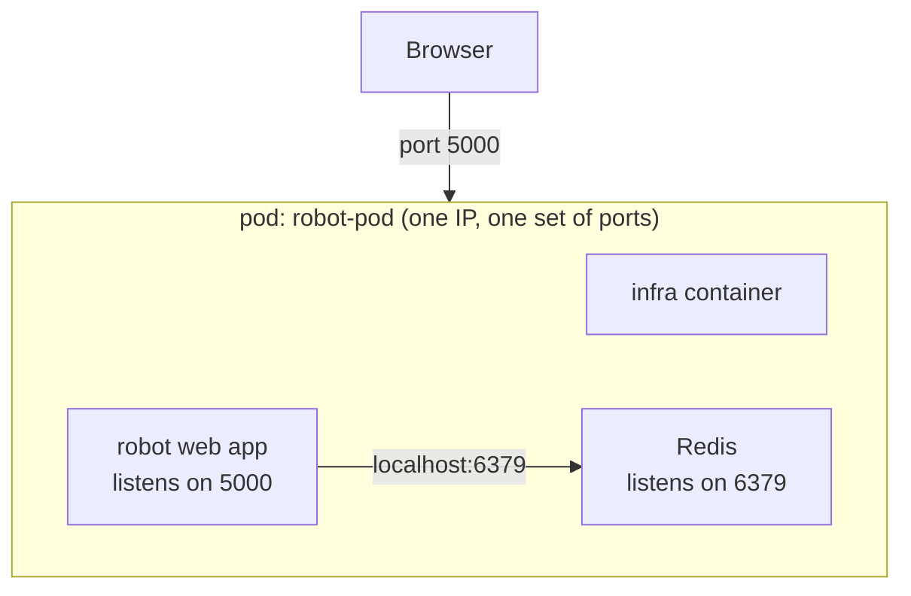

{:class="cover"}

---

By the end of this lesson you will be able to create a pod, run several containers inside it, and explain what the containers share.

Docker has no built-in idea of a pod. Podman does, borrowed from Kubernetes. A **pod** is a group of containers that run together and share one network identity. It is a neat way to join our robot web app to a Redis database without setting up a separate network.

## What a pod shares

Containers in a pod share:

- One IP address and one set of ports
- `localhost`, so one container can reach another on `127.0.0.1`
- Their lifecycle, because you start, stop and remove the pod as a unit

They do **not** share a filesystem. Each container still has its own image and its own volumes.

Every pod also gets a tiny, silent **infra container** that holds the shared network open. You will see it in `podman ps` and you can ignore it.



## Build the robot pod

If you no longer have the `robot-status` image from lesson 6, rebuild it in `~/robot-status` with `podman build -t robot-status .`.

First create the pod. Ports are published on the **pod**, not on each container:

```bash
podman pod create --name robot-pod -p 5000:5000
```

Add Redis, then the web app. The web app finds Redis at `localhost`, because they share a network:

```bash
podman run -d --pod robot-pod --name robot-redis docker.io/library/redis:7-alpine

podman run -d --pod robot-pod --name robot-web \
  -e REDIS_HOST=localhost -e ROBOT_NAME=Sparky \
  localhost/robot-status
```

Open `http://localhost:5000` and refresh a few times. The page says the visits are "stored in redis".

## Look inside the pod

```bash
podman pod ps
podman ps --pod
podman pod inspect robot-pod
```

`podman pod ps` lists the pods, and `podman ps --pod` lists containers with the pod they belong to. You should see three containers: the infra container, Redis and the web app.

## Control the whole pod

```bash
podman pod stop robot-pod
podman pod start robot-pod
podman pod rm -f robot-pod
```

Stopping the pod stops everything in it, and `rm -f` removes the pod and every container inside. Note that Redis keeps its data in memory in this simple setup, so the visit count resets when the container is removed. In lesson 12 we add a volume.

## When to use a pod

Pods suit containers that are tightly coupled and always run together: an app and its cache, or an app and a log shipper. They are less suitable for independent services that you want to restart separately, because the pod's start and stop affect every member.

## Try it Yourself

1. Run `podman exec robot-web python -c "import urllib.request; print(urllib.request.urlopen('http://localhost:5000/status').read())"` to ask the app for its JSON status from inside the pod
2. Stop only the Redis container with `podman stop robot-redis` and refresh the page. What happens? Start it again
3. Challenge: create a second pod, `robot-pod2`, on port 5001 with `ROBOT_NAME=Twinkle`. Can both pods run at once?

## Common Issues

- **Problem**: `Error: ... port is already allocated` or a bind error when creating the pod.
- **Solution**: Pick a different host port, or remove the earlier pod or container using it (`podman ps`).
- **Why**: Only one thing on the Pi can listen on a given host port.

- **Problem**: Running `podman run -p 5000:5000 --pod robot-pod ...` fails.
- **Solution**: Remove `-p` from `podman run` and publish ports on `podman pod create` instead.
- **Why**: A pod has one shared network, so its ports are set once on the pod.

- **Problem**: The web app cannot reach Redis.
- **Solution**: Check `REDIS_HOST=localhost`, not `redis`, and that both containers are in the same pod with `podman ps --pod`.
- **Why**: Inside a pod, containers find each other on `localhost`. Names like `redis` only work on a user-defined network.

## Check your understanding


? What do containers in the same pod share?
- [ ] Their filesystem
- [x] Their network identity, including localhost
- [ ] Their image
> Pods share a network namespace, but not storage.

? Where do you publish a port for containers in a pod?
- [ ] On every container with `-p`
- [x] On the pod with `podman pod create -p`
- [ ] You cannot publish ports from pods
> The pod owns the network, so it owns the published ports.

? How does the robot web app reach Redis in the pod?
- [ ] At the hostname `redis`
- [x] At `localhost`
- [ ] Through the Docker daemon
> Both containers share one localhost inside the pod.

? What does `podman pod rm -f robot-pod` do?
- [ ] Removes only the pod, leaving the containers
- [x] Stops and removes the pod and the containers in it
- [ ] Removes the images
> Removing the pod removes its member containers too. Images stay.

