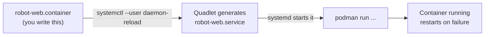

{:class="cover"}

---

By the end of this lesson you will be able to write a Quadlet file that runs a container as a systemd service, make it start at boot, and read its logs.

A robot is not much use if its dashboard vanishes whenever the Pi reboots. Docker has a daemon that restarts containers. Podman has no daemon, so we use the one that already runs every Linux service: **systemd**.

## Quadlet: containers as systemd services

You write a short file describing the container, and a systemd helper called **Quadlet** turns it into a service. This replaces the older `podman generate systemd` command, which is now deprecated. Quadlet needs Podman **4.4 or newer**; check with `podman --version`.

Your user's Quadlet files live in `~/.config/containers/systemd/`.



## Step 1: Write the file

Make sure you built the `robot-status` image as your user (lesson 6), then:

```bash
mkdir -p ~/.config/containers/systemd
nano ~/.config/containers/systemd/robot-web.container
```

```ini
[Unit]
Description=Robot status web app

[Container]
Image=localhost/robot-status:latest
ContainerName=robot-web
PublishPort=5000:5000
Environment=ROBOT_NAME=Sparky

[Service]
Restart=always

[Install]
WantedBy=default.target
```
{: .no-snakie }

The `[Container]` section holds the same things you gave `podman run`. The `[Service]` section is plain systemd and says to restart on failure. The `[Install]` section is what makes it start automatically, so there is no `systemctl enable` step for Quadlet services.

## Step 2: Start it

```bash
systemctl --user daemon-reload
systemctl --user start robot-web.service
systemctl --user status robot-web.service
```

The service is named after the file. Open `http://localhost:5000` to see it working.

## Step 3: Start at boot

User services normally start when you log in and stop when you log out. To keep them running on a Pi that nobody logs in to, enable **lingering**:

```bash
sudo loginctl enable-linger $USER
```

Reboot the Pi with `sudo reboot`, wait a minute, and visit the page again. It should be back with no help from you.

## Logs and monitoring

Containers run as normal processes, so the usual tools work:

```bash
journalctl --user -u robot-web.service -f
podman logs robot-web
podman stats --no-stream
```

If your Podman is older than 4.4, the old route still works. Create a container first (`podman create --name robot ...`), then:

```bash
podman generate systemd --name robot --files --restart-policy=always
mkdir -p ~/.config/systemd/user
mv container-robot.service ~/.config/systemd/user/
systemctl --user daemon-reload
systemctl --user enable --now container-robot.service
```
{: .no-snakie }

## Harden it

Adding a few options costs nothing. In a Quadlet file they appear as extra lines under `[Container]`:

| Goal | Quadlet line | Same as `podman run` |
| --- | --- | --- |
| Drop all extra Linux privileges | `DropCapability=all` | `--cap-drop=all` |
| Stop gaining privileges | `NoNewPrivileges=true` | `--security-opt no-new-privileges` |
| Read-only filesystem | `ReadOnly=true` | `--read-only` |
{:class="table table-single"}

Try each one and check the app still runs. If something breaks, the logs will tell you what it needed. Also use **pinned image tags** such as `redis:7-alpine` rather than `latest`, so a surprise update cannot change your robot overnight, and keep passwords out of files by using `podman secret create` rather than writing them in plain text.

## Try it Yourself

1. Stop the service with `systemctl --user stop robot-web.service` and confirm the page goes away. Start it again
2. Kill the container's process with `podman kill robot-web` and watch systemd bring it back with `systemctl --user status robot-web.service`
3. Challenge: add `Environment=ROBOT_NAME=Twinkle` for a different name, run `daemon-reload` and `restart`, and confirm the page changed

## Common Issues

- **Problem**: `Unit robot-web.service not found`.
- **Solution**: Check the file is in `~/.config/containers/systemd/`, ends in `.container`, then run `systemctl --user daemon-reload`. Also check `podman --version` is 4.4 or newer.
- **Why**: Quadlet only generates services from files in the right folder, and only exists in newer Podman.

- **Problem**: The service starts when you log in but not after a reboot.
- **Solution**: Run `sudo loginctl enable-linger $USER`.
- **Why**: Without lingering, your user's services only run while you are logged in.

- **Problem**: The service fails and the logs say the image was not found.
- **Solution**: Run `podman images` as your own user, and rebuild with `podman build -t robot-status .` if it is missing.
- **Why**: The service runs as you, so it only sees your images, not root's.

> **Teachers**: Enabling lingering needs `sudo`, and it keeps a learner's services running after they log out. On shared Pis, agree who owns which port and stop services at the end of the session so the next group starts clean. Rebooting a shared Pi interrupts other users, so do the reboot test only on a Pi each learner owns.

## Check your understanding


? Where do rootless Quadlet files go?
- [ ] `/etc/podman/`
- [x] `~/.config/containers/systemd/`
- [ ] `~/.local/bin/`
> That folder is where the user's Quadlet generator looks.

? What makes a user service keep running after you log out?
- [ ] `systemctl --user disable`
- [x] `loginctl enable-linger`
- [ ] `podman machine start`
> Lingering lets your user's services run without a login session.

? What replaced the deprecated `podman generate systemd`?
- [ ] `podman compose`
- [x] Quadlet files
- [ ] `podman run --restart`
> Quadlet is the current way to run containers as services.

? What does `Restart=always` in the `[Service]` section do?
- [ ] Reboots the Pi
- [x] Tells systemd to restart the service whenever it stops
- [ ] Pulls a new image
> It is a normal systemd setting, applied to the container's service.

