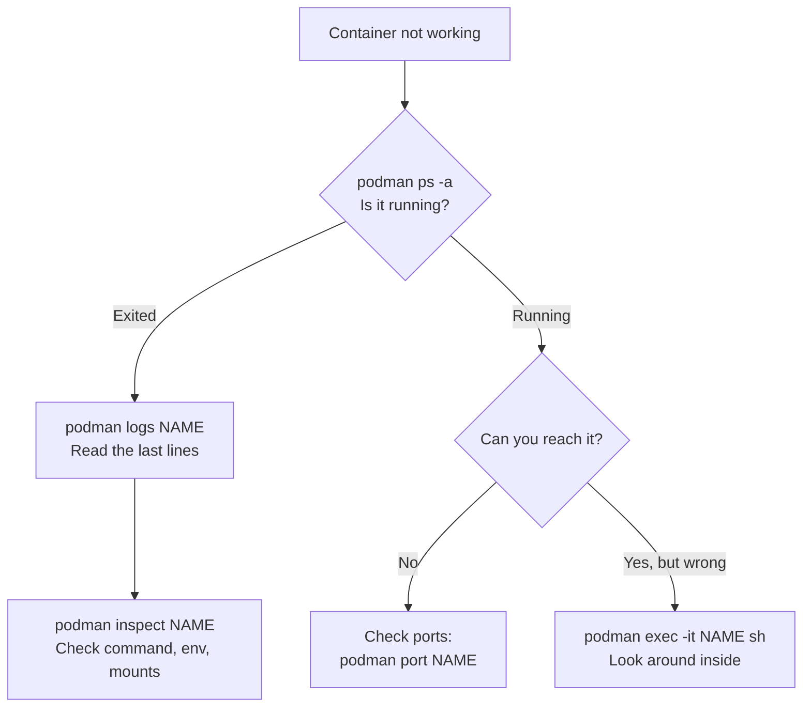

{:class="cover"}

---

By the end of this lesson you will be able to follow a simple routine to diagnose a misbehaving container, and fix the most common rootless problem: files owned by the wrong user.

Containers fail in boring, predictable ways. The trick is to ask the same questions in the same order every time. Think of it like debugging a robot: power, wiring, then code.

## The debugging routine



### Step 1: Is it running?

```bash
podman ps -a
```

The `STATUS` column tells you if it is `Up` or `Exited (1)`. An exit code of 0 means it finished normally, and anything else means it failed.

### Step 2: What did it say?

```bash
podman logs robot-web
```

Read the **last** lines first, since the error is usually at the bottom. For a systemd service, use `journalctl --user -u robot-web.service -n 50`.

### Step 3: What was it told to do?

```bash
podman inspect robot-web --format '{{.Config.Cmd}} {{.Config.Env}}'
podman inspect robot-web --format '{{.State.ExitCode}}'
```

This shows the command, environment variables and exit code, which catches typos such as a wrong `REDIS_HOST`.

### Step 4: Look around inside

```bash
podman exec -it robot-web sh
```

Check the files and environment from the container's own point of view. If the container exits too fast to `exec` into, run the image with a shell instead: `podman run -it --rm --entrypoint sh localhost/robot-status`.

## The rootless file permission puzzle

This is the one that catches everyone. Make a folder and mount it:

```bash
mkdir -p ~/robot-data
podman run --rm -v ~/robot-data:/data docker.io/library/alpine sh -c "echo hi > /data/test.txt"
ls -l ~/robot-data
```

The file may show an owner you do not recognise, such as a number like `100999`, or you may get `Permission denied`. That is the user namespace from lesson 5 at work: container users map to a different range of IDs on the host.

Two fixes:

```bash
# Option 1: make the container's user match yours
podman run --rm --userns=keep-id -v ~/robot-data:/data docker.io/library/alpine sh -c "echo hi > /data/test.txt"

# Option 2: change ownership as seen from inside your user namespace
podman unshare chown -R 0:0 ~/robot-data
```
{: .no-snakie }

Option 1 maps your own user into the container. Option 2 uses `podman unshare` to run `chown` inside the namespace, so "root in the container" becomes the owner.

## Handy extras

| Command | What it tells you |
| --- | --- |
| `podman top NAME` | Processes inside the container |
| `podman stats --no-stream` | CPU and memory right now |
| `podman diff NAME` | Files changed since the container started |
| `podman port NAME` | Published ports |
| `podman events` | A live feed of what Podman is doing |
| `podman system df` | How much space images and volumes use |
{:class="table table-single"}

## Try it Yourself

1. Start a container that fails on purpose with `podman run --name broken docker.io/library/alpine sh -c "exit 3"`, then find its exit code with `podman inspect`
2. Run `podman run -d --name bad -e REDIS_HOST=nowhere -p 5002:5000 localhost/robot-status`, load `http://localhost:5002` and read the logs. What does the error say?
3. Challenge: reproduce the file ownership puzzle, then fix it both ways and compare `ls -ln ~/robot-data` before and after

## Common Issues

- **Problem**: `Error: ... short-name resolution enforced`.
- **Solution**: Use the full image name, for example `docker.io/library/alpine`.
- **Why**: Podman will not guess the registry.

- **Problem**: The container exits straight away.
- **Solution**: Run `podman logs NAME` and `podman inspect NAME --format '{{.State.ExitCode}}'`.
- **Why**: A container stops when its main process stops, so something in the command or its configuration ended it.

- **Problem**: `Permission denied` writing to a mounted folder.
- **Solution**: Use `--userns=keep-id`, or fix ownership with `podman unshare chown`.
- **Why**: Rootless user namespaces make container users appear as different IDs on the host.

- **Problem**: A port you published is not reachable from another computer.
- **Solution**: Use the Pi's IP address, check `podman port NAME`, and make sure the host port is 1024 or higher.
- **Why**: `localhost` is only the machine you are on, and rootless containers cannot use privileged ports.

## Check your understanding


? What is the first command to run when a container is not working?
- [x] `podman ps -a`
- [ ] `podman system prune`
- [ ] `podman machine init`
> It shows whether the container is running or exited, and its exit code.

? Which command shows the last output of a container that has exited?
- [ ] `podman top`
- [x] `podman logs`
- [ ] `podman port`
> Logs keep what the container printed, even after it stops.

? Why might a file written into a mounted folder show an unfamiliar owner ID?
- [ ] The file is corrupt
- [x] User namespaces map container users to different IDs on the host
- [ ] Podman copies files to another disk
> That is the rootless mapping, and `--userns=keep-id` or `podman unshare` deals with it.

? What does `podman unshare chown -R 0:0 folder` do?
- [ ] Gives the folder to the real root user
- [x] Sets ownership as seen from inside your user namespace
- [ ] Removes the folder
> It runs `chown` inside the namespace, so container root owns the files.

