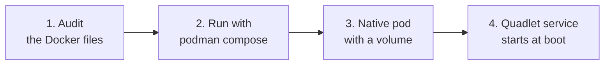

{:class="cover"}

---

By the end of this lesson you will be able to migrate a Docker Compose project to Podman, run it as a pod with persistent data, and make it start at boot as a systemd service.

Time to use everything. We'll take the robot status stack from the Docker course (a Flask web app plus Redis) and move it to Podman in four stages. Each stage works on its own, so you can stop at any point and still have a running robot page.



You need the `~/robot-status` folder with `app.py`, `requirements.txt` and a `Containerfile` or `Dockerfile` (lesson 6), and the `compose.yaml` from lesson 8. If you did the Docker course, your old files will do.

## Stage 1: Audit the Docker files

Before you run anything, look for the things that do not carry over. If Docker is still running the old stack on this machine, stop it first so the ports are free (`docker compose down`).

```bash
cd ~/robot-status
grep -n -E "image:|FROM|docker.sock|privileged|ports:|- \"[0-9]+:" compose.yaml Containerfile Dockerfile 2>/dev/null
```

Use this checklist on what you find:

| If you find | Do this |
| --- | --- |
| `image: redis` or `FROM python:3.12-slim` | Use the full name: `docker.io/library/redis`, `docker.io/library/python` |
| A host port below 1024 | Change it to 1024 or above |
| `/var/run/docker.sock` mounted | Rethink it; Podman has no Docker daemon socket by default |
| `privileged: true` | Try to remove it; rootless containers should not need it |
| A `version:` line in Compose | Delete it; it is ignored |
{:class="table table-single"}

Edit the files to match, using `nano`.

## Stage 2: Run with Compose

```bash
podman compose up -d --build
podman ps
```

Open `http://localhost:5000` and refresh a few times. Note the visit count. Then tear down and bring it back:

```bash
podman compose down
podman compose up -d
```

If the count carried on from where it left off, your Redis volume works. If `podman compose` is not found or has no provider, go back to lesson 8. When you are happy, shut it down with `podman compose down`.

## Stage 3: A native pod with a volume

Compose is handy, but a pod is a native Podman object we can export and manage. Build the same stack by hand:

```bash
podman build -t robot-status .

podman pod create --name robot-pod -p 5000:5000

podman run -d --pod robot-pod --name robot-redis \
  -v robot-redis-data:/data \
  docker.io/library/redis:7-alpine redis-server --appendonly yes

podman run -d --pod robot-pod --name robot-web \
  -e REDIS_HOST=localhost -e ROBOT_NAME=Sparky \
  localhost/robot-status
```

Compare this with the Compose file. The service name `redis` became `localhost`, because pod members share a network, and the Redis volume is named so data survives.

Prove the data survives: refresh a few times, then remove the pod completely and recreate it.

```bash
podman pod rm -f robot-pod
podman volume ls
```

`robot-redis-data` is still there. Recreate the pod with the same commands above and the visit count carries on.

## Stage 4: Make it a service

Export the pod, then let systemd run it. Quadlet has a `.kube` file type that runs a Kubernetes YAML file as a service (Podman 4.4 or newer):

```bash
podman kube generate robot-pod -f robot-pod.yaml
podman pod rm -f robot-pod

mkdir -p ~/.config/containers/systemd
cp robot-pod.yaml ~/.config/containers/systemd/
nano ~/.config/containers/systemd/robot-status.kube
```

Put this in the `.kube` file:

```ini
[Unit]
Description=Robot status pod

[Kube]
Yaml=robot-pod.yaml

[Install]
WantedBy=default.target
```
{: .no-snakie }

Then start it and make it survive reboots:

```bash
systemctl --user daemon-reload
systemctl --user start robot-status.service
systemctl --user status robot-status.service
sudo loginctl enable-linger $USER
```

Open the page, then reboot with `sudo reboot`. After a minute, check `http://localhost:5000` again. Your robot page is now a proper service, and your visit count is still there.

## What you changed, and why

- **No daemon**: systemd now plays the daemon's role of keeping things running
- **Rootless**: nothing here used `sudo` except `enable-linger`
- **Full image names**: no registry guessing
- **A named volume**: data outlives the containers
- **A text file as the source of truth**: `robot-pod.yaml` and the `.kube` file can live in version control

## Try it Yourself

1. Change `ROBOT_NAME` in `robot-pod.yaml` (inside `~/.config/containers/systemd/`), run `systemctl --user daemon-reload` and `systemctl --user restart robot-status.service`. Does the page change?
2. Stop the service, then run `podman pod ps`. Is the pod gone?
3. Challenge: add a second robot as a separate pod on port 5001, with its own volume. What would you change in the YAML?

## Common Issues

- **Problem**: `podman compose up` fails with a port error.
- **Solution**: Stop the old Docker stack with `docker compose down`, or change the port in `compose.yaml`.
- **Why**: Docker and Podman cannot both publish the same host port.

- **Problem**: The service cannot find `robot-pod.yaml`.
- **Solution**: Copy the YAML file next to the `.kube` file, and check the `Yaml=` line spells its name exactly.
- **Why**: A relative `Yaml=` path is looked up beside the unit file.

- **Problem**: `robot-status.service` is not found.
- **Solution**: Run `systemctl --user daemon-reload`, then check `podman --version` is 4.4 or newer.
- **Why**: Quadlet generates the service on reload, and only exists in newer Podman versions.

- **Problem**: The visit count resets after the pod is recreated.
- **Solution**: Check Redis is started with `-v robot-redis-data:/data` and `redis-server --appendonly yes`.
- **Why**: Without a volume and persistence turned on, Redis keeps its data only in memory.

> **Teachers**: Allow about 90 minutes, or split it into stages 1 and 2 in one session and 3 and 4 in the next. Stage 4 needs `sudo` for `enable-linger` and a reboot, so only do it on Pis the learner owns, not on shared classroom machines. If Docker is also installed, make sure learners stop the old stack first, otherwise the ports clash and the error messages confuse. No Docker or Pi at all? Learners can still do stage 1 as a paper audit of a sample Compose file.

## Check your understanding


? Why does Redis use `localhost` in the pod version but `redis` in the Compose version?
- [ ] Pods hide the network
- [x] Pod containers share one network namespace, so they reach each other on localhost
- [ ] Redis changes its name
> The pod shares a network. Compose gave each service its own name on a project network.

? What keeps the visit count after the pod is removed?
- [ ] The infra container
- [x] The named volume `robot-redis-data`
- [ ] The pod YAML file
> Named volumes are stored separately from containers and pods.

? Which Quadlet file type runs a Kubernetes YAML file as a service?
- [ ] `.container`
- [x] `.kube`
- [ ] `.service`
> A `.kube` file points to the YAML with `Yaml=`.

? Why do we run `sudo loginctl enable-linger $USER`?
- [ ] To install Podman
- [x] To let the user's services run at boot without a login
- [ ] To make containers root-owned
> Without lingering, user services only run while you are logged in.

