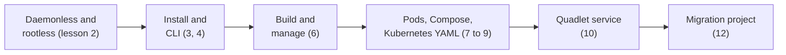

{:class="cover"}

---

By the end of this lesson you will be able to summarise what makes Podman different from Docker, and choose what to learn next.

Congratulations makers! You started with a Docker habit and finished with a robot status page that runs as a rootless systemd service on a Raspberry Pi. Let's look back at the route.

## What you learned

| Lesson | The big idea |
| --- | --- |
| 2 to 3 | Podman has no daemon. Containers are normal processes owned by you, and install needs `sudo` only once |
| 4 | Most Docker commands work with `docker` swapped for `podman`, but image names need the registry, and rootless cannot use ports below 1024 |
| 5 to 6 | User namespaces map container root to your user. A Containerfile builds an image just like a Dockerfile |
| 7 to 9 | Pods share a network. Compose needs a provider. `podman kube generate` and `podman kube play` move between Podman and Kubernetes YAML |
| 10 to 11 | Quadlet runs containers as systemd services, and the debugging routine finds most faults |
| 12 | A real project migrated in four stages |
{:class="table table-single"}

## Where Podman fits

Podman and Docker follow the same OCI standards, so you are not choosing one forever. Images move freely between them. A sensible rule of thumb:

- **Use Podman** when you want rootless by default, no always-on daemon, systemd services and pods, or you are on a distribution that ships it
- **Use Docker** when your team, tools or tutorials already depend on it, or you need its desktop tools
- **Know both**, because the knowledge transfers and most of the commands match

Podman is developed quickly, so check `podman --version` and the [official Podman documentation](https://docs.podman.io) when something here looks out of date.

## Next steps

- **Scale up.** Pods and Kubernetes YAML are a good lead-in to running containers across several Pis with the [K3s course](/learn/k3s/)
- **Revisit the Docker side.** If you skipped any of it, the [Docker course](/learn/docker/) builds the same app with a daemon and shows you what you gained and gave up
- **Sharpen the terminal.** The [Linux command line course](/learn/linux_intro/) covers the shell, permissions and processes that make containers easier to understand
- **Explore the toolbox.** Try Buildah for building images, and Skopeo for inspecting and copying them
- **Automate updates.** Look up `podman auto-update` and the Quadlet `AutoUpdate=` setting so your robot can pull newer images by itself

## Try it Yourself

1. Write a one-paragraph explanation, in your own words, of why a rootless container is safer than a root one
2. Take another small project of your own, such as a different Flask or Node app, and run it through the four stages of lesson 12
3. Challenge: teach someone else. Explain Podman to a friend using the architecture diagram from lesson 2 and see what questions they ask

## Common Issues

- **Problem**: A tutorial uses `podman generate systemd` or `podman play kube` and you are unsure whether to follow it.
- **Solution**: Use Quadlet and `podman kube play` instead, and check `podman --version` before copying commands.
- **Why**: Podman changes quickly, and older tutorials teach commands that are deprecated or renamed.

## Check your understanding


? What does Podman use instead of a daemon to keep services running at boot?
- [ ] A background `podmand` service
- [x] systemd, for example through Quadlet files
- [ ] Compose restart policies only
> Lesson 10 uses Quadlet to turn a container into a systemd service.

? Can a Docker-built image run under Podman?
- [x] Yes, both use OCI images
- [ ] No, they use different formats
- [ ] Only on macOS
> OCI images are portable between the tools.

? Which course would you take to run containers across several Raspberry Pis?
- [ ] The Linux command line course
- [x] The K3s course
- [ ] This course again
> K3s is a small Kubernetes distribution designed for clusters of small machines.

