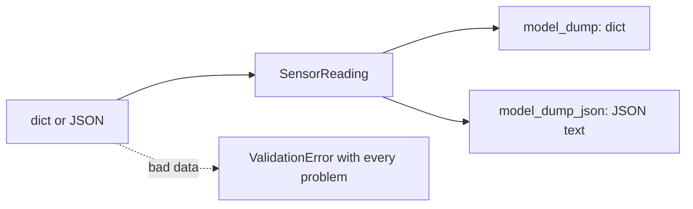

{:class="cover"}

---

By the end of this lesson you will be able to define a model with required, optional and default fields, convert it to a dict or JSON, and read the errors Pydantic raises.

Let's build a model for the messages a Pico weather station sends. This is the bread and butter of Pydantic, and everything later in the course builds on it.

## Defining the model

A model is a class that inherits from `BaseModel`. Each annotated attribute is a field. A field with no default is required, a field with a default is optional, and `str | None = None` means "may be missing or null".

```python
from pydantic import BaseModel, ValidationError


class SensorReading(BaseModel):
    sensor: str
    temperature_c: float
    battery_mv: int
    note: str | None = None
    online: bool = True


r = SensorReading(sensor="pico-1", temperature_c="21.5", battery_mv=3920)
print(r)
print(type(r.temperature_c))
print(r.model_dump())
print(r.model_dump_json())
print(r.model_dump(exclude_none=True))

data = {"sensor": "pico-2", "temperature_c": 19, "battery_mv": "3800", "online": "no"}
r2 = SensorReading.model_validate(data)
print(r2)

try:
    SensorReading(sensor="pico-3", temperature_c="warm")
except ValidationError as err:
    print(err.error_count(), "problems")
    for e in err.errors():
        print(e["loc"], e["type"], e["msg"])
    print(err)
```

Output:

```
sensor='pico-1' temperature_c=21.5 battery_mv=3920 note=None online=True
<class 'float'>
{'sensor': 'pico-1', 'temperature_c': 21.5, 'battery_mv': 3920, 'note': None, 'online': True}
{"sensor":"pico-1","temperature_c":21.5,"battery_mv":3920,"note":null,"online":true}
{'sensor': 'pico-1', 'temperature_c': 21.5, 'battery_mv': 3920, 'online': True}
sensor='pico-2' temperature_c=19.0 battery_mv=3800 note=None online=False
2 problems
('temperature_c',) float_parsing Input should be a valid number, unable to parse string as a number
('battery_mv',) missing Field required
2 validation errors for SensorReading
temperature_c
  Input should be a valid number, unable to parse string as a number [type=float_parsing, input_value='warm', input_type=str]
    For further information visit https://errors.pydantic.dev/2.14/v/float_parsing
battery_mv
  Field required [type=missing, input_value={'sensor': 'pico-3', 'temperature_c': 'warm'}, input_type=dict]
    For further information visit https://errors.pydantic.dev/2.14/v/missing
```



## What just happened

**Conversion (coercion).** The string `"21.5"` became the float `21.5`, and `"3800"` became the integer `3800`. In its default "lax" mode Pydantic converts values when the conversion is safe and obvious. Even the string `"no"` became `False`. That is handy for data that arrives as text, such as query strings or CSV files.

**Getting data out.** Pydantic v2 uses `model_` names:

- `model_dump()` gives a Python dict
- `model_dump_json()` gives a JSON string, ready to send
- `model_dump(exclude_none=True)` leaves out fields that are `None`
- `model_validate(data)` builds a model from a dict, which is what the old `parse_obj` did

**All errors at once.** Pydantic collects every problem, not just the first one. `err.errors()` returns a list of dictionaries (handy for logging or sending back to a client), and `err.error_count()` tells you how many there were. The `loc` tuple points at the field.

**Why this matters:** a robot that receives commands or readings needs to say exactly what was wrong with a message, not just "bad data". Structured errors give you that for free.

**Common mistakes:**

- Using a mutable default like `tags: list = []` in plain classes. Pydantic copies defaults for each instance, so it is safe in models, but still prefer `Field(default_factory=list)` when you want to be explicit.
- Forgetting that `temperature_c: float` with `"warm"` is an error, not a zero. Always handle `ValidationError` at the point where data enters your program.

## Try it Yourself

1. Add a `location: str = "unknown"` field and check that a reading without it still validates.
2. Pass `battery_mv=3920.5`. Does Pydantic accept it for an `int` field? Print the error type.
3. Use `r.model_dump_json(indent=2)` and read the result. Then try `include={"sensor", "temperature_c"}` on `model_dump`.
4. Challenge: build a reading from the JSON string `'{"sensor": "pico-4", "temperature_c": 20, "battery_mv": 3700}'` using `model_validate_json`.

## Common Issues

- **Problem**: `ValidationError: Field required` for a field you are sure you sent.
- **Solution**: Print the raw dict and check the key spelling and case.
- **Why**: Pydantic matches field names exactly, so `Battery_mv` and `battery_mv` are different.

- **Problem**: A field comes out as `True` or `False` when you expected a string.
- **Solution**: Check the type hint, and use `str` or `Literal[...]` rather than `bool` for text.
- **Why**: Pydantic converts to the type you declare, so the hint decides what you get.

- **Problem**: `AttributeError: 'dict' object has no attribute 'temperature_c'`.
- **Solution**: Validate first with `SensorReading.model_validate(data)`, then use the model.
- **Why**: A plain dict uses `data["temperature_c"]`, only models support attribute access.

## Check your understanding


? Which method turns a dictionary into a validated model in Pydantic v2?
- [ ] `parse_obj`
- [x] `model_validate`
- [ ] `model_dump`
> `model_validate` builds a model from a dict. `parse_obj` is the deprecated v1 name.

? What does `model_dump(exclude_none=True)` do?
- [ ] Removes fields that are required
- [x] Leaves out fields whose value is None
- [ ] Converts None to 0
> Optional fields that were not set are omitted from the output dictionary.

? How many errors does Pydantic report when two fields are wrong?
- [ ] Only the first one
- [x] All of them, in one ValidationError
- [ ] None, it silently fixes them
> The ValidationError holds every problem, and `error_count()` tells you how many.

? What happens to the string "21.5" for a `float` field?
- [ ] It is rejected
- [x] It is converted to the float 21.5
- [ ] It stays a string
> In the default lax mode Pydantic converts values when it is safe to do so.

