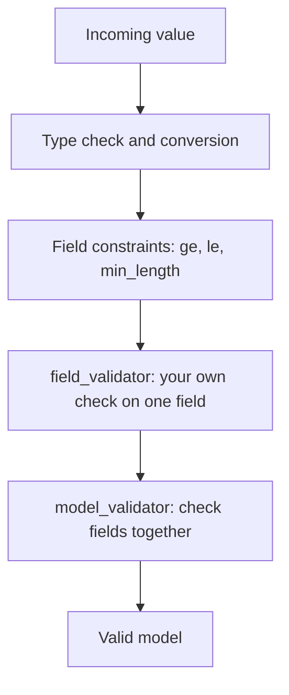

{:class="cover"}

---

By the end of this lesson you will be able to limit values with `Field`, clean a single field with `field_validator`, and check several fields together with `model_validator`.

A servo can only turn 180 degrees, and asking it for 200 is a bug. Types alone cannot say "a number between 0 and 180", so let's teach our models the rules of the real world.

## Three tools, three jobs



- **`Field(...)`** adds simple rules: `ge` (greater or equal), `gt`, `le`, `lt`, `min_length`, `max_length`, `pattern`.
- **`@field_validator("name")`** runs your function on one field. Use it to clean or reject a value.
- **`@model_validator(mode="after")`** runs once all fields are valid, so you can compare them.

Let's put them all in one program.

```python
from pydantic import BaseModel, Field, ValidationError, field_validator, model_validator


class ServoCommand(BaseModel):
    name: str = Field(min_length=2, max_length=20)
    angle: int = Field(ge=0, le=180, description="Degrees, 0 to 180")
    speed: float = Field(default=1.0, gt=0, le=10)

    @field_validator("name")
    @classmethod
    def lowercase_name(cls, value: str) -> str:
        return value.strip().lower()


class DriveRange(BaseModel):
    min_angle: int = Field(ge=0, le=180)
    max_angle: int = Field(ge=0, le=180)

    @model_validator(mode="after")
    def check_order(self):
        if self.min_angle >= self.max_angle:
            raise ValueError("min_angle must be smaller than max_angle")
        return self


print(ServoCommand(name="  Pan ", angle=45))
try:
    ServoCommand(name="x", angle=200, speed=0)
except ValidationError as err:
    print(err)

print(DriveRange(min_angle=10, max_angle=170))
try:
    DriveRange(min_angle=120, max_angle=40)
except ValidationError as err:
    print(err)
```

Output:

```
name='pan' angle=45 speed=1.0
3 validation errors for ServoCommand
name
  String should have at least 2 characters [type=string_too_short, input_value='x', input_type=str]
    For further information visit https://errors.pydantic.dev/2.14/v/string_too_short
angle
  Input should be less than or equal to 180 [type=less_than_equal, input_value=200, input_type=int]
    For further information visit https://errors.pydantic.dev/2.14/v/less_than_equal
speed
  Input should be greater than 0 [type=greater_than, input_value=0, input_type=int]
    For further information visit https://errors.pydantic.dev/2.14/v/greater_than
min_angle=10 max_angle=170
1 validation error for DriveRange
  Value error, min_angle must be smaller than max_angle [type=value_error, input_value={'min_angle': 120, 'max_angle': 40}, input_type=dict]
    For further information visit https://errors.pydantic.dev/2.14/v/value_error
```

## How it works

**What it does:** `" Pan "` was stripped and lower-cased by our validator, and every bad field was reported at once. When a validator raises `ValueError` (or `AssertionError`), Pydantic wraps it into a `ValidationError` for you, with the prefix "Value error".

**Rules for validators in v2:**

- Put `@classmethod` under `@field_validator`. Forgetting it is the most common v2 mistake.
- Always `return` the value, otherwise the field becomes `None`.
- Use `mode="before"` to run before Pydantic's own type conversion, which helps with messy input such as `"45 deg"`.
- A `mode="after"` model validator is an ordinary method that returns `self`.

**Why this matters:** the validation lives in the model, not scattered through your robot code. Wherever a `ServoCommand` exists, you know it is safe to send to the servo.

**Common mistakes:**

- Using the v1 `@validator` decorator. It is deprecated in v2, so write `@field_validator`.
- Checking `min_angle < max_angle` in a field validator. Field validators run per field, so use a model validator when you need two fields.

## Try it Yourself

1. Add a `pattern=r"^[a-z_]+$"` rule to a new `joint: str` field and see which input fails.
2. Write a `field_validator` that rounds `speed` to one decimal place.
3. Add a `model_validator` to `ServoCommand` that rejects `speed > 5` when `angle > 150`.
4. Challenge: raise your own message from a validator with `raise ValueError("...")` and read how it appears in `err.errors()`.

## Common Issues

- **Problem**: A validator never runs.
- **Solution**: Check the field name inside `@field_validator("...")` matches exactly, and that the field was supplied or has `validate_default=True`.
- **Why**: Validators attach by name, and default values are not validated unless you ask for it.

- **Problem**: The field comes out as `None` after validation.
- **Solution**: Add `return value` at the end of the validator.
- **Why**: Whatever a validator returns replaces the field value.

- **Problem**: `PydanticUserError` about a validator needing a classmethod.
- **Solution**: Place `@classmethod` directly beneath `@field_validator(...)`.
- **Why**: v2 calls the validator on the class, not on an instance.

## Check your understanding


? Which tool checks that `min_angle` is smaller than `max_angle`?
- [ ] `Field(ge=0)`
- [ ] A field validator on `min_angle` alone
- [x] A model validator
> A model validator runs after all fields are valid, so it can compare them.

? What must a field validator do with the value when it is happy?
- [ ] Print it
- [x] Return it
- [ ] Raise a ValidationError
> The returned value becomes the field, and returning nothing gives None.

? What does `Field(ge=0, le=180)` mean?
- [x] The value must be from 0 to 180 inclusive
- [ ] The value must be strictly between 0 and 180
- [ ] The value is converted to 180 if too large
> `ge` is greater or equal and `le` is less or equal, so both ends are allowed.

