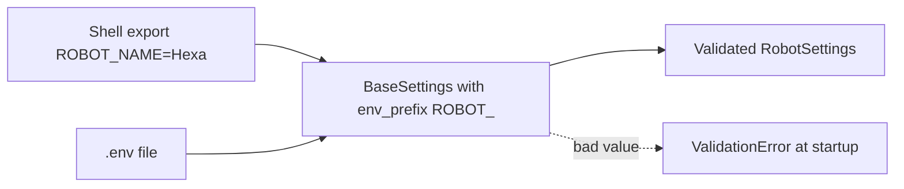

{:class="cover"}

---

By the end of this lesson you will be able to tighten a model with `ConfigDict`, and load a robot's settings from environment variables with `pydantic-settings`.

You now know how to write models. This lesson is about writing them well: strict where it counts, and with settings kept out of your code so you never paste a secret into a program you share.

## Configuring a model with ConfigDict

In v2 you configure a model with `model_config = ConfigDict(...)`. This replaces the old `class Config:` block from v1. Three options earn their keep on most robot projects:

- `extra="forbid"` rejects fields you did not declare, which catches typos like `temprature_c`
- `frozen=True` makes instances read-only, so a waypoint cannot change under your feet (it also makes them hashable)
- `str_strip_whitespace=True` trims spaces from every string

## Settings from the environment

`pydantic-settings` (a separate package, installed in lesson 2) gives you `BaseSettings`. It is a model that fills itself from environment variables, validating as it goes. With `env_prefix="ROBOT_"`, the variable `ROBOT_NAME` fills the `name` field.

```python
import os

from pydantic import BaseModel, ConfigDict, ValidationError
from pydantic_settings import BaseSettings, SettingsConfigDict


class Waypoint(BaseModel):
    model_config = ConfigDict(extra="forbid", frozen=True, str_strip_whitespace=True)

    label: str
    x_cm: float
    y_cm: float


wp = Waypoint(label="  dock ", x_cm=0, y_cm=0)
print(wp)

try:
    wp.x_cm = 10
except ValidationError as err:
    print(err.errors()[0]["type"])

try:
    Waypoint(label="a", x_cm=1, y_cm=2, z_cm=3)
except ValidationError as err:
    print(err.errors()[0]["type"], err.errors()[0]["msg"])


class RobotSettings(BaseSettings):
    model_config = SettingsConfigDict(env_prefix="ROBOT_")

    name: str = "unnamed"
    max_speed: float = 0.5
    broker_host: str = "localhost"
    broker_port: int = 1883


os.environ["ROBOT_NAME"] = "Hexa"
os.environ["ROBOT_MAX_SPEED"] = "0.8"
print(RobotSettings())

os.environ["ROBOT_BROKER_PORT"] = "mqtt"
try:
    RobotSettings()
except ValidationError as err:
    print(err.errors()[0]["loc"], err.errors()[0]["msg"])
```

Output:

```
label='dock' x_cm=0.0 y_cm=0.0
frozen_instance
extra_forbidden Extra inputs are not permitted
name='Hexa' max_speed=0.8 broker_host='localhost' broker_port=1883
('broker_port',) Input should be a valid integer, unable to parse string as an integer
```



## What happened

**Strict models.** Trying `wp.x_cm = 10` raised a `frozen_instance` error, and the unknown `z_cm` raised `extra_forbidden`. In a robot, that means a typo in a config file fails loudly at startup instead of silently using a default.

**Settings.** In real use you would set the variables in your shell (`export ROBOT_NAME=Hexa`) or put them in a `.env` file and add `env_file=".env"` to `SettingsConfigDict`. We used `os.environ` here so the example runs anywhere. A bad value, like a port of `"mqtt"`, fails at startup with a clear message.

**More habits worth having:**

- Use separate models for input and output (lesson 8).
- Keep validation in the model, not scattered through your code.
- Validate once, at the edge, then pass the typed object around.
- Use `Field(description=...)` so generated API docs explain each field.
- Never commit a `.env` file with real keys. Add it to `.gitignore`.

**Why this matters:** a robot with a typo in its config that silently falls back to defaults is the sort of bug that costs an afternoon.

**Common mistakes:**

- Using `class Config:` from old tutorials. v2 shows a deprecation warning, so use `model_config`.
- Putting secrets in source code instead of the environment.

> **Teachers**: Settings and API keys are a good moment to talk about secrets. Make sure learners never commit a `.env` file or a real key to a shared repository or a school GitHub account, and use fake keys in class.

## Try it Yourself

1. Add `validate_assignment=True` to a non-frozen model and see what happens when you assign a bad value.
2. Add a `speed_limit` setting and set it from your shell with `export`, or `set` on Windows.
3. Create a `.env` file and load it with `env_file=".env"`. Which wins, the file or a real environment variable?
4. Challenge: write a model for a whole robot config with `extra="forbid"` at every level.

## Common Issues

- **Problem**: `ModuleNotFoundError: No module named 'pydantic_settings'`.
- **Solution**: Run `python -m pip install pydantic-settings`.
- **Why**: In v2, `BaseSettings` moved out of the core `pydantic` package into its own.

- **Problem**: Your settings ignore the environment variable.
- **Solution**: Check the variable name and prefix. With `env_prefix="ROBOT_"`, the name is `ROBOT_MAX_SPEED`.
- **Why**: The prefix and field name are joined, and matching is case-insensitive by default.

- **Problem**: A `ValidationError` of type `frozen_instance` when changing a model field.
- **Solution**: Either remove `frozen=True` or create a changed copy with `model_copy(update={...})`.
- **Why**: Frozen models are read-only on purpose.

## Check your understanding


? What does `extra="forbid"` do?
- [ ] Makes every field optional
- [x] Rejects fields that were not declared on the model
- [ ] Forbids default values
> It catches typos in field names by raising an `extra_forbidden` error.

? Which v2 feature replaces the old `class Config:`?
- [ ] `@validator`
- [x] `model_config = ConfigDict(...)`
- [ ] `parse_obj`
> v2 uses a `model_config` attribute set to a `ConfigDict`.

? Where does `BaseSettings` read its values from by default?
- [ ] A database
- [x] Environment variables
- [ ] The Pico
> With a prefix such as ROBOT_, the variable ROBOT_NAME fills the name field.

