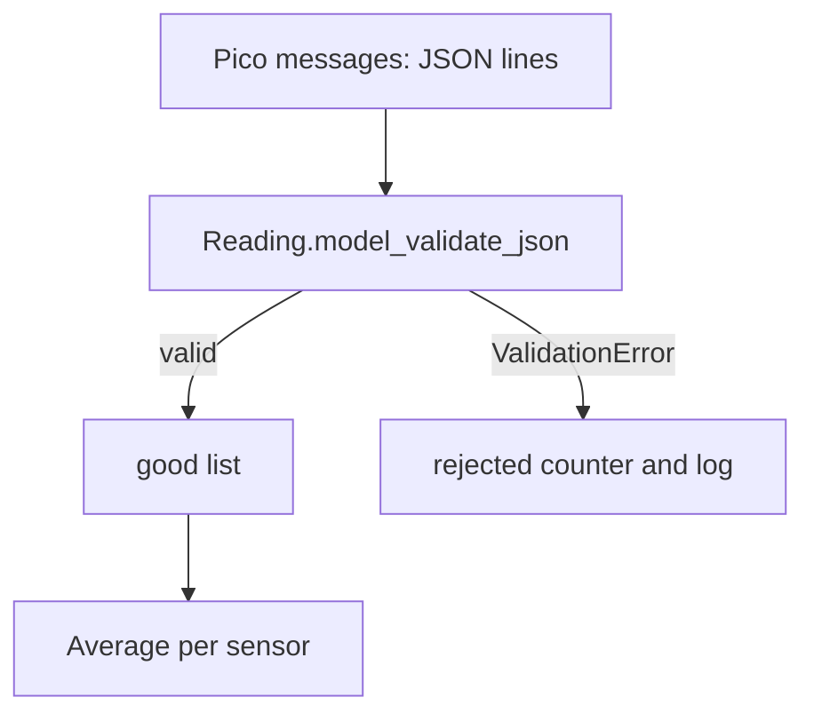

{:class="cover"}

---

By the end of this lesson you will be able to build a small pipeline that reads messy sensor messages, keeps the good ones, reports the bad ones, and summarises the result.

Time for the capstone. Imagine two Picos sending JSON lines over a serial port or MQTT. Wi-Fi drops, a sensor glitches, and one message is plain garbage. A good pipeline shrugs it all off, keeps the good data and tells you what it threw away.



## The pipeline

Save this as `pipeline.py`. The five lines in `LINES` stand in for data arriving from your Picos, and in your own project you would read them from `serial`, MQTT or a file.

```python
from pydantic import BaseModel, Field, ValidationError

# Pretend these lines arrived over a serial port or MQTT from a Pico
LINES = [
    '{"sensor": "pico-1", "temperature_c": 21.4, "humidity": 55, "battery_mv": 3950}',
    '{"sensor": "pico-1", "temperature_c": "NaN", "humidity": 55, "battery_mv": 3940}',
    '{"sensor": "pico-2", "temperature_c": 19.0, "humidity": 130, "battery_mv": 3700}',
    'not json at all',
    '{"sensor": "pico-2", "temperature_c": 19.5, "humidity": 60, "battery_mv": 3690}',
]


class Reading(BaseModel):
    sensor: str
    temperature_c: float = Field(ge=-40, le=85)
    humidity: int = Field(ge=0, le=100)
    battery_mv: int = Field(ge=0, le=5000)


good: list[Reading] = []
rejected = 0
for line in LINES:
    try:
        good.append(Reading.model_validate_json(line))
    except ValidationError as err:
        rejected += 1
        first = err.errors()[0]
        print("rejected:", first["loc"], first["msg"])

print(f"{len(good)} good, {rejected} rejected")
for sensor in sorted({r.sensor for r in good}):
    temps = [r.temperature_c for r in good if r.sensor == sensor]
    print(sensor, "average", sum(temps) / len(temps))
```

Output:

```
rejected: ('temperature_c',) Input should be less than or equal to 85
rejected: ('humidity',) Input should be less than or equal to 100
rejected: () Invalid JSON: expected ident at line 1 column 2
2 good, 3 rejected
pico-1 average 21.4
pico-2 average 19.5
```

## What it shows

- **A sensor glitch is caught.** The string `"NaN"` converts to a float that is not a number, and it fails the range check, so it never reaches your averages. A glitch like that would quietly poison a plain `float()` pipeline.
- **A silly value is caught.** 130 percent humidity is impossible, so the message is rejected.
- **Garbage is caught.** Text that is not JSON gives a `ValidationError` too, with an empty `loc` because the problem is the whole message. You do not need a separate `try` for `json.loads`.
- **The loop carries on.** One bad message costs you one message.

From here the same pattern scales: swap the list for a serial read loop, write good readings to SQLite or a CSV file with `model_dump()`, or put the model behind a FastAPI endpoint as in lesson 7.

**Common mistakes:**

- Catching every `Exception` instead of `ValidationError`, which hides real bugs in your own code.
- Throwing rejected messages away silently. Count them and log them, because a rising rejection count is how you notice a failing sensor.

## Where Pydantic shows up in the real world

You now have the same toolkit used by many production Python projects. FastAPI uses it for every request and response, and `pydantic-settings` handles configuration for services of every size. Many tools for working with AI models use it to check structured responses. The robot-maker version is the same: describe your data once, and trust it afterwards.

## Try it Yourself

1. Add a `timestamp: int` field and a message missing it, then check the rejection message.
2. Write each good reading to a `readings.jsonl` file with `model_dump_json()`, one per line.
3. Keep a count of rejections per sensor, using a dictionary.
4. Challenge: read the file back with `Reading.model_validate_json` and confirm you get the same readings.

## Common Issues

- **Problem**: Every line is rejected as "Invalid JSON".
- **Solution**: Print `repr(line)` and look for a trailing newline, a byte-string prefix, or single quotes.
- **Why**: A serial read returns bytes, so decode first with `line.decode()`, and JSON needs double quotes.

- **Problem**: A rejected-count that keeps climbing for one sensor.
- **Solution**: Print the full `err.errors()` for that sensor and check wiring, power and the sensor range.
- **Why**: Consistent rejections usually mean a real hardware problem, not bad luck.

## What's next

Congratulations, you can now validate, convert and protect data like a pro. Where to go from here:

- [FastAPI user authentication course](/learn/fastapi/) takes the API ideas further, with registration and login
- [Python for beginners](/learn/python/) is a good place to strengthen classes and data structures if any part felt shaky
- Try the official Pydantic documentation at docs.pydantic.dev for features we did not cover, such as computed fields and discriminated unions

## Check your understanding


? Why count and log rejected messages?
- [ ] To make the program slower
- [x] A rising count can reveal a failing sensor or wiring problem
- [ ] Pydantic requires it
> Rejections are information about the health of your hardware.

? What error type does a line that is not JSON produce with `model_validate_json`?
- [ ] A TypeError
- [x] A ValidationError
- [ ] Nothing, it is ignored
> Invalid JSON is reported as a ValidationError with an empty loc.

? Why did the NaN reading not pollute the averages?
- [x] It failed the temperature range check, so it was rejected
- [ ] NaN is a valid temperature
- [ ] Averages ignore bad values
> Range constraints reject NaN, so it never reached the good list.

