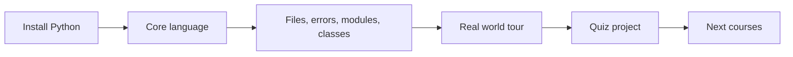

{:class="cover"}

---

By the end of this lesson you will be able to install Python, run a program from your editor and from a terminal, and explain what the course will cover.

---

## Overview

Ahoy there makers! Python is the language behind a huge number of robots, 3D printer tools, data projects and Raspberry Pi gadgets. It reads almost like plain English, so it is a friendly first language, and it is powerful enough that you will not outgrow it.

This course takes you from your very first line of Python to a small working application. The first half covers the core language: variables, data structures, control flow, files, errors, modules and classes. The second half is a guided tour of what people do with Python in the real world, from web scraping and charts to machine learning, automation and databases. Each tour lesson gives you one small, complete program to run, and points you to a deeper course when you are ready for more.

This is the first course in the Python learning pathway. Everything here is ordinary computer-side Python (called CPython). If you want to run Python on a microcontroller, [Learn MicroPython - The basics](/learn/micropython/) is a good next step, because it builds on what you learn here.

## Course Content

- Installing Python and running your first program
- Variables, data types and operators
- Strings, lists, tuples, dictionaries and sets
- Decisions, loops and functions
- Reading and writing files
- Handling errors and exceptions
- Modules, libraries, `pip` and virtual environments
- Classes and objects, with a robot to model
- A tour of data, web scraping, charts, machine learning, deep learning, automation and databases
- Decorators, generators and context managers
- A project: a command line quiz application
- Tips, tricks and where to go next

## Key Results

After completing this course, you will:

- Be able to write, save and run Python programs on your own computer
- Use lists, dictionaries, loops, functions and classes to organise a program
- Handle files and errors without your program crashing
- Install libraries safely inside a virtual environment
- Have seen a working example of scraping, charting, machine learning, automation and a database
- Know which course to take next

## What you'll need

- A computer running Windows, macOS or Linux. A Raspberry Pi 4 or 5 is perfect
- An internet connection to download Python and libraries
- A code editor, such as [Thonny](https://www.thonny.org), [VS Code](https://code.visualstudio.com/) or [PyCharm](https://www.jetbrains.com/pycharm/)
- No electronics are needed. Every example runs on a computer

## How the course works

Each lesson teaches one idea and opens with a sentence starting "By the end of this lesson you will be able to...". Code appears in boxes. Where a box has a **Run** button you can run it right in your browser, no install needed, and edit it and run it again. Boxes without a Run button need a real Python install (usually because they use a library, a webcam, a network or your own files), so save them to a file and run them on your computer.

Every lesson ends with **Try it Yourself** exercises of rising difficulty, a **Common Issues** list for when things go wrong, and a short quiz. Your progress and quiz score are saved in your browser and shown in the sidebar.

> **Teachers**: This course suits learners aged about 11 and up with no coding experience, working alone or in pairs. Allow 30 to 45 minutes per lesson. No electronics are needed. Lessons 1 to 8 (the core language) can be completed in the browser using the Run buttons, so they work on locked-down school machines with no install. Lessons 9 to 15 mostly need Python and the ability to install libraries, so check with your IT team first: some schools block `pip` and the websites it downloads from. Installing needs administrator rights on Windows and macOS, and a school network may block the downloads.

---

## Why Python?

Python is one of the most popular programming languages in the world because of its simplicity and readability. Here are some reasons to learn it:

1. **Simplicity**: the syntax is designed to be readable, which makes it an excellent first language.
1. **Versatility**: web, games, data, machine learning, automation, and robots, Python can do it all.
1. **Community**: a huge, friendly community means answers to almost every question already exist.
1. **Career opportunities**: Python developers are in demand across many industries.

## Installing Python

Before you can run Python on your own computer you need the Python interpreter, the program that reads your code and carries it out.

1. Visit the [official Python downloads page](https://www.python.org/downloads/).
1. Download the current release of Python 3 for your operating system. Any recent Python 3 will work for this course, and you do not need to hunt for a particular version.
1. Run the installer and follow the prompts. On Windows, if the installer offers a tick box to add Python to your `PATH`, tick it, so you can type `python` in a terminal.

> ## Already installed?
>
> macOS and Linux (including Raspberry Pi OS) usually come with Python 3. Open a terminal and type `python3 --version` to check. On Windows try `python --version` or `py --version`.

You will also need somewhere to write code. A plain text editor works, but Thonny, VS Code and PyCharm all add helpful extras such as colour and error hints. Thonny is the simplest for a first week, and it is already on Raspberry Pi OS.

## Your first Python program

Let's write the classic first program. Press **Run** to try it right here:


print("Hello, World!")



To run it on your own computer:

1. Open your editor and paste the code into a new file.
1. Save it as `hello_world.py`.
1. Open a terminal and move to the folder where you saved it.
1. Type `python hello_world.py` and press enter. On macOS and Linux, use `python3 hello_world.py`.

You should see `Hello, World!` printed. You have just written and run a program.

---

## Try it Yourself

1. Change the message so it prints your own name.
1. Add a second `print()` line. Each `print()` starts a new line.
1. Challenge: print a robot greeting in three lines, using three `print()` calls, such as `Beep`, `Boop`, `Ready for orders`.

## Common Issues

- **Problem**: The terminal says `python is not recognized` or `command not found`.
- **Solution**: Try `python3` (macOS and Linux) or `py` (Windows). If none work, run the Python installer again and tick the option to add Python to your `PATH`.
- **Why**: The terminal can only run programs it can find, and `PATH` is the list of places it looks.

- **Problem**: `SyntaxError: unterminated string literal`.
- **Solution**: Check that every opening quote has a matching closing quote.
- **Why**: Python reads text between quotes as a string, and a missing quote means it never finds the end.

- **Problem**: `python hello_world.py` says `No such file or directory`.
- **Solution**: Your terminal is in the wrong folder. Move to the folder holding the file (with `cd`), or give the full path.
- **Why**: Python looks for the file name in the folder the terminal is currently in.

## Check your understanding


? Which of these prints a message in Python?
- [ ] `echo("Hello")`
- [x] `print("Hello")`
- [ ] `console.log("Hello")`
> `print()` is Python's built-in function for showing text. The others come from other languages.

? What file extension do Python programs use?
- [ ] `.txt`
- [x] `.py`
- [ ] `.pyc`
> Python source files end in `.py`.

? On macOS and Linux, how do you check whether Python 3 is installed?
- [ ] Type `hello` in the terminal
- [x] Type `python3 --version` in a terminal
- [ ] Open the Python website
> `python3 --version` prints the installed version, or an error if Python 3 is missing.


---

## Summary

You now know why Python is worth learning, how to install it, and how to write and run a program. In the next lesson we will meet variables, the containers that hold your data.
