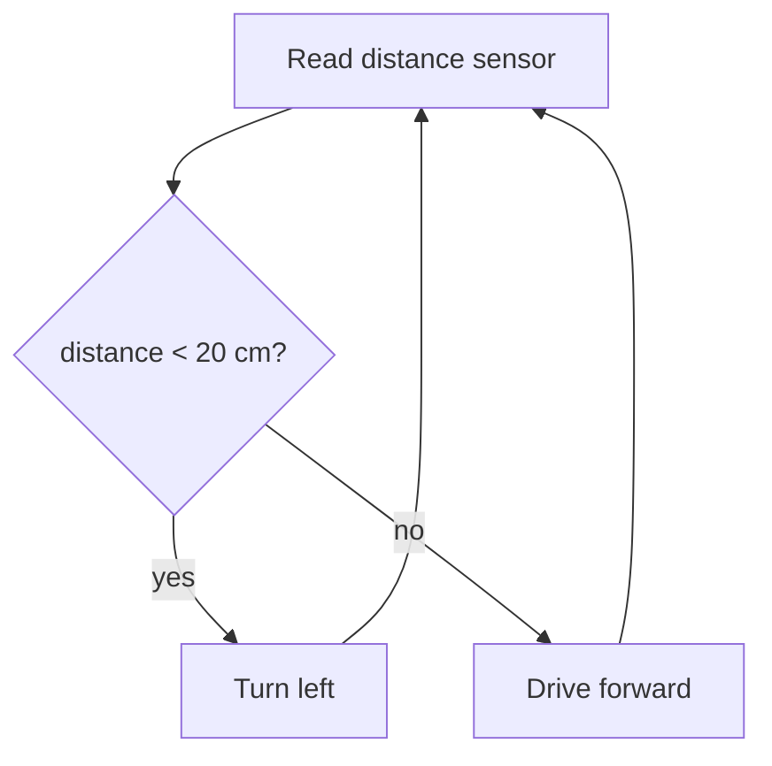

{:class="cover"}

---

By the end of this lesson you will be able to make decisions with `if`, `elif` and `else`, repeat work with `for` and `while`, and package code into reusable functions.

---

So far our programs run straight from the top to the bottom. Real robots need to **decide** ("is something in the way?") and **repeat** ("keep checking, forever"). That is control flow.

## Conditional statements

`if`, `elif` (short for else if) and `else` pick which block of code runs. Python checks the conditions from the top and runs the first one that is true.


distance_cm = 12

if distance_cm < 10:
    print("Stop!")
elif distance_cm < 30:
    print("Slow down")
else:
    print("Full speed ahead")



The colon at the end of each condition and the indented line below it are both required. Try changing `distance_cm` to 5, 25 and 100 and see which branch runs.

## Loops

Python has two kinds of loop.

A `for` loop works through a sequence, or repeats a set number of times:


for i in range(5):
    print(i)          # 0, 1, 2, 3, 4

for sensor in ["left", "middle", "right"]:
    print("Reading the", sensor, "sensor")



A `while` loop repeats as long as its condition is true:


battery_percent = 100

while battery_percent > 70:
    print("Driving, battery at", battery_percent)
    battery_percent -= 10     # something must change, or the loop never ends



Two helpers are worth knowing: `break` leaves a loop early, and `continue` skips to the next time round.

## Functions

A function is a named, reusable block of code. It only runs when you call it, it can take **parameters** (inputs) and it can **return** a result.


def choose_action(distance_cm):
    if distance_cm < 10:
        return "stop"
    elif distance_cm < 30:
        return "slow"
    return "go"

for reading in [80, 25, 8]:
    print(reading, "cm ->", choose_action(reading))



**Why this matters:** once a decision lives in a function you can test it on its own, reuse it, and give it a name that explains what it does. Aim for functions that do one thing.

---

## Try it Yourself

1. Write a function `is_even(n)` that returns `True` for even numbers (hint: `n % 2 == 0`). Use a `for` loop to print every even number from 1 to 20.
1. Change `choose_action()` so it also returns `"reverse"` when the distance is under 5 cm.
1. Use a `while` loop to count down from 10 to 1, then print `Lift off!`.
1. Challenge: write a function `average(readings)` that returns the average of a list, without using `sum()`.

## Common Issues

- **Problem**: A `while` loop never stops and the program seems frozen.
- **Solution**: Make sure something inside the loop changes the condition. In a terminal, press Ctrl+C to stop it.
- **Why**: A `while` loop only ends when its condition becomes false.

- **Problem**: `SyntaxError: expected ':'`.
- **Solution**: Add the colon at the end of the `if`, `elif`, `else`, `for`, `while` or `def` line.
- **Why**: The colon tells Python that an indented block follows.

- **Problem**: A function prints `None`.
- **Solution**: Use `return` to hand back a value. `print()` only displays it.
- **Why**: A function with no `return` gives back `None` by default.

## Check your understanding


? What does `range(5)` produce in a `for` loop?
- [ ] 1, 2, 3, 4, 5
- [x] 0, 1, 2, 3, 4
- [ ] 0, 1, 2, 3, 4, 5
> `range(5)` starts at 0 and stops before 5.

? When does a `while` loop stop?
- [x] When its condition becomes `False`
- [ ] After five repeats
- [ ] When it reaches the end of the file
> A `while` loop repeats as long as its condition is true, so make sure something changes inside the loop.

? In `if`, `elif`, `else`, how many of the blocks run?
- [ ] All of them
- [x] Only the first one whose condition is true (or the `else` if none are)
- [ ] The last one
> Python works down the chain and runs just one branch.

? What does a function return if it has no `return` statement?
- [ ] 0
- [ ] An empty string
- [x] `None`
> `None` is Python's way of saying "no value".


---

## Summary

You can now make decisions, repeat actions and wrap code into functions. In the next lesson we will save data to files so it survives after the program stops.
