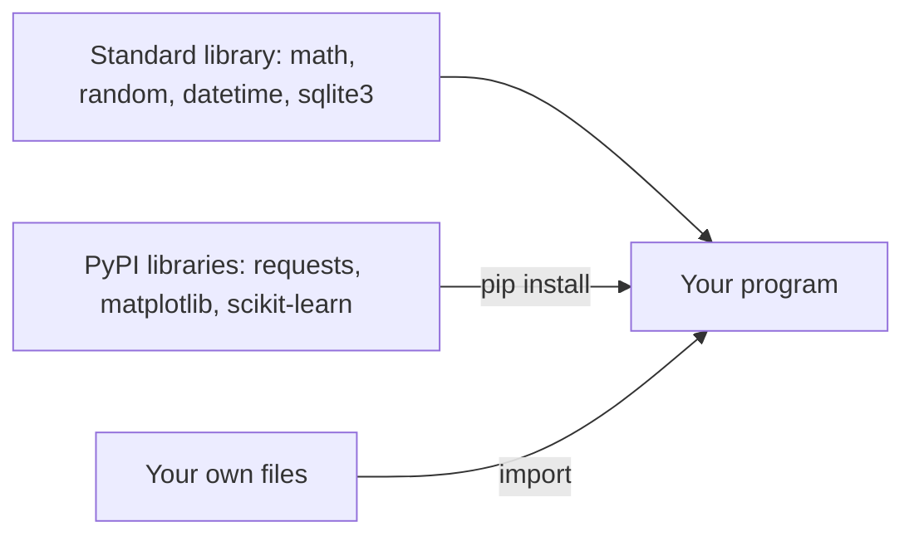

{:class="cover"}

---

By the end of this lesson you will be able to import modules, use `math`, `random` and `datetime`, and create a virtual environment so you can install libraries with `pip`.

---

Python is famous for its "batteries included" approach: a huge library of ready-made code comes with it, and thousands more libraries are a download away. Learning to use other people's code is one of the biggest speed-ups you will get.

A **module** is a single file of Python code. A **library** (or package) is a collection of modules. They define functions, classes and variables you can reuse.



## Importing modules

Use `import`, then reach inside the module with dot notation:


import math

print(math.sqrt(16))     # 4.0
print(math.pi)           # 3.141592653589793
print(math.sin(math.pi / 2))   # 1.0



You can also import just what you need: `from math import sqrt`, then call `sqrt(16)`. Use `import math as m` to give a module a shorter nickname. Avoid `from math import *`, because you will not know where each name came from.

## The math module

Robots love maths. Here is the distance a robot is from its start, using Pythagoras, and the angle it would turn to face home:


import math

x, y = 30, 40                          # position in cm from the start
distance = math.hypot(x, y)            # straight-line distance
angle = math.degrees(math.atan2(y, x)) # direction in degrees

print("Distance:", distance)
print("Angle:", round(angle, 1))



## The random module

Random numbers make simulations, games and "wander around" behaviour:


import random

print(random.random())                   # a float from 0 up to 1
print(random.randint(1, 10))             # a whole number from 1 to 10
print(random.choice(["left", "right", "forward"]))   # pick one

# a fake distance sensor with a bit of noise
reading = 50 + random.randint(-3, 3)
print("Noisy reading:", reading)



## The datetime module

`datetime` handles dates and times, which is handy for time-stamping robot logs:


import datetime

now = datetime.datetime.now()
print(now)
print(now.strftime("%Y-%m-%d %H:%M"))   # a tidy format

launch = datetime.datetime(2025, 1, 1)
delta = now - launch
print("Days since launch:", delta.days)



## Installing libraries with pip

Libraries that are not built in live on the Python Package Index (PyPI), and you install them with `pip`. The safe way is to give every project its own **virtual environment**: a private folder of libraries, so projects cannot break each other or your system Python. You will use this from the next lesson onwards.

On macOS and Linux (including Raspberry Pi OS):

```bash
python3 -m venv .venv
source .venv/bin/activate
pip install requests
```
{: .no-snakie }

On Windows (Command Prompt or PowerShell):

```bash
python -m venv .venv
.venv\Scripts\activate
pip install requests
```
{: .no-snakie }

`python3 -m venv .venv` makes a folder called `.venv`. The `activate` line switches your terminal to use it, and your prompt will show `(.venv)`. While it is active, `pip install` puts libraries inside it. Type `deactivate` to leave, and delete the `.venv` folder if you ever want a fresh start. Use `pip list` to see what is installed.

> **Teachers**: School computers often block `pip`, or stop learners installing software. Ask IT whether PyPI (pypi.org and files.pythonhosted.org) is reachable. If it is not, the built-in modules in this lesson still work, and the Run buttons need nothing installed. A virtual environment needs no administrator rights, which makes it a good fit for locked-down machines when Python itself is already installed.

---

## Try it Yourself

1. Use `random.choice()` to make a program that picks a random direction for your robot to drive.
1. Print today's date in the form `24 November 2026` using `strftime` (the codes are `%d`, `%B` and `%Y`).
1. Use `math.hypot()` to find how far a robot is from home at `(12, 5)`.
1. Challenge: create a virtual environment, activate it, run `pip install requests`, then start Python and type `import requests` to prove it worked.

## Common Issues

- **Problem**: `ModuleNotFoundError: No module named 'requests'`.
- **Solution**: Activate the virtual environment you installed into, then run `pip install requests` again. Check with `pip list`.
- **Why**: Libraries are installed per environment. If you installed in one place and run in another, Python cannot find it.

- **Problem**: On Raspberry Pi OS or recent Linux, `pip install` says `error: externally-managed-environment`.
- **Solution**: Create and activate a virtual environment first, then run `pip install` inside it.
- **Why**: The operating system protects its own Python from being changed by `pip`, so installs have to go into your own environment.

- **Problem**: On Windows, activating the environment is blocked with a message about scripts being disabled.
- **Solution**: Use Command Prompt (`.venv\Scripts\activate`) instead of PowerShell, or ask your administrator about the PowerShell execution policy.
- **Why**: PowerShell can refuse to run script files by default.

- **Problem**: My file called `random.py` breaks `import random`.
- **Solution**: Rename your file to something that is not a module name.
- **Why**: Python finds your file first and imports that instead of the real module.

## Check your understanding


? What's the difference between a module and a library?
- [x] A module is one Python file; a library is a collection of modules
- [ ] They're exactly the same
- [ ] Libraries are written in C and modules in Python
> A module is a single `.py` file. A library (or package) groups related modules together.

? After `import random`, how do you pick a random item from a list?
- [ ] `random.pick(items)`
- [x] `random.choice(items)`
- [ ] `choice(items)`
> Use dot notation to reach functions inside the module: `random.choice()`.

? Why use a virtual environment?
- [ ] It makes Python run faster
- [x] It gives each project its own libraries so projects don't clash
- [ ] It is required to run any Python program
> Each environment keeps its own installed libraries, separate from other projects and the system Python.

? Which command installs the `requests` library?
- [ ] `import requests`
- [x] `pip install requests`
- [ ] `python requests`
> `pip` downloads libraries from PyPI. `import` only loads one that is already installed.


---

## Summary

You can import modules, use three useful standard library modules, and install new libraries inside a virtual environment. Next we will bundle data and behaviour together with classes.
