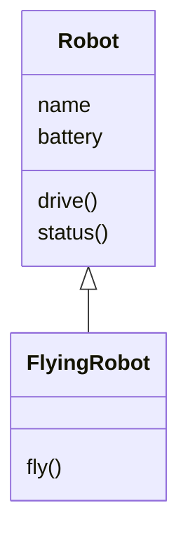

{:class="cover"}

---

By the end of this lesson you will be able to define a class, create objects from it, add methods, and use inheritance to build a new class from an existing one.

---

Once a robot has a name, a battery level, some sensors and a handful of things it can do, you end up with lots of related variables and functions floating around. **Object-oriented programming** (OOP) bundles the data and the behaviour together into one neat package.

## Classes and objects

A **class** is a blueprint. An **object** (also called an instance) is a thing built from that blueprint. Every robot built from a `Robot` blueprint has its own name and battery.

The special `__init__` method runs when you create an object and sets up its **attributes**. `self` is the object being built.


class Robot:
    def __init__(self, name, battery):
        self.name = name
        self.battery = battery

chip = Robot("Chip", 100)
bolt = Robot("Bolt", 60)

print(chip.name, chip.battery)   # Chip 100
print(bolt.name, bolt.battery)   # Bolt 60



`chip` and `bolt` are two separate objects. Changing one never changes the other.

## Methods

**Methods** are functions defined inside a class. They do things with the object's own data, which they reach through `self`.


class Robot:
    def __init__(self, name, battery):
        self.name = name
        self.battery = battery

    def drive(self):
        if self.battery >= 10:
            self.battery -= 10
            print(f"{self.name} drives. Battery: {self.battery}")
        else:
            print(f"{self.name} is too tired to drive")

chip = Robot("Chip", 20)
chip.drive()
chip.drive()
chip.drive()



**Why this matters:** the rule "driving costs 10 battery, and you cannot drive when it is low" lives in one place, with the data it protects.

## Inheritance

**Inheritance** lets you make a new class from an existing one, adding or changing only what is different. The new class is the **child** (or derived) class and the one it inherits from is the **parent** (or base) class.


class Robot:
    def __init__(self, name, battery):
        self.name = name
        self.battery = battery

    def drive(self):
        self.battery -= 10
        print(f"{self.name} drives. Battery: {self.battery}")

class FlyingRobot(Robot):
    def __init__(self, name, battery, max_height):
        super().__init__(name, battery)   # let Robot set up name and battery
        self.max_height = max_height

    def fly(self):
        self.battery -= 25
        print(f"{self.name} flies up to {self.max_height} m. Battery: {self.battery}")

sky = FlyingRobot("Sky", 100, 30)
sky.drive()   # inherited from Robot
sky.fly()     # its own method



`super()` gives you the parent class, so `FlyingRobot` can reuse `Robot`'s setup without copying it.

---

## Try it Yourself

1. Create a `Robot` class with a `name` and a `battery` level, and a `drive()` method that reduces the battery by 10 and prints a message. Make two robots and drive one of them.
1. Add a `charge()` method that sets the battery back to 100.
1. Make a `FlyingRobot` that inherits from `Robot` and adds a `fly()` method.
1. Challenge: add a `status()` method to `Robot` that returns a string like `"Chip: 80% battery"`, then check that `FlyingRobot` can use it too.

## Common Issues

- **Problem**: `TypeError: Robot.drive() takes 1 positional argument but 2 were given`.
- **Solution**: Every method needs `self` as its first parameter, and you call it without passing `self` yourself: `chip.drive()`.
- **Why**: Python passes the object in automatically as the first argument.

- **Problem**: `AttributeError: 'Robot' object has no attribute 'battery'`.
- **Solution**: Write `self.battery = battery` in `__init__`, and use `self.battery` (not just `battery`) inside methods.
- **Why**: Plain variable names inside a method vanish when it ends. Attributes on `self` stay with the object.

- **Problem**: The child class says an attribute is missing, such as `name`.
- **Solution**: Call `super().__init__(...)` inside the child's `__init__`.
- **Why**: If a child defines its own `__init__`, the parent's one does not run unless you call it.

## Check your understanding


? What does `self` refer to inside a method?
- [ ] The class itself
- [x] The particular object the method was called on
- [ ] The parent class
> `self` is the instance, so `self.battery` is that object's own battery.

? What does `super().__init__(name, battery)` do in the `FlyingRobot` class?
- [x] Runs the parent class's `__init__` so the name and battery are set up
- [ ] Creates a new `Robot` object
- [ ] Deletes the parent class
> `super()` gives you access to the parent class, so `FlyingRobot` can reuse `Robot`'s setup.

? What is the difference between a class and an object?
- [ ] There is none
- [x] A class is a blueprint, an object is a thing built from it
- [ ] An object is a blueprint, a class is a thing built from it
> `Robot` is the class; `chip` and `bolt` are objects made from it.


---

## Summary

You can now model a robot with a class, give it methods and extend it with inheritance. This finishes the core language. From the next lesson we go on a tour of what Python can do in the real world, starting with data.
