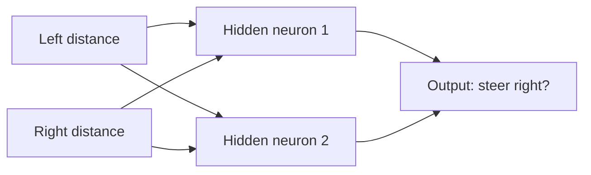

{:class="cover"}

---

By the end of this lesson you will be able to describe what a neural network is made of, and train a small Keras model that turns two distance readings into a steering decision.

---

Deep learning is a branch of machine learning that uses **neural networks**: layers of simple units, loosely inspired by the brain, that learn by example. It is the technology behind image recognition, speech recognition and many self-driving systems. Last lesson's model was a simple one. Neural networks can cope with far more complicated patterns, like pictures, but they need more data and more computing power.



## What is one neuron?

A neuron is smaller than it sounds. It multiplies each input by a **weight**, adds them up with a **bias**, and squashes the result into a number between 0 and 1. Training a network just means finding good weights. You can run a neuron right here, with nothing but the standard library:


import math

def neuron(inputs, weights, bias):
    total = bias
    for value, weight in zip(inputs, weights):
        total += value * weight
    return 1 / (1 + math.exp(-total))   # sigmoid squashes the result to 0..1

# left and right distances as fractions of the sensor range (0 to 1)
weights = [-4, 4]     # a close left obstacle pushes towards steering right
bias = 0

print(neuron([0.2, 0.9], weights, bias))   # obstacle on the left: near 1
print(neuron([0.9, 0.2], weights, bias))   # obstacle on the right: near 0



Here we chose the weights by hand. Close to 1 means "steer right", close to 0 means "steer left". A real network has many neurons in layers and **learns** its own weights from examples.

## Install TensorFlow and Keras

TensorFlow is Google's open-source library for machine learning. **Keras** is its friendly high-level interface, and it comes with TensorFlow. In an activated virtual environment (lesson 7):

```bash
pip install tensorflow
```
{: .no-snakie }

This is a big download (hundreds of megabytes). TensorFlow can lag behind the newest Python release, so if `pip` says `No matching distribution found`, check which Python versions are supported on the [TensorFlow install page](https://www.tensorflow.org/install) and make your virtual environment with a supported one.

> **Teachers**: TensorFlow is a large install, and many school machines have limited disk space or block big downloads. Try it on one machine first. If it is not practical, the neuron example above runs in the browser, and the scikit-learn lesson covers the same train, test and predict ideas. Training this tiny network takes seconds, but bigger networks take far longer, so keep class demos small.

## Train a steering network

We will generate 500 pretend readings of the left and right distance sensors. The right answer is "steer right" (1) when the left side is closer, otherwise 0. The network is never told that rule: it has to discover it. Save this as `steer.py`:

```python
import numpy as np
from tensorflow import keras

np.random.seed(0)
keras.utils.set_random_seed(0)

# 500 pretend readings: [left distance, right distance], scaled 0 to 1.
# The answer is 1 (steer right) when the left side is closer, otherwise 0.
X = np.random.rand(500, 2)
y = (X[:, 0] < X[:, 1]).astype("float32")

model = keras.Sequential([
    keras.Input(shape=(2,)),                     # two numbers in
    keras.layers.Dense(8, activation="relu"),    # a hidden layer of 8 neurons
    keras.layers.Dense(1, activation="sigmoid"), # one output between 0 and 1
])

model.compile(loss="binary_crossentropy", optimizer="adam", metrics=["accuracy"])
model.summary()

model.fit(X, y, epochs=30, batch_size=32, verbose=0)

loss, accuracy = model.evaluate(X, y, verbose=0)
print("Accuracy:", round(float(accuracy), 2))

print("Obstacle on the left :", model.predict(np.array([[0.2, 0.9]]), verbose=0)[0][0])
print("Obstacle on the right:", model.predict(np.array([[0.9, 0.2]]), verbose=0)[0][0])
```
{: .no-snakie }

When we ran it, `model.summary()` listed 33 parameters (the weights and biases), the accuracy came out at about 0.91, and the two predictions were roughly 0.8 for the left obstacle and 0.2 for the right one. Your numbers will differ slightly, and TensorFlow may print some start-up messages first, which are safe to ignore.

What each part does:

- `keras.Sequential([...])` stacks layers one after another. `Dense` means every neuron connects to every neuron in the previous layer.
- `activation="relu"` and `"sigmoid"` are the squashing functions. Sigmoid gives an answer between 0 and 1, which suits a yes/no output.
- `compile()` picks the **loss** (how wrong the model is), and the **optimizer** (how it improves).
- `fit()` does the training. One **epoch** is one pass through all the examples.
- `evaluate()` measures accuracy. Here we measure on the training data to keep the example short. In a real project you would hold back test data, as in the machine learning lesson.

Want to go further? The [Reinforcement Learning](/learn/reinforcement_learning/) course trains agents by reward instead of by labelled examples, and [Computer Vision on Raspberry Pi with CVZone](/learn/cvzone/) puts trained models to work on camera images.

---

## Try it Yourself

1. Run the neuron example with the weights `[4, -4]`. What does it do to the answers, and why?
1. In `steer.py`, change `epochs=30` to `5`, then to `100`. What happens to the accuracy?
1. Change `Dense(8, ...)` to `Dense(2, ...)` and then `Dense(32, ...)`. Does a bigger hidden layer help on this easy problem?
1. Challenge: add a third input for a front sensor, so the input shape becomes `(3,)`, and invent a rule for it.

## Common Issues

- **Problem**: `ERROR: No matching distribution found for tensorflow`.
- **Solution**: Your Python is probably too new, or the wrong type of computer, for the TensorFlow release. Create the virtual environment with an older supported Python, and check the install page.
- **Why**: TensorFlow wheels are built for specific Python versions and platforms.

- **Problem**: A flood of messages about CUDA, oneDNN or `cuda drivers` when running.
- **Solution**: You can ignore them. They say TensorFlow is using your CPU rather than a graphics card.
- **Why**: TensorFlow reports what hardware it found when it starts.

- **Problem**: The accuracy stays near 0.5 after training.
- **Solution**: Train for more epochs, and check that the labels `y` actually match the inputs `X`.
- **Why**: 0.5 means the network is guessing, which happens when it has not learned yet or has no pattern to learn.

## Check your understanding


? How does Keras relate to TensorFlow?
- [ ] They're competing libraries that can't be used together
- [x] Keras is a high-level API that comes with TensorFlow
- [ ] TensorFlow is a part of Keras
> You can use Keras through `from tensorflow import keras`.

? What does one neuron do?
- [x] Multiplies its inputs by weights, adds a bias and squashes the result
- [ ] Stores a whole image
- [ ] Runs a `for` loop
> Training a network means adjusting those weights and biases so the outputs become right.

? What is an epoch?
- [ ] One neuron
- [ ] The accuracy of the model
- [x] One complete pass through the training examples
> `fit(..., epochs=30)` shows the training examples to the network 30 times.


---

## Summary

You have seen what a neuron is, and trained a small neural network to steer from distance readings. Next we will put Python to work automating boring jobs.
