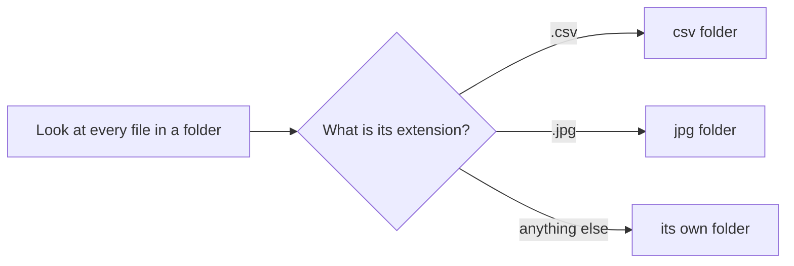

{:class="cover"}

---

By the end of this lesson you will be able to write a script that sorts files into folders using `pathlib` and `shutil`, and explain what browser automation with Selenium is for.

---

Task automation means letting a script do the repetitive jobs for you. If you do something by hand more than a handful of times, such as renaming files, tidying downloads or filling in the same web form, a short Python script can do it in a blink, the same way every time.



## Tidy a folder with pathlib and shutil

Your robot projects make a mess: CSV logs, photos, 3D print files, notes, all dumped into one downloads folder. Let's write a script that sorts them. Two standard library modules do the work, so there is nothing to install:

- `pathlib` represents files and folders as `Path` objects, with handy methods such as `mkdir()`, `iterdir()`, `write_text()` and `.suffix` (the file extension).
- `shutil` does high-level file operations such as copying and moving.

The script first makes its own sample files, so it is safe to run anywhere. Press **Run**, or save it as `tidy.py`:


from pathlib import Path
import shutil

# 1. Make a messy folder to tidy (so this example needs no files of yours)
inbox = Path("robot_downloads")
inbox.mkdir(exist_ok=True)
for name in ["run1.csv", "run2.csv", "photo1.jpg", "photo2.jpg", "notes.txt", "plan.stl"]:
    (inbox / name).write_text("example")

# 2. Sort every file into a sub-folder named after its extension
for file in sorted(inbox.iterdir()):
    if file.is_file():
        folder = inbox / (file.suffix.lstrip(".") or "other")
        folder.mkdir(exist_ok=True)
        shutil.move(str(file), str(folder / file.name))
        print("Moved", file.name, "->", folder.name)

# 3. Show the result
for item in sorted(inbox.rglob("*")):
    print(item)



You should see six `Moved` lines, then a tree with `csv`, `jpg`, `stl` and `txt` folders, each holding the right files. Notice how:

- `inbox / name` joins paths with a slash, and works on Windows, macOS and Linux alike.
- `sorted(inbox.iterdir())` makes a fixed list first, so the folders we create while looping do not confuse the loop.
- `file.suffix` is `".csv"`, and `.lstrip(".")` removes the dot to make a folder name.
- `or "other"` supplies a folder name for files with no extension.

**Why this matters:** the script moves real files, so test it on a copy of your data first. Python's `shutil.move()` does not ask "are you sure?".

To make a script like this run by itself, schedule it. On Linux and Raspberry Pi OS, `crontab -e` lets you run a command at set times, and Windows has Task Scheduler.

## Automating a web browser with Selenium

Some jobs live inside a web page: clicking buttons, filling in forms, testing your own website. **Selenium** drives a real browser from Python. Install it in a virtual environment with `pip install selenium` (it needs Firefox installed). Recent versions fetch the matching browser driver automatically. This sketch opens DuckDuckGo and searches for something:

```python
from selenium import webdriver
from selenium.webdriver.common.by import By

driver = webdriver.Firefox()             # opens a Firefox window controlled by Python
driver.get("https://duckduckgo.com")

search_box = driver.find_element(By.NAME, "q")
search_box.send_keys("Python robots")
search_box.submit()

driver.quit()                            # close the browser
```
{: .no-snakie }

A real browser window will open, so this only works on a computer with a screen, and websites change their layout, so the element name `"q"` may need updating one day. We have not run this example in the course's test setup because it needs a graphical browser, so treat it as a starting point. Older tutorials use methods such as `find_element_by_name()`. Those were removed in Selenium 4, so use `find_element(By.NAME, ...)`.

> **Teachers**: Automation scripts move and delete real files, so have learners work on a throwaway folder or copies, never on their only copy of homework. Selenium opens a browser and clicks on its own, which can trigger school web filters and may break a site's terms of use if you point it at someone else's site. Use it on pages you own or on sites that permit it.

---

## Try it Yourself

1. Run the tidy script, then add a file `notes2.txt` to the list of sample names and run it again. Where does it go?
1. Change the script so files with no extension go into a folder called `misc` instead of `other`.
1. Use `shutil.copy()` instead of `shutil.move()` so the originals stay in place.
1. Challenge: add a check so that a file is only moved if its name starts with `run`.

## Common Issues

- **Problem**: `FileExistsError` or a file overwritten when moving.
- **Solution**: Check whether the destination file already exists with `(folder / file.name).exists()` and skip it or rename it.
- **Why**: Moving a file onto an existing name can fail or replace the old one, depending on the system.

- **Problem**: `PermissionError`.
- **Solution**: Close the file in any program that has it open, and check you are allowed to change that folder.
- **Why**: The operating system will not let a script change files that are locked or protected.

- **Problem**: `SessionNotCreatedException` or a message about a missing browser or driver in Selenium.
- **Solution**: Install the browser you chose (Firefox here), and update Selenium with `pip install --upgrade selenium`.
- **Why**: Selenium needs the browser and a matching driver, and old versions cannot find them.

## Check your understanding


? Which built-in module copies and moves files?
- [ ] `random`
- [x] `shutil`
- [ ] `selenium`
> `shutil` handles high-level file operations like copying and moving.

? What does `Path("a.csv").suffix` give you?
- [ ] `"a"`
- [x] `".csv"`
- [ ] `"csv.a"`
> `.suffix` is the file extension, including the dot.

? What is Selenium used for?
- [ ] Sorting files into folders
- [ ] Drawing charts
- [x] Controlling a web browser from Python
> Selenium opens a real browser and clicks, types and reads pages for you.


---

## Summary

You wrote a script that tidies a folder, and saw how Selenium can drive a browser. Next we will store data properly in a database.
