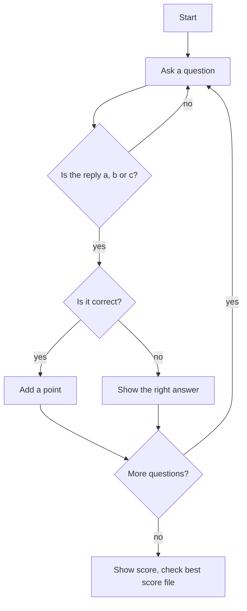

{:class="cover"}

---

By the end of this lesson you will be able to combine classes, lists, loops, functions, input checking and files into one working program, and extend it with your own ideas.

---

Time for the capstone. We will build a multiple-choice quiz game that runs in the terminal. It asks questions, checks and scores the answers, tells you the right answer when you slip up, and remembers your best score in a file. It uses almost everything from this course: a class (lesson 8), lists (3), loops, decisions and functions (4), a file (5) and error handling (6).



## The plan

We will build it from small, testable pieces:

1. A `Question` class that holds a prompt, three choices and the right letter, and knows how to ask itself.
1. A list of `Question` objects (our quiz).
1. A `run_quiz()` function that loops through the questions and counts the score.
1. A `save_best()` function that keeps the best score in a file.

## The complete program

Create a new file called `quiz.py`, copy in the program below, and run it with `python quiz.py` (`python3 quiz.py` on macOS and Linux). It uses `input()`, so it needs a real terminal rather than a browser Run box.

```python
class Question:
    def __init__(self, prompt, choices, answer):
        self.prompt = prompt
        self.choices = choices      # a list of three answers
        self.answer = answer        # "a", "b" or "c"

    def ask(self):
        """Show the question, get a valid letter, and return True if correct."""
        print()
        print(self.prompt)
        for letter, choice in zip("abc", self.choices):
            print(f"  ({letter}) {choice}")

        while True:
            reply = input("Your answer: ").strip().lower()
            if reply in ("a", "b", "c"):
                break
            print("Please type a, b or c.")

        if reply == self.answer:
            print("Correct!")
            return True

        correct_text = self.choices["abc".index(self.answer)]
        print(f"Not quite. The answer was ({self.answer}) {correct_text}.")
        return False


questions = [
    Question("What does a distance sensor measure?",
             ["Colour", "How far away something is", "Battery level"], "b"),
    Question("Which Python type holds True or False?",
             ["str", "float", "bool"], "c"),
    Question("What does a for loop do?",
             ["Repeats code for each item", "Saves a file", "Imports a module"], "a"),
]


def run_quiz(questions):
    score = 0
    for question in questions:
        if question.ask():
            score += 1
    print()
    print(f"You got {score} out of {len(questions)}.")
    return score


def save_best(score, filename="best_score.txt"):
    """Remember the best score in a file, and say if this beat it."""
    try:
        with open(filename) as f:
            best = int(f.read())
    except (FileNotFoundError, ValueError):
        best = 0

    if score > best:
        with open(filename, "w") as f:
            f.write(str(score))
        print("New best score!")
    else:
        print(f"Best score so far: {best}")


if __name__ == "__main__":
    final_score = run_quiz(questions)
    save_best(final_score)
```
{: .no-snakie }

Answer the three questions and you will see `Correct!` or the right answer for each, then your score such as `You got 3 out of 3.`, followed by `New best score!` the first time. Run it again and it compares you with the score saved in `best_score.txt`.

## How it works

- **The `Question` class** bundles the data (`prompt`, `choices`, `answer`) with the behaviour (`ask()`). Because each question knows how to ask itself, `run_quiz()` stays short.
- **`zip("abc", self.choices)`** pairs each letter with a choice so we can print `(a)`, `(b)`, `(c)` without writing three `print` lines.
- **The `while True` loop** keeps asking until the reply is a, b or c, and `break` leaves it. `.strip().lower()` tidies the reply, so `" B "` still counts as `b`.
- **`run_quiz()`** loops through the list. `question.ask()` returns `True` or `False`, which is exactly what an `if` needs.
- **`save_best()`** reads the old best score inside `try`. If the file does not exist yet, or holds something that is not a number, the `except` sets the best to 0 instead of crashing. That is the error-handling lesson at work.
- **`if __name__ == "__main__":`** means "only run this when the file is run directly". If another program imports `quiz.py` to reuse `Question`, the quiz will not start by itself.

> **Teachers**: This project works well in pairs, with one learner typing and one reading the questions aloud, and it makes a good assessed piece because every learner can extend it differently. Plan about 45 to 60 minutes. The program saves `best_score.txt` in the folder it runs from, so on shared computers every learner will see the same best score unless they use separate folders.

---

## Try it Yourself

1. Add three more questions of your own, on any topic, such as your favourite robots. Remember each needs three choices and the right letter.
1. Change the quiz so it shows `Question 1 of 3` before each question. Hint: use `enumerate()` in `run_quiz()`.
1. Load the questions from a text file, one question per line with the parts separated by `|`, using what you learned in the files lesson. Use `line.split("|")` to separate them.
1. Challenge: shuffle the questions with `random.shuffle(questions)` so every game is different, then add a timer with the `time` module that reports how long the quiz took.

## Common Issues

- **Problem**: `EOFError: EOF when reading a line` when the program calls `input()`.
- **Solution**: Run it in a real terminal or in Thonny's shell, not in a place that has no keyboard input.
- **Why**: `input()` needs a keyboard to read from, and some editors and online runners do not provide one.

- **Problem**: The best score is never saved, or the file is in the wrong place.
- **Solution**: Look in the folder you ran the program from, or print `os.getcwd()` after `import os` to see where that is.
- **Why**: A bare file name like `best_score.txt` is created in the current working directory, which is not always where the program file lives.

- **Problem**: Every answer is marked wrong.
- **Solution**: Check the answer letter in each `Question(...)` is lowercase, such as `"b"`, and matches the position of the right choice.
- **Why**: The reply is converted to lowercase and compared directly to `self.answer`.

- **Problem**: `IndentationError` after pasting the code.
- **Solution**: Check the pasted code kept its indentation. The lines inside each class, function and loop must be indented consistently with four spaces.
- **Why**: Python uses indentation to know which lines belong together.

## Check your understanding


? Why does `ask()` use a `while True` loop around `input()`?
- [ ] To make the quiz run forever
- [x] To keep asking until the player types a, b or c
- [ ] To count the score
> The loop repeats until the reply is valid, then `break` leaves it.

? What does the `try` and `except` in `save_best()` protect against?
- [ ] The player typing the wrong letter
- [x] A missing or unreadable score file
- [ ] A question with no answer
> If the file is not found, or does not contain a whole number, `best` falls back to 0.

? What does `if __name__ == "__main__":` do?
- [ ] Defines the `Question` class
- [x] Runs the quiz only when the file is run directly, not when imported
- [ ] Imports a module
> It lets other programs reuse your classes and functions without starting the quiz.

? Why does `.strip().lower()` follow `input()`?
- [x] So that `" B "` is treated the same as `b`
- [ ] To make the answer longer
- [ ] To save it to a file
> It removes stray spaces and capital letters before comparing.


---

## Summary

You have built a complete application from classes, loops, functions, error handling and files, and you have the skills to keep extending it. Next, a bonus lesson of tips and tricks, and then where to go from here.
