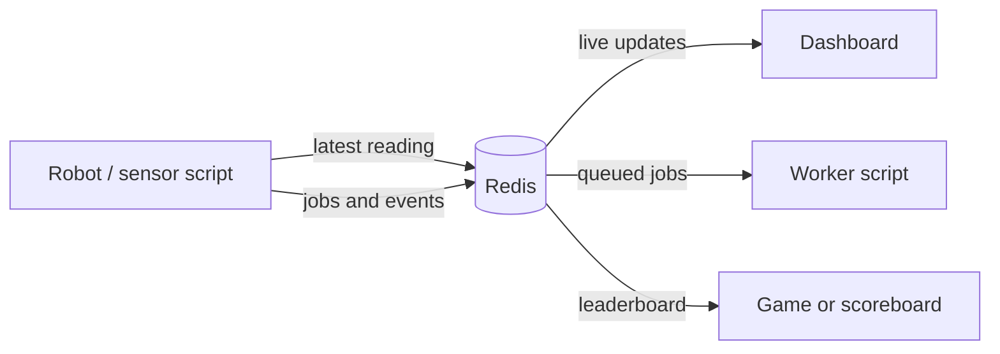

{:class="cover"}

---

Ahoy there makers! Picture a robot driving round the lounge, a dashboard on your laptop showing its battery level, and a little script counting how many laps it has done. Three programs, one shared notice board. That notice board is Redis.

By the end of this lesson you will be able to explain what Redis is, name the jobs it does well, and say which kind of data you would put in it for a robot project.

---

## Overview

Redis is a data store that keeps everything in memory (RAM), which is why it answers in a fraction of a millisecond. It can act as a database, a cache and a message broker all at once. Instead of just rows and columns, it gives you ready-made data structures: strings, hashes, lists, sets and sorted sets.

For makers that means Redis is the glue between programs. A robot publishes its readings, a dashboard shows them, a logger keeps the last hundred, and none of them need to know about each other.

## Course Content

- **Redis basics**: install Redis, talk to it with `redis-cli` and Python, and meet keys that expire
- **Data types**: strings, hashes, lists, sets and sorted sets, and what each is for
- **Commands and transactions**: run several commands together, and handle errors
- **Lists, sets, hashes and sorted sets**: a job queue, unique visitors, a robot's latest state and a leaderboard
- **Pub/sub**: live messages between programs
- **Expiry and persistence**: self-deleting keys, and how Redis survives a restart
- **Project**: a robot telemetry hub that uses everything
- **Summary**: what you learned and where to go next

## Key Results

After completing this course, you will be able to:

- Install Redis and talk to it from `redis-cli` and from Python
- Choose the right data type for latest readings, job queues, unique counts and leaderboards
- Group commands into transactions and handle connection and command errors
- Send live messages between programs with pub/sub
- Make keys expire and explain what RDB snapshots and the append-only file protect
- Build a small robot telemetry hub with a publisher, a worker and a dashboard

## What you'll need

- A computer with Python 3 installed. A Raspberry Pi 4 or 5 works well
- An internet connection to install Redis and the `redis` Python library
- A Linux or macOS machine, or Docker (for Windows)
- No robot is required: every lesson uses simulated sensor values. If you do have a robot, you can swap in real readings

You should be comfortable writing simple Python programs. If you're new to Python, take [Python for beginners](/learn/python/) first. The [Docker course](/learn/docker/) is a helpful companion, and [Create Databases with Python and SQLite3](/learn/sqlite3/) shows the other way to store data from a program.

## What is Redis for?

- **Latest value**: the most recent distance reading, stored under a key
- **Caching**: remembering an expensive answer for a few minutes
- **Queues**: a list of jobs for a worker to take one at a time
- **Counting**: unique visitors, laps, button presses
- **Leaderboards**: ranked scores that stay sorted automatically
- **Messaging**: one program publishing, many listening

> ## Redis or Valkey?
>
> In 2024 Redis moved from its old BSD licence to source-available licences, and the Linux Foundation started [Valkey](https://valkey.io), an open source fork of Redis 7.2. Redis 8 later added the AGPLv3 open source licence as an option. Valkey speaks the same commands and works with the same Python library, so everything in this course works with either.

## How the course works

**Commands first, then Python.** Each lesson shows the command in `redis-cli`, with its real output, and then the same idea in Python. Typing the command by hand is the quickest way to see what Redis does.

**Checked against a real server.** The output shown was produced by running the examples against Redis 7 with the `redis` Python library. Your version may print slightly different spacing, but the results will match.

**Complete programs.** Programs you are asked to save and run are complete files. Short snippets that only make sense inside a bigger program say so.

**Quizzes and exercises.** Each lesson ends with a quiz, and your score is kept in your browser. The Try it Yourself exercises get harder as you go.

> **Teachers**: this course suits learners aged 14 and over who can already write small Python programs. Allow 30 to 45 minutes per lesson, and about 90 minutes for the project. Each learner or pair needs a computer where they can install software, which can be blocked on locked-down school machines. If so, run one shared Redis on a teacher machine or a Raspberry Pi and keep it on the classroom network only, never the open internet. With no installs at all, learners can still read the lessons and work through the `redis-cli` examples on paper. No robot kit is needed.

## Check your understanding


? Why is Redis so fast?
- [ ] It stores data on a special kind of SD card
- [x] It keeps its data in memory
- [ ] It only stores numbers
> Redis holds its data in RAM, so reads and writes don't wait for a disk.

? Which job is a good fit for Redis?
- [ ] Storing years of photos
- [x] Sharing the latest sensor reading between a robot and a dashboard
- [ ] Running a Python program
> Redis is a fast shared store for small, frequently changing data.

? Can you use the Valkey fork with this course?
- [x] Yes, it uses the same commands and Python library
- [ ] No, the commands are completely different
> Valkey was forked from Redis 7.2, so the examples work with either.


Ready? Let's get Redis running.
