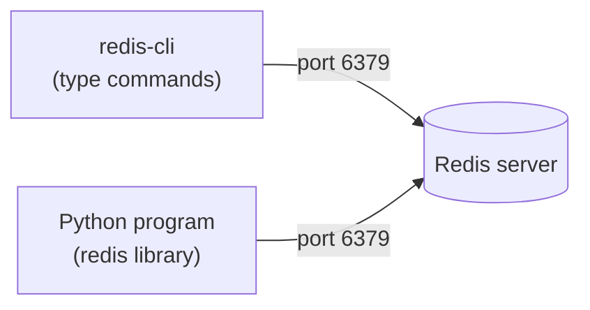

{:class="cover"}

---

By the end of this lesson you will be able to install Redis, store and read back a value with `redis-cli`, and do the same from a Python program.

---

## Overview

Redis stores **keys** and **values**. The key is a name, like `robot:1:distance`, and the value is whatever you want to remember under that name. Because Redis lives in memory it is fast, but it also means you are limited by how much RAM the machine has.

Let's get a server running, poke it by hand, then talk to it from Python.



Both tools are just clients. They connect to the server on port `6379`, send a command and print the reply.

## Installing Redis

Pick whichever option suits your computer.

**Raspberry Pi OS, Debian or Ubuntu**

```bash
sudo apt update
sudo apt install redis-server
```

The server starts automatically and runs in the background. By default it only accepts connections from the same machine, which is exactly what we want for learning.

**macOS** (with [Homebrew](https://brew.sh))

```bash
brew install redis
brew services start redis
```

**Any computer with Docker** (including Windows)

```bash
docker run -d --name redis -p 127.0.0.1:6379:6379 redis
```

The `127.0.0.1:` part keeps the port private to your own computer. See the [Docker course](/learn/docker/) if you're new to Docker.

## Say hello with redis-cli

`redis-cli` is a command-line client that comes with Redis. (With Docker, run `docker exec -it redis redis-cli` to open it inside the container.) Type a command and press Enter:

```
127.0.0.1:6379> ping
PONG
127.0.0.1:6379> set robot:1:distance 42.5
OK
127.0.0.1:6379> get robot:1:distance
"42.5"
127.0.0.1:6379> incr robot:1:boots
(integer) 1
127.0.0.1:6379> incr robot:1:boots
(integer) 2
127.0.0.1:6379> get nothing
(nil)
```

A few things to notice:

- `PONG` means the server is alive
- `set` stores a value and `get` reads it back. The quotes in `"42.5"` are just how `redis-cli` prints text
- `incr` adds one to a number, creating it at 1 if it does not exist yet. It is great for counting boots, laps and button presses
- A key that does not exist gives `(nil)`

> ## Redis stores text
>
> The value `42.5` went in as text and came back as text. Redis does not know it is a number until you ask it to `incr` it. When you read values in Python you convert them yourself, for example with `float()`.

## Connect from Python

Install the library, ideally in a virtual environment:

```bash
pip install redis
```

On Raspberry Pi OS, create and activate a virtual environment first (`python3 -m venv ~/redis-env` then `source ~/redis-env/bin/activate`).

Save this as `hello_redis.py`:

```python
import redis

r = redis.Redis(host='localhost', port=6379, decode_responses=True)

r.set('robot:1:distance', 42.5)
print(r.get('robot:1:distance'))

distance = float(r.get('robot:1:distance'))
print(distance + 10)

print(r.get('nothing'))
```

Run it and you will see:

```
42.5
52.5
None
```

`redis.Redis(...)` creates a client. `set()` and `get()` have the same names as the commands. A missing key gives `None` in Python, where `redis-cli` printed `(nil)`.

> ## Bytes or strings?
>
> Redis stores bytes. Without `decode_responses=True`, `get()` returns `b'42.5'` instead of `'42.5'`. We use `decode_responses=True` throughout this course so you get normal Python strings back.

## Try it Yourself

1. In `redis-cli`, store your robot's name under `robot:1:name` and read it back
2. Use `incr` three times on a counter called `laps`, then `get` it. What type does Python give you if you `r.get('laps')`?
3. Challenge: write a program that stores a pretend battery voltage, reads it back, converts it to a `float` and prints "Battery low" if it is below 6.5

## Common Issues

- **Problem**: `redis.exceptions.ConnectionError: Error 111 connecting to localhost:6379. Connection refused.`
- **Solution**: Start the server (`sudo systemctl start redis-server` on Debian, `brew services start redis` on macOS, or `docker start redis`).
- **Why**: Nothing is listening on port 6379, so the connection is refused.

- **Problem**: `get()` returns `b'42.5'` with a `b` in front.
- **Solution**: Add `decode_responses=True` when you create the client.
- **Why**: Without it, the library hands you raw bytes.

- **Problem**: `TypeError` when adding to a value you read.
- **Solution**: Convert it first, e.g. `float(r.get('robot:1:distance'))`.
- **Why**: Redis returns text, and Python will not add a number to a string.

## Check your understanding


? Which port does Redis listen on by default?
- [ ] 80
- [ ] 5432
- [x] 6379
> 6379 is Redis's default port. You can change it in the configuration file.

? Why do we pass `decode_responses=True` when connecting?
- [ ] It makes Redis faster
- [x] So results come back as Python strings instead of bytes
- [ ] It's required to connect to localhost
> Redis returns bytes by default, like `b'42.5'`.

? What does `get` return for a key that does not exist?
- [ ] An empty string
- [ ] An error
- [x] `(nil)` in redis-cli, and `None` in Python
> A missing key is not an error, it is simply empty.


> **Teachers**: installing software needs admin rights, which locked-down school computers often deny. A shared Redis on one Pi, or Docker on a teacher machine, avoids this. If you share one server, ask each learner to prefix their keys with their own name (for example `sam:robot:1:distance`) so they don't overwrite each other, and never publish port 6379 beyond the classroom network, because a default Redis has no password.
