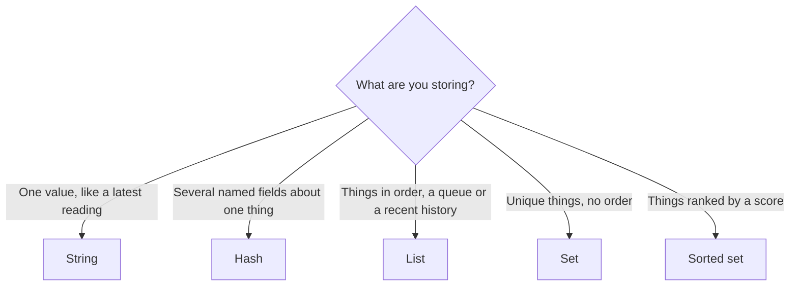

{:class="cover"}

---

By the end of this lesson you will be able to name the five main Redis data types, pick the right one for a robot job, and check what type a key holds.

---

## Overview

In a spreadsheet everything is a cell. In Redis, the value under a key can be one of several shapes, and each shape has its own commands. Picking the right shape is most of the skill. If you choose well, Redis does the hard work for you: it keeps things in order, throws away duplicates and counts in one step.



## The five shapes, and what they are for

| Type | Think of it as | Robot or maker example |
| --- | --- | --- |
| String | One labelled box | The latest distance reading, a counter of laps |
| Hash | A small dictionary | Everything about robot 1: mode, battery, distance |
| List | A queue or a stack | Commands waiting for the robot, the last 10 readings |
| Set | A bag with no duplicates | The names of everyone who visited your stand today |
| Sorted set | A ranked scoreboard | Fastest maze times, highest scores |
{:class="table table-single"}

## Trying each one by hand

Here is one of each in `redis-cli`. The `type` command tells you what shape a key holds.

```
127.0.0.1:6379> set robot:1:distance 42.5
OK
127.0.0.1:6379> type robot:1:distance
string
127.0.0.1:6379> hset robot:1:state mode explore battery 7.4 distance 42.5
(integer) 3
127.0.0.1:6379> hget robot:1:state battery
"7.4"
127.0.0.1:6379> rpush robot:1:jobs forward left stop
(integer) 3
127.0.0.1:6379> lrange robot:1:jobs 0 -1
1) "forward"
2) "left"
3) "stop"
127.0.0.1:6379> sadd visitors:today alice bob alice
(integer) 2
127.0.0.1:6379> zadd laps:best 12.4 alice 9.8 bob
(integer) 2
127.0.0.1:6379> zrange laps:best 0 -1 withscores
1) "bob"
2) "9.8"
3) "alice"
4) "12.4"
```

Notice that the set kept only two names even though we added `alice` twice, and the sorted set put `bob`'s faster time first without being asked.

## The same tour in Python

Each Redis command has a Python method with the same name in lower case: `SET` is `set()`, `HGET` is `hget()`. That means the [Redis command reference](https://redis.io/docs/latest/commands/) is useful even when you are writing Python.

Save this as `tour.py`:

```python
import redis

r = redis.Redis(host='localhost', port=6379, decode_responses=True)
r.flushdb()   # start with an empty database (careful on a shared server!)

r.set('robot:1:distance', 42.5)
r.hset('robot:1:state', mapping={'mode': 'explore', 'battery': 7.4, 'distance': 42.5})
r.rpush('robot:1:jobs', 'forward', 'left', 'stop')
r.sadd('visitors:today', 'alice', 'bob', 'alice')
r.zadd('laps:best', {'alice': 12.4, 'bob': 9.8})

for key in sorted(r.keys('*')):
    print(key, '->', r.type(key))

print(r.hgetall('robot:1:state'))
print(r.lrange('robot:1:jobs', 0, -1))
print(r.smembers('visitors:today') == {'alice', 'bob'})
print(r.zrange('laps:best', 0, -1, withscores=True))
```

Running it prints:

```
laps:best -> zset
robot:1:distance -> string
robot:1:jobs -> list
robot:1:state -> hash
visitors:today -> set
{'mode': 'explore', 'battery': '7.4', 'distance': '42.5'}
['forward', 'left', 'stop']
True
[('bob', 9.8), ('alice', 12.4)]
```

The hash comes back as a Python dictionary, which makes hashes a natural fit for a robot's state. The values are still text (`'7.4'`), so convert them when you need numbers. A set has no order, which is why we compare it to a set instead of printing it.

## Naming keys

All the keys above use colons, like `robot:1:state`. That is just a convention, but it makes keys easy to organise, and you can find a group with `keys robot:1:*`. Use `keys` only when learning, because on a big database it is slow. Real programs track their own key names.

## Try it Yourself

1. In `redis-cli`, store a hash for a second robot called `robot:2:state` with a `mode` and a `battery`
2. Use `type` on each of your keys. Which one would give an error if you used `get` on it?
3. Add `robot:2:jobs` as a list, and a set called `sensors:fitted` holding `ultrasonic`, `camera` and `ultrasonic`. How many members does it hold?
4. Challenge: decide which data type you would use for "the five most recent obstacle distances", and explain your choice to a friend

## Common Issues

- **Problem**: `(error) WRONGTYPE Operation against a key holding the wrong kind of value`
- **Solution**: Use `type yourkey` to see what it holds, then use that type's commands (`hgetall` for a hash, `lrange` for a list).
- **Why**: A key has exactly one type, and `get` only works on strings.

- **Problem**: Numbers come back from a hash as strings like `'7.4'`.
- **Solution**: Convert with `float()` or `int()` when you read them.
- **Why**: Redis stores everything as text and does not remember that you meant a number.

- **Problem**: Your `set` call quietly replaced an earlier value.
- **Solution**: Give different things different key names, or use `set key value nx` to only set it if it does not exist.
- **Why**: Setting a key that exists overwrites it, whatever type it held.

## Check your understanding


? Which data type would you use for a game leaderboard?
- [ ] List
- [ ] Set
- [x] Sorted set
> A sorted set keeps players ordered by their score.

? Which data type stores no duplicates and has no order?
- [x] Set
- [ ] List
- [ ] Hash
> Sets hold unique members with no particular order.

? You want to keep mode, battery and distance for one robot under a single key. What fits best?
- [ ] A list
- [x] A hash
- [ ] A set
> A hash holds named fields, like a small dictionary.

? What does `type robot:1:jobs` print after `rpush robot:1:jobs forward left stop`?
- [x] `list`
- [ ] `string`
- [ ] `queue`
> `rpush` creates a list, and `type` reports the shape of the key.


> **Teachers**: `flushdb` in the example deletes every key in the current database. On a Redis server shared by a class, one learner running it wipes everyone's work. Give each learner their own Redis, or remove that line and use key names with their own prefix.
