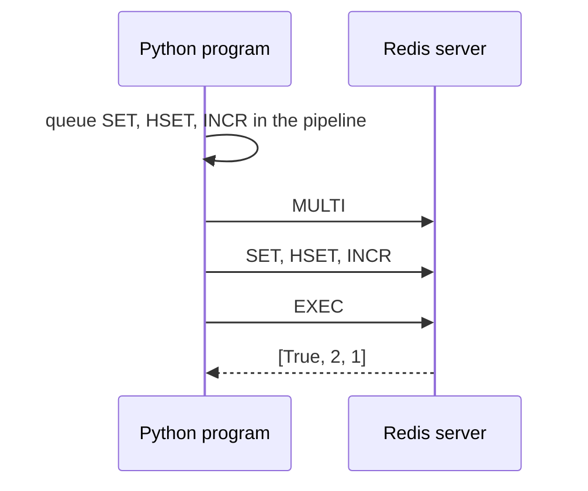

{:class="cover"}

---

By the end of this lesson you will be able to send several commands in one go with a pipeline, explain what a Redis transaction does and does not guarantee, and handle errors without crashing your program.

---

## Overview

So far we have sent one command at a time. That is fine for a robot that writes one reading a second, but sometimes you want to update several things together: the latest mode, the battery level and a boot counter, for example. Redis lets you queue commands and send them in one trip, and optionally run them as a single uninterrupted block.



## Pipelines and transactions

A **transaction** is a group of commands sent between `MULTI` and `EXEC`. Redis runs them one after another, and no other client's commands can slip in between.

In Python you use a `pipeline`. By default it wraps the queued commands in `MULTI` and `EXEC` for you:

```python
import redis

r = redis.Redis(host='localhost', port=6379, decode_responses=True)

with r.pipeline() as pipe:
    pipe.set('robot:1:mode', 'explore')
    pipe.hset('robot:1:state', mapping={'battery': 7.4, 'distance': 42.5})
    pipe.incr('robot:1:boots')
    results = pipe.execute()

print(results)
```

Run on an empty database, it prints:

```
[True, 2, 1]
```

- Commands added to `pipe` are queued in your program. Nothing is sent yet
- `execute()` sends them all, and returns a list with one result per command, in order
- `True` is the reply to `set`, `2` is the number of new hash fields `hset` created, and `1` is the new value of the counter
- Sending commands together is also much faster, because there is only one round trip to the server

If you only want the speed and not the all-or-nothing block, ask for a plain pipeline with `r.pipeline(transaction=False)`. In a quick test on one machine, 1,000 `set` calls took about 0.17 seconds one at a time and 0.01 seconds in a pipeline. Your numbers will differ, but the gap is real, especially over Wi-Fi to a Pi.

> ## Atomic, but no rollback
>
> A Redis transaction makes sure the commands run together, but it does not undo earlier commands if a later one fails. That is different from transactions in SQL databases.

Let's prove it. Suppose `robot:1:name` holds the text `BurgerBot`, and we try to `incr` it, which makes no sense:

```python
r.set('robot:1:name', 'BurgerBot')

pipe = r.pipeline()
pipe.set('step', 'one')
pipe.incr('robot:1:name')
pipe.set('step2', 'three')
try:
    pipe.execute()
except redis.exceptions.ResponseError as e:
    print('Error:', e)
print(r.get('step'), r.get('step2'))
```
{: .no-snakie }

This prints:

```
Error: Command # 2 (INCRBY robot:1:name 1) of pipeline caused error: value is not an integer or out of range
one three
```

The bad command failed, but the commands before and after it still ran. If you want to see each result instead of an exception, use `pipe.execute(raise_on_error=False)`, which gives `[True, ResponseError(...), True]`.

## Handling errors

The two errors you will meet most are:

- `redis.exceptions.ConnectionError`: the server is not running, or the address or port is wrong
- `redis.exceptions.ResponseError`: the server understood you but refused the command, for example `WRONGTYPE`

Both inherit from `redis.exceptions.RedisError`, so you can catch them in order from most specific to most general. Save this as `safe_connect.py`:

```python
import redis

r = redis.Redis(host='localhost', port=6379, decode_responses=True)

try:
    r.ping()
    print("Connected!")
    r.set('robot:1:name', 'BurgerBot')
    r.incr('robot:1:name')
except redis.exceptions.ConnectionError:
    print("Can't reach Redis. Is the server running?")
except redis.exceptions.ResponseError as e:
    print('Redis said no:', e)
except redis.exceptions.RedisError as e:
    print('Some other Redis error:', e)
```

With the server running it prints:

```
Connected!
Redis said no: value is not an integer or out of range
```

Stop the server and the first `except` catches the failure and prints the friendly message instead of a long traceback. For a robot that should keep running, that is the difference between a tidy log line and a crash.

## Try it Yourself

1. Change the pipeline so it also adds `'ultrasonic'` to a set called `robot:1:sensors`. What does `execute()` return now?
2. Use `pipe.execute(raise_on_error=False)` on the broken example and print the list. Which position holds the error?
3. Time 1,000 `incr` calls with and without `transaction=False`. How much faster is the pipeline on your setup?
4. Challenge: write a function `safe_incr(key)` that returns the new value, or `None` if Redis is unreachable or the key holds text

## Common Issues

- **Problem**: A transaction partly worked and partly failed.
- **Solution**: Check every result in the list from `execute(raise_on_error=False)`, and validate your data before you queue it.
- **Why**: Redis does not roll back. Commands that were valid still run when a later one fails.

- **Problem**: `ConnectionError` appears the moment the program starts.
- **Solution**: Check the server is running with `redis-cli ping`, and that `host` and `port` match.
- **Why**: The Python library connects as soon as it sends its first command.

- **Problem**: You read a value in the middle of building a pipeline and get `Pipeline` back instead of data.
- **Solution**: Read values before or after the pipeline, not inside it.
- **Why**: Commands in a pipeline are queued, and have no result until `execute()` runs.

## Check your understanding


? What does `pipe.execute()` return?
- [ ] Nothing
- [x] A list with one result for each queued command
- [ ] Only the result of the last command
> Each command in the pipeline gets its own entry in the results list.

? If the second command in a Redis transaction fails, what happens to the first?
- [ ] It's rolled back
- [x] It stays done; Redis transactions don't roll back
> Redis runs the commands together but doesn't undo them.

? Which exception means the server is not running?
- [x] `redis.exceptions.ConnectionError`
- [ ] `redis.exceptions.ResponseError`
- [ ] `KeyError`
> `ConnectionError` is raised when the client cannot reach the server.


> **Teachers**: the "no rollback" idea surprises students who have met SQL transactions, so say it out loud before they write any code. For a calm demo of an error, use the `incr` on a text key, because it is safe and repeatable. Avoid stopping a shared server to show `ConnectionError`. Point the client at an unused port instead, such as 6399.
