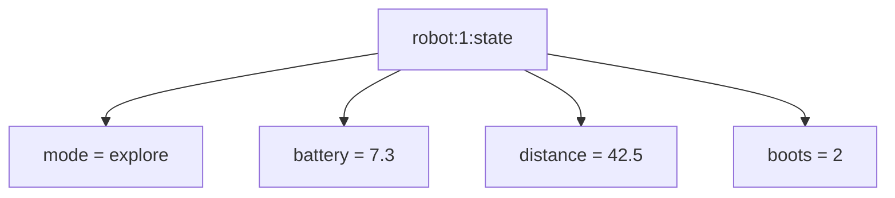

{:class="cover"}

---

By the end of this lesson you will be able to store a robot's latest readings in one Redis hash, read or update a single field, and make the hash expire when the robot goes quiet.

---

## Overview

A robot has many facts about it at once: its mode, battery voltage, distance reading and how many times it has booted. You could store each as its own string (`robot:1:mode`, `robot:1:battery`, and so on), but a **hash** keeps them together under one key, like a small Python dictionary living inside Redis.



That is tidy, and it has a practical benefit. You can read the whole thing with one command, change one field without touching the rest, and delete or expire the whole robot's state in one go.

## Reading and writing fields

```
127.0.0.1:6379> hset robot:1:state mode explore battery 7.4 distance 42.5
(integer) 3
127.0.0.1:6379> hget robot:1:state battery
"7.4"
127.0.0.1:6379> hset robot:1:state battery 7.3
(integer) 0
127.0.0.1:6379> hgetall robot:1:state
1) "mode"
2) "explore"
3) "battery"
4) "7.3"
5) "distance"
6) "42.5"
127.0.0.1:6379> hmget robot:1:state mode battery
1) "explore"
2) "7.3"
```

- `hset` sets one or more fields, and replies with how many fields were **new**. Updating `battery` replied `0` because the field already existed, but the value did change
- `hget` reads one field, `hmget` reads several, and `hgetall` reads them all
- Every value is text. `7.3` is stored as the characters `7.3`

A few more commands are handy:

```
127.0.0.1:6379> hincrby robot:1:state boots 1
(integer) 1
127.0.0.1:6379> hincrby robot:1:state boots 1
(integer) 2
127.0.0.1:6379> hexists robot:1:state mode
(integer) 1
127.0.0.1:6379> hdel robot:1:state distance
(integer) 1
127.0.0.1:6379> hkeys robot:1:state
1) "mode"
2) "battery"
3) "boots"
127.0.0.1:6379> hlen robot:1:state
(integer) 3
```

`hincrby` adds a whole number to a field and creates the field if needed, so it is a counter that lives inside the hash. `hdel` deletes a field, `hkeys` lists field names, `hvals` lists values and `hlen` counts fields.

## A robot and a dashboard

A hash can also **expire**. If your robot writes its state every second and the hash is set to expire after a few seconds, then a robot that crashes or loses power simply vanishes from the dashboard. No "last seen" code is needed.

Save this as `robot_state.py`. It plays both parts, the robot and the dashboard:

```python
import time
import redis

r = redis.Redis(host='localhost', port=6379, decode_responses=True)
r.delete('robot:1:state')

def robot_reports(battery, distance):
    """What the robot does every second."""
    with r.pipeline() as pipe:
        pipe.hset('robot:1:state', mapping={
            'mode': 'explore',
            'battery': battery,
            'distance': distance,
        })
        pipe.expire('robot:1:state', 2)      # vanish after 2 seconds of silence
        pipe.execute()

def dashboard_shows():
    """What the dashboard does."""
    state = r.hgetall('robot:1:state')
    if not state:
        print('Robot offline')
        return
    print('Battery', float(state['battery']), 'V, distance', float(state['distance']), 'cm')

robot_reports(7.4, 42.5)
dashboard_shows()

r.hincrbyfloat('robot:1:state', 'battery', -0.1)    # one field changes
print('Battery now', r.hget('robot:1:state', 'battery'))

time.sleep(3)    # the robot goes quiet...
dashboard_shows()
```

Run it and you will see:

```
Battery 7.4 V, distance 42.5 cm
Battery now 7.3
Robot offline
```

Three things to notice:

- `hset(..., mapping={...})` stores a whole dictionary in one call. This is the modern spelling, replacing the old `hmset`
- A pipeline sends `hset` and `expire` together, so the hash can never exist without its timer
- `hincrbyfloat` changes one field by a decimal amount. The last `dashboard_shows()` finds nothing because the hash expired

## Try it Yourself

1. In `redis-cli`, create `robot:2:state` with a `mode` and `battery`, then use `hmget` to read just the battery
2. Change `robot_reports` to also store a `timestamp` field using `time.time()`
3. Lengthen the `expire` time to 10 seconds, shorten the `sleep`, and check the dashboard still reports the robot online
4. Challenge: make the dashboard print "Battery low" in red text when the battery falls below 6.8

## Common Issues

- **Problem**: `hgetall` returns an empty dictionary `{}` for a robot you just set up.
- **Solution**: Check the key name for typos, and check whether you set an `expire` that has already passed.
- **Why**: A missing or expired hash looks the same as an empty one.

- **Problem**: `float(state['battery'])` raises `KeyError`.
- **Solution**: Use `state.get('battery')` and handle `None`, or check the robot has written the field.
- **Why**: A field that was never set does not exist in the dictionary.

- **Problem**: An older tutorial tells you to use `hmset`.
- **Solution**: Use `hset(key, mapping={...})` instead.
- **Why**: `hset` has accepted several fields since Redis 4.0, and the Redis documentation lists `hmset` as deprecated.

## Check your understanding


? Which method returns a whole hash as a Python dictionary?
- [ ] `hget()`
- [x] `hgetall()`
- [ ] `hkeys()`
> `hgetall()` returns every field and value. `hkeys()` only returns the field names.

? Why does `robot_reports` send `hset` and `expire` in a pipeline?
- [x] So the hash and its timer are set together
- [ ] Because `expire` needs a pipeline to work
- [ ] To make the battery value a number
> Sent together, the hash can never exist without its timer.

? A hash holds `battery` with the value `7.3`. What type does Python receive from `hget`?
- [ ] `float`
- [x] `str`
> Redis stores text, so you convert with `float()` yourself.


> **Teachers**: the expiry trick is a neat way to show "heartbeat" monitoring with no extra code. If your students share one Redis server, a hash is a good unit to teach key prefixes with: `team3:robot:1:state`. If a group's laptop sleeps during the lesson, its robot will appear offline after the expiry time, which is a useful talking point, not a fault.
