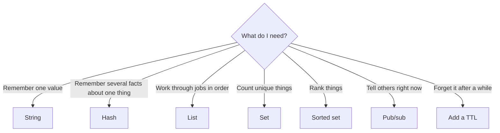

{:class="cover"}

---

By the end of this lesson you will be able to match a maker job to the right Redis feature, and know where to learn more.

---

## What you built and learned

You started by installing Redis and saying `PONG` to it. You finished with a robot and a dashboard sharing live readings, a job queue and a leaderboard through one small server. Along the way you met every major piece of Redis:

| Lesson | What you learned | Robot or maker use |
| --- | --- | --- |
| [Redis basics](/learn/redis/02_redis_basics.html) | Keys, `set` and `get`, `incr`, the Python client | Latest sensor reading, a boot counter |
| [Data types](/learn/redis/03_data_types.html) | Strings, hashes, lists, sets, sorted sets | Choosing the right shape |
| [Commands and transactions](/learn/redis/04_commands_and_transactions.html) | Pipelines, `MULTI` and `EXEC`, no rollback, error handling | Updating state together |
| [Lists](/learn/redis/05_redis_lists.html) | `rpush`, `blpop`, `ltrim` | A job queue, the last N readings |
| [Sets](/learn/redis/06_redis_sets.html) | `sadd`, `scard`, `sinter` | Unique visitors, who came both days |
| [Hashes](/learn/redis/07_redis_hashes.html) | `hset`, `hgetall`, `hincrby` | A robot's whole state in one key |
| [Sorted sets](/learn/redis/08_redis_sorted_sets.html) | `zadd`, `zrange`, `zincrby` | Leaderboards and fastest times |
| [Pub/sub](/learn/redis/09_redis_pub_sub.html) | `publish`, `subscribe` | Live readings to a dashboard |
| [Expiry and persistence](/learn/redis/10_expiry_and_persistence.html) | TTL, RDB snapshots, the AOF | Caches, heartbeats, surviving a restart |
| [Telemetry hub](/learn/redis/11_robot_telemetry_hub.html) | All of the above together | A robot and dashboard system |
{:class="table table-single"}

## Choosing the right tool

When you start a new project, ask what you need to **do** with the data:

Remember the two main cautions from the course. Pub/sub forgets messages that nobody was listening for, and Redis transactions do not roll back. And keep your server private: a default Redis has no password, so never expose its port to the internet.

## Where to go next

- [Create Databases with Python and SQLite3](/learn/sqlite3/) for data you want on disk and searchable with SQL
- [MongoDB](/learn/mongodb/) for storing documents when your data does not fit tidy tables
- [FastAPI](/learn/fastapi/) to put a web page or API in front of your Redis data
- [Docker](/learn/docker/) to run Redis next to your own programs in containers
- [Python for beginners](/learn/python/) if you want to tidy up your Python skills

## Additional resources

- Redis documentation: <https://redis.io/docs/latest/>
- Redis command reference: <https://redis.io/docs/latest/commands/>
- Redis Python library documentation: <https://redis-py.readthedocs.io/en/stable/>
- Redis University (free courses): <https://university.redis.io/>
- Valkey, the open source fork: <https://valkey.io>

## Try it Yourself

1. Add a second robot to the telemetry hub and show both on the dashboard
2. Make the hub keep a rolling list of the last 20 battery readings and print the average
3. Add a button on a web page (see FastAPI) that pushes a `stop` job onto the queue
4. Challenge: add a `team` prefix to every key and run two hubs side by side on one server

## Common Issues

- **Problem**: A project works on your laptop but cannot connect from your Pi.
- **Solution**: Point the client at the server's address (`host='192.168.x.x'`), and make sure Redis is set to accept network connections only on a network you trust.
- **Why**: A default Redis listens on the local machine only, which protects it but also blocks other computers.

## Check your understanding


? You want to cache a web page for five minutes. Which call fits best?
- [x] `set('page', html, ex=300)`
- [ ] `lpush('page', html)`
- [ ] `publish('page', html)`
> `ex=300` makes the key expire after 300 seconds, so stale pages clear themselves.

? Which Redis feature would you use to send live sensor readings to several programs at once?
- [ ] Sorted sets
- [ ] Transactions
- [x] Pub/sub
> Every subscriber to a channel receives each published message.

? You need the fastest maze times ranked automatically. Which data type fits?
- [ ] A list
- [x] A sorted set
- [ ] A hash
> A sorted set keeps members in score order as you add them.


> **Teachers**: this lesson makes a good short review. Ask learners to pick a project (a plant monitor, a lap timer, a door counter) and say which Redis feature they would use for each part, and why, before they write any code. The security reminder is worth repeating: Redis on a school network should never be reachable from outside the school.
