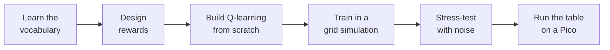

{:class="cover"}

---



Ahoy there makers! What if your robot could figure things out on its own?

Most robots we build follow instructions we wrote: "go forward, and if the distance is under 20 cm, turn right". That works brilliantly when we know exactly what the room looks like. Real floors are messy, though. Furniture shifts, a dog wanders through, someone leaves a bag in the hallway. Hardcoded routines break down fast.

Reinforcement learning (RL) takes a different approach. Instead of telling the robot what to do, we set up a **reward signal** and let it work out a strategy through **trial and error**. The same idea sits behind game-playing AIs, and at maker scale it needs nothing more exotic than a Python dictionary.

## Overview

This course teaches **tabular Q-learning**, the clearest form of reinforcement learning. There are no black-box layers: just a table of numbers, a handful of Python functions and a simulated robot that genuinely gets better with practice.

The path is:

We will be honest throughout about what this does and does not show. A Q-table on a toy grid is **not** how a real robot learns to walk, and by the end you will know exactly which parts of the idea carry over to real hardware and which do not.

The maths is kept gentle. Every formula appears first as a commented line of Python, and every symbol is explained the first time it appears.

## Course Content

- Why hardcoded behaviours struggle in messy environments
- The core vocabulary: agent, environment, state, action, reward
- Designing a reward function, and the loopholes agents find in bad ones
- Turning continuous sensor readings into discrete states
- Markov decision processes, just enough to be useful
- Discount factors and the Bellman idea
- Building a Q-table with a Python dictionary
- Exploration versus exploitation with epsilon-greedy
- The Q-learning update rule and the training loop
- Training in a grid-world simulation, then reading the learning curve
- The sim-to-real gap, and testing a policy with sensor noise
- Reading and filtering an HC-SR04 in MicroPython
- Running a trained Q-table on a Raspberry Pi Pico
- Where tabular learning runs out of road, and what deep RL does instead

## Key Results

After completing this course, you will:

- Understand the difference between programmed behaviour and learned behaviour
- Be able to write tabular Q-learning for a simple task
- Know how to represent a robot's world as states, actions and rewards
- Have trained a Q-table in simulation and watched it improve over hundreds of episodes
- Have run a trained policy on a Raspberry Pi Pico, if you build the robot
- Know where the idea stops being enough, and where to go next

## What you'll need

**For lessons 1 to 11 (simulation, runs on your computer):**

- A computer with a recent Python 3
- Nothing to install: everything uses the Python standard library
- A text editor, Thonny or VS Code. Short programs also run in the Run boxes on the page

**For lessons 12 and 13 (the real robot, optional):**

- Raspberry Pi Pico or Pico W with MicroPython installed
- L298N or similar H-bridge motor driver
- Two DC gear motors with wheels, and a chassis to hold them
- HC-SR04 ultrasonic sensor, plus a 1k and a 2k resistor for a voltage divider
- A battery pack for the motors (4 x AA is common)
- Jumper wires, and Thonny to copy files to the Pico

> If you have built a robot for the [MicroPython Robotics Projects](/learn/micropython_robotics/) course, that hardware is exactly what lessons 12 and 13 use, with the same pin numbers.

## Prerequisites

You should be comfortable with Python functions, loops and dictionaries:

- [Introduction to Python](/learn/python/) covers the Python we rely on
- [MicroPython Robotics Projects](/learn/micropython_robotics/) covers the motor and ultrasonic wiring used in the last two lessons

You do **not** need any machine-learning experience.

## How the course works

Each lesson teaches one idea and ends with exercises, common problems and a short quiz. Code blocks are complete programs unless they say otherwise, and the printed output you see is what you will get, because the examples fix their random seeds. Anything that varies from run to run is flagged.

Lessons 1 to 11 run on your computer as plain Python. Only lessons 12 and 13 are MicroPython for the Pico, and each of those says so at the top.

Look out for these callouts:

> **Note:** background or a reminder of something covered earlier.

> **Tip:** a practical suggestion.

> **Teachers**: classroom notes on timing, kit and things to watch for.

> **Teachers**: the course suits ages 14 and up, or any beginner who can write a Python function. Allow about 30 to 45 minutes per lesson. Lessons 1 to 11 need only a computer with Python (or a browser with the Run boxes), so a whole class can work with no hardware. The real-robot lessons 12 and 13 suit one robot per group of two to four learners, and can be skipped or run as a teacher demonstration.

Let's build a robot that can learn!
