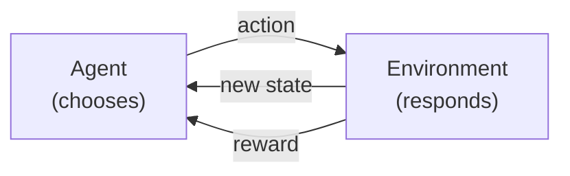

{:class="cover"}

---

By the end of this lesson you will be able to name the five parts of a reinforcement learning problem, point to each one on a robot, and write the loop that connects them.

---

Every field has its jargon, and reinforcement learning is no exception. The good news is that five terms cover almost everything, and each one maps onto something physical on your robot. We will use a BurgerBot-style robot throughout: two DC motors and an ultrasonic sensor on a Raspberry Pi Pico.

---

## The five core concepts

**Agent.** The decision-maker. On our robot it is not the whole program, only the part that takes in a sensor reading and returns a motor command.

**Environment.** Everything the agent is *not*: the arena, the wheels and floor, friction, and the sensor itself. The environment receives an action, changes, and hands back an observation and a reward. In our simulation it is a Python object. On the real robot it is the physical world.

**State.** A snapshot of the situation that the agent uses to decide. For us that will be a small label such as `"near"`, `"medium"` or `"far"` for what the sensor sees. The agent only knows what the state tells it.

**Action.** A choice the agent makes each time step, for example one of `"forward"`, `"turn_left"`, `"turn_right"` or `"stop"`.

**Reward.** A single number saying how good the last action was. Positive pushes the agent to repeat it, negative pushes it away. It is the only feedback the agent ever gets, so lesson 3 is devoted to designing it.

---

## The agent-environment loop

These five parts connect in a cycle that repeats thousands of times during training:



One **episode** is a single attempt, from the start until the goal is reached, the robot crashes, or a step limit runs out. Then the environment resets and a new episode begins.

---

## The loop in code

Here is a complete, runnable version. The environment is a five-cell corridor with the goal at the end, and the agent is deliberately clueless: it picks at random. A fixed seed makes the output repeatable.

```python
import random

ACTIONS = ["forward", "back"]


class Corridor:
    """The environment: a corridor of 5 cells with the goal at the far end."""

    def __init__(self):
        self.length = 5
        self.position = 0

    def reset(self):
        self.position = 0
        return self.position                      # the state

    def step(self, action):
        if action == "forward":
            self.position = min(self.position + 1, self.length - 1)
        else:
            self.position = max(self.position - 1, 0)
        done = self.position == self.length - 1   # reached the goal?
        reward = 10.0 if done else -1.0           # treat, or small cost per step
        return self.position, reward, done


def random_agent(state):
    """The agent: for now it ignores the state and picks at random."""
    return random.choice(ACTIONS)


random.seed(3)
env = Corridor()
state = env.reset()
total_reward = 0.0

for step in range(1, 101):
    action = random_agent(state)                  # agent decides
    next_state, reward, done = env.step(action)   # environment responds
    if step <= 5:
        print(f"step {step:2d}: state {state} -> {action:<7} -> state {next_state}, reward {reward:+.0f}")
    total_reward += reward
    state = next_state
    if done:
        break

print(f"Episode over after {step} steps, total reward {total_reward:+.0f}")
```

You should see:

```
step  1: state 0 -> forward -> state 1, reward -1
step  2: state 1 -> forward -> state 2, reward -1
step  3: state 2 -> back    -> state 1, reward -1
step  4: state 1 -> back    -> state 0, reward -1
step  5: state 0 -> forward -> state 1, reward -1
Episode over after 19 steps, total reward -8
```

The random agent wanders and finally stumbles onto the goal after 19 steps. A different seed gives a different episode, and learning will mean replacing `random_agent` with something that improves. Notice the shape of `step()`: it takes an action and returns `(next_state, reward, done)`. We will keep that shape for every environment in the course, including the grid world.

---

## Mapping to real hardware

| RL concept | On the real robot |
|---|---|
| Agent | The MicroPython control script |
| Environment | The arena, floor, wheels and sensor |
| State | A distance band from the ultrasonic sensor (near, medium, far) |
| Action | A motor command (forward, turn left, turn right, stop) |
| Reward | Defined by you; on a real robot it often needs extra sensing to measure |
| Episode | One run until the goal, a crash or a time limit |
{:class="table table-single"}

That reward row hides a catch. In simulation the reward is free, because the simulator knows when you hit something. On a real robot you need a bumper, a current spike or a person with a stopwatch to produce it. That is one reason we train in simulation and only *run* the finished policy on the robot.

> **Note:** the agent sees only the state, not the whole world. A forward-facing ultrasonic sensor says nothing about what is beside the robot. That is called **partial observability**, and we will meet it again in lesson 11.

---

## Try it Yourself

1. Change `random.seed(3)` to `random.seed(7)` and run again. How many steps does the random agent take now? Try five seeds and write down the numbers.
2. Change the reward so each non-goal step costs `-5` instead of `-1`. How does `total_reward` change, and does the agent behave differently?
3. Sketch the five parts for a different robot, such as a line follower or a robot arm that picks up a block. What are its states, actions and reward?
4. Challenge: make `random_agent` always return `"forward"`. What happens, and why is that agent not really *learning*?

## Common Issues

- **Problem**: I cannot tell whether the agent or the environment owns something.
- **Solution**: If the code *chooses* it, it belongs to the agent. If the code merely *observes or suffers* it, it belongs to the environment.
- **Why**: The split decides what goes inside `step()` and what the agent is allowed to see.

- **Problem**: My loop never ends.
- **Solution**: Add a step limit like `for step in range(1, 101)`, and make sure `done` becomes `True` somewhere.
- **Why**: An episode needs an ending, either a goal or a time limit, or training stalls on one run.

## Check your understanding


? What does the environment send back to the agent after each action?
- [ ] Only a reward
- [x] A new state and a reward
- [ ] The best action to try next
> The environment returns the new state and the reward. Choosing the action is the agent's job.

? Which of these is an episode?
- [ ] A single sensor reading
- [x] One attempt from the start until the goal, a crash or a step limit
- [ ] The whole training run
> An episode is one attempt. Training is made of many episodes.

? In the corridor example, why does the random agent take a different number of steps with a different seed?
- [x] It chooses its actions at random, so each seed gives a different wander
- [ ] The corridor gets longer
- [ ] The reward changes
> Only the agent's random choices change with the seed. The corridor and rewards stay the same.


---

Next up: designing the reward function, the signal that teaches your robot what "good" means.
