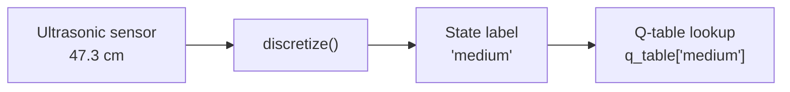

{:class="cover"}

---

By the end of this lesson you will be able to turn a continuous sensor reading into a small set of named states, and count how many states your robot's world has.

---

Sensors do not lie, but what they measure is a continuous number: centimetres, volts, degrees. A Q-table needs a *discrete* label it can use as a dictionary key. This lesson builds the bridge between the messy analogue world and the tidy world of a lookup table.



---

## The problem with raw values

An HC-SR04 ultrasonic sensor reports distances from about 2 cm to 400 cm. Used raw, that is hundreds of separate situations, and each would have to be visited many times before the agent learned anything about it. Worse, 37 cm and 38 cm would count as different situations although the right action is almost certainly the same.

The fix is **discretisation**: grouping nearby values into labelled bins.

---

## A discretise function

We will use three bands, **near**, **medium** and **far**. The thresholds below match the simulation we build later, where one grid cell is about 30 cm.

```python
def discretize(distance_cm):
    """Map a distance in centimetres to 'near', 'medium' or 'far'."""
    if distance_cm < 30:
        return "near"
    elif distance_cm < 90:
        return "medium"
    else:
        return "far"


for d in [5, 29.9, 30, 60, 89.9, 90, 150, 300]:
    print(f"{d:6.1f} cm  ->  {discretize(d)}")
```

Output:

```
   5.0 cm  ->  near
  29.9 cm  ->  near
  30.0 cm  ->  medium
  60.0 cm  ->  medium
  89.9 cm  ->  medium
  90.0 cm  ->  far
 150.0 cm  ->  far
 300.0 cm  ->  far
```

Testing the values either side of each boundary is a good habit. Off-by-one slips at `30` and `90` are easy to make and hard to spot later.

---

## What goes into a state?

On a simple grid the state can combine several facts into a **tuple**, which Python happily uses as a dictionary key:

```python
HEADINGS = ["north", "east", "south", "west"]
DISTANCE_BANDS = ["near", "medium", "far"]


def count_states(rows, cols, headings, bands):
    return rows * cols * headings * bands


print("5x5 grid, 4 headings, 3 bands:", count_states(5, 5, len(HEADINGS), len(DISTANCE_BANDS)))
print("7x7 grid, 4 headings, 3 bands:", count_states(7, 7, 4, 3))
print("Raw 16-bit distance x heading in 0.1 degrees:", 65536 * 3600)

# A tuple works as a dictionary key, so it can index the Q-table
q_table = {}
q_table[(2, 3, "east", "near")] = {"forward": -2.1, "turn_left": 0.4}
print(q_table[(2, 3, "east", "near")])
```

Output:

```
5x5 grid, 4 headings, 3 bands: 300
7x7 grid, 4 headings, 3 bands: 588
Raw 16-bit distance x heading in 0.1 degrees: 235929600
{'forward': -2.1, 'turn_left': 0.4}
```

A few hundred states is easy for a table. Nearly 236 million is not: it would need gigabytes and millions of episodes to fill. That is why discretisation is not a workaround but the right design for tabular learning.

---

## How many bins?

| Too few bins | Too many bins |
|---|---|
| Few states, so learning is quick | Many states, so each is visited rarely |
| Important differences are lost ("near" and "medium" need different actions) | Fine differences that change nothing, like 37 cm versus 38 cm |
| Jerky or unsafe behaviour | Training takes many more episodes |
{:class="table table-single"}

Three bands is a good start for obstacle avoidance. Try more only if you can name a decision that needs the extra detail.

> **Note:** our grid world treats the edges of the grid as obstacles, so a move off the grid counts as a collision and the robot stays where it was. That means no special "edge" states are needed.

---

## Try it Yourself

1. Change `discretize()` to four bands: `"very_near"` below 15 cm, `"near"` 15 to 30, `"medium"` 30 to 90 and `"far"` above. Write a test loop that checks values either side of every boundary.
2. Use `count_states()` to count the states for a 6 by 6 grid with 4 headings and your four bands. Is that still comfortable for a table?
3. A robot arm has two joints, each from 0 to 180 degrees. Decide how you would discretise each joint, and count the states. What granularity would you choose, and why?
4. Challenge: add a `"unknown"` band for a reading of `-1` (a sensor timeout). Decide what the robot should do in that state, and why.

## Common Issues

- **Problem**: My sensor gives negative or enormous numbers sometimes.
- **Solution**: Filter and clamp the reading before discretising. Lesson 12 shows how on the real sensor.
- **Why**: A timeout value is not a distance, and `discretize(-1)` would wrongly report "near" without telling you why.

- **Problem**: Should I put the robot's action history into the state?
- **Solution**: Not to begin with. Start with the current reading only.
- **Why**: Every extra fact multiplies the number of states, so training slows down. The next lesson explains when history is not needed.

- **Problem**: A reading exactly on a threshold lands in the wrong band.
- **Solution**: Decide which side owns the boundary (`<` or `<=`) and test it.
- **Why**: A 30.0 cm reading is "medium" here because `< 30` is false. Be deliberate about it.

## Check your understanding


? Why do we discretise the sensor reading before using it as a state?
- [ ] The sensor cannot measure centimetres
- [x] A table needs a small set of labelled states, not hundreds of nearly identical ones
- [ ] Python cannot store decimals
> Grouping nearby values into bands keeps the table small and lets the agent learn quickly.

? A 7 by 7 grid with 4 headings and 3 bands has how many states?
- [ ] 147
- [x] 588
- [ ] 84
> 7 x 7 x 4 x 3 = 588.

? What is the cost of using too many distance bands?
- [x] Each state is visited less often, so training takes longer
- [ ] The robot can no longer see obstacles
- [ ] The Q-table stops working
> More states means less experience per state.


---

Next up: why "the present state is all you need", the Markov property in plain English.
