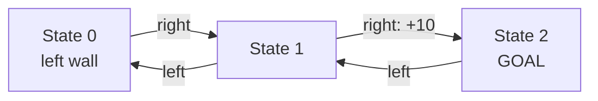

{:class="cover"}

---

By the end of this lesson you will be able to describe the Markov property, write a tiny problem as states, actions, transitions and rewards, and follow a policy through it in code.

---

You may have noticed something quietly assumed so far: when the agent chooses an action, it only looks at the *current* state, not at the history of states that led here. That seems almost too simple. Surely the robot should remember where it came from?

---

## The Markov property

The **Markov property**, named after the mathematician Andrey Markov, says:

> **The future depends only on the present, not on the past.**

More carefully: once you know the current state, knowing the whole history adds nothing about what happens next. For our robot that means "where I am, which way I face and what my sensor reads is all I need". The route I took to get here is already baked into the state.

This is a *modelling choice*, and it is true only when the state captures everything that matters. In the grid world it holds exactly: position, heading and the layout fully decide what `forward` does. On a real robot it holds only approximately. If the wheels slip or the battery sags, speed matters too, and a state without it is not quite Markov. We will return to that in lesson 11.

---

## The four parts of an MDP

A **Markov decision process (MDP)** is the framework that formalises everything so far:

| Part | Symbol | Our robot's version |
|---|---|---|
| States | S | Every combination of position, heading and distance band |
| Actions | A | forward, turn_left, turn_right, stop |
| Transitions | T(s, a) | Which state follows when you take action a in state s |
| Rewards | R(s, a) | The reward for that step |
{:class="table table-single"}

Q-learning is **model-free**: the agent never gets T or R as tables. It discovers their effects by acting. But writing a tiny MDP out in full is the best way to see what the agent is up against.



Here is that corridor as code, with a function that follows any policy and reports how it did. The same transition and reward tables could describe a robot in a three-cell hallway.

```python
import random

S = [0, 1, 2]                    # positions in the corridor, left to right
A = ["left", "right"]

# Transition table: T[state][action] = next state
T = {
    0: {"left": 0, "right": 1},      # at the left wall: cannot go further left
    1: {"left": 0, "right": 2},
    2: {"left": 1, "right": 2},      # the goal
}

# Reward table: R[state][action] = reward for taking that action
R = {
    0: {"left": -0.1, "right": -0.1},
    1: {"left": -0.1, "right": 10.0},    # stepping into the goal pays well
    2: {"left": -0.1, "right": -0.1},
}

GOAL = 2


def run_episode(policy, max_steps=100):
    """Follow a policy from state 0 and return (steps, total reward)."""
    state, total = 0, 0.0
    for step in range(1, max_steps + 1):
        action = policy(state)
        total += R[state][action]
        state = T[state][action]
        if state == GOAL:
            return step, total
    return max_steps, total


random.seed(5)
random_policy = lambda s: random.choice(A)
always_right = lambda s: "right"

steps, total = run_episode(always_right)
print(f"Always right: {steps} steps, reward {total:.1f}")

results = [run_episode(random_policy) for _ in range(1000)]
avg_steps = sum(r[0] for r in results) / len(results)
avg_reward = sum(r[1] for r in results) / len(results)
print(f"Random policy over 1000 episodes: {avg_steps:.1f} steps, reward {avg_reward:.1f}")
```

Output:

```
Always right: 2 steps, reward 9.9
Random policy over 1000 episodes: 6.1 steps, reward 9.5
```

A **policy** is simply a rule that maps each state to an action. "Always right" solves this corridor in two steps; the random policy needs about six on average (the exact figure wobbles slightly with the seed). On a 7 by 7 grid with obstacles the best policy is not obvious by inspection, and that is where learning earns its keep.

---

## Episodes and terminal states

An MDP run is split into **episodes**: a sequence of (state, action, reward) steps from a starting state to a **terminal state**, which is the goal or a crash. The environment then resets, but the agent **keeps its Q-table**. Everything learned in earlier episodes carries forward.

---

## Try it Yourself

1. Change `random.seed(5)` to other numbers and rerun. How much does the random policy's average step count move around? Is it close to 6?
2. Make the corridor five cells long with the goal at position 4. Update `S`, `T`, `R` and `GOAL`, and compare "always right" with the random policy again.
3. Add a trap at cell 2 of the five-cell corridor with a reward of -50 for entering it and an episode that ends there. How would a good policy change?
4. Challenge: for a 4 by 4 grid with 4 headings and 3 distance bands, work out the number of states and the number of state-action pairs. That is the biggest the Q-table can get.

## Common Issues

- **Problem**: Does the Markov property mean the robot can never use memory?
- **Solution**: Put whatever memory matters into the state, such as the last action taken.
- **Why**: If history matters, a state that includes it is Markov again, at the cost of more states.

- **Problem**: My robot's moves are not always the same, for example the wheels slip.
- **Solution**: Carry on. MDPs allow random transitions, and Q-learning averages over many tries of the same action.
- **Why**: The transition is then a probability, not a fixed rule, and repeated experience reveals the typical outcome.

- **Problem**: Do I have to write T and R tables before training?
- **Solution**: No. Q-learning learns from interaction, so the environment simply runs.
- **Why**: Q-learning is model-free, so the tables above are only for understanding.

## Check your understanding


? What does the Markov property say?
- [ ] The past is more important than the present
- [x] Once you know the current state, the history adds no extra information about what happens next
- [ ] The robot must remember every state it visited
> The state is supposed to carry everything relevant, so the history is not needed.

? What is a policy?
- [x] A rule that maps each state to an action
- [ ] A table of transition probabilities
- [ ] The reward at the goal
> A policy tells the agent what to do in each state.

? What is kept between episodes during training?
- [ ] Nothing, each episode starts blank
- [x] The agent's Q-table
- [ ] The robot's position
> The environment resets, but the knowledge in the Q-table carries over.


---

Next up: discount factors and the Bellman idea, and why a reward tomorrow is worth slightly less than the same reward today.
