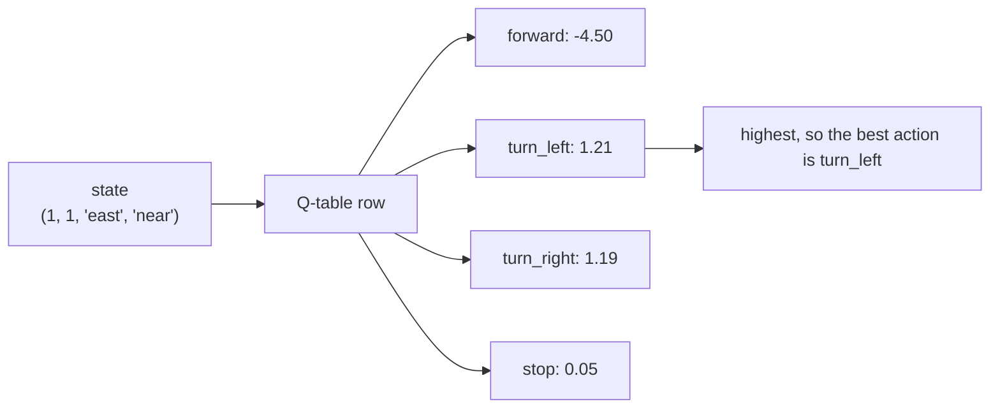

{:class="cover"}

---

By the end of this lesson you will be able to build a Q-table in Python, read the best action out of it, and save it to JSON and load it back.

---

We have talked about learning from rewards and discounting the future. Now we need somewhere to keep what the robot has learned. That place is the **Q-table**, and it is simpler than its name suggests.

---

## What is a Q-table?

**Q** stands for **quality**. The Q-table has one row per state and one column per action. Each cell holds one number: the agent's current estimate of the total discounted reward it will collect if it takes that action in that state and then acts well afterwards. We write one cell as `Q[state][action]`.



To act, the agent looks up its current state and picks the column with the biggest number. A big negative number on `forward` says "do not drive into that".

---

## Building and using it

We use a `defaultdict`, which creates a zeroed row the first time a new state is seen, so we never need to list every state in advance. Run this complete program, which also fills in a few values by hand so we can read the table.

```python
import ast
import json
from collections import defaultdict

ACTIONS = ["forward", "turn_left", "turn_right", "stop"]


def make_q_table():
    """An empty Q-table. Any new state starts with a Q-value of 0.0 per action."""
    return defaultdict(lambda: {action: 0.0 for action in ACTIONS})


def best_action(q_table, state):
    """Return the action with the highest Q-value in this state."""
    action_values = q_table[state]
    return max(action_values, key=lambda a: action_values[a])


def print_q_table(q_table):
    header = f"{'State':<26}{'forward':>8}{'turn_left':>11}{'turn_right':>12}{'stop':>7}"
    print(header)
    print("-" * len(header))
    for state, v in q_table.items():
        best = best_action(q_table, state)
        print(f"{str(state):<26}{v['forward']:>8.2f}{v['turn_left']:>11.2f}"
              f"{v['turn_right']:>12.2f}{v['stop']:>7.2f}   best: {best}")


q_table = make_q_table()
print(q_table[(0, 0, "north", "far")])      # a brand new state appears with zeros

# Pretend some training has happened by filling in a few values by hand
q_table[(1, 1, "east", "near")] = {
    "forward": -4.50, "turn_left": 1.21, "turn_right": 1.19, "stop": 0.05}
q_table[(1, 0, "east", "far")] = {
    "forward": 3.21, "turn_left": 0.42, "turn_right": 0.38, "stop": -0.10}

print()
print_q_table(q_table)

# Saving: JSON keys must be strings, so turn each tuple key into text
text = json.dumps({str(k): v for k, v in q_table.items()}, indent=2)
print("\nFirst line of the JSON:", text.splitlines()[1].strip())

# Loading: ast.literal_eval turns "(1, 1, 'east', 'near')" back into a tuple
loaded = {ast.literal_eval(k): v for k, v in json.loads(text).items()}
print("Round trip worked:", loaded[(1, 1, "east", "near")] == q_table[(1, 1, "east", "near")])
```

Output:

```
{'forward': 0.0, 'turn_left': 0.0, 'turn_right': 0.0, 'stop': 0.0}

State                      forward  turn_left  turn_right   stop
----------------------------------------------------------------
(0, 0, 'north', 'far')        0.00       0.00        0.00   0.00   best: forward
(1, 1, 'east', 'near')       -4.50       1.21        1.19   0.05   best: turn_left
(1, 0, 'east', 'far')         3.21       0.42        0.38  -0.10   best: forward

First line of the JSON: "(0, 0, 'north', 'far')": {
Round trip worked: True
```

Look at the first row. All four values are zero, so `max()` returns the **first** action in the dictionary, `forward`. Early in training that is just a tie, not a decision. Lesson 8 shows a way to break ties fairly.

> **Note:** the numbers in rows two and three are made up to show what a trained table looks like. A real one comes from the training loop in lesson 9.

---

## Saving as JSON

When training finishes we save the table so another program can use it. JSON keys must be text, so we write `str(k)` for each tuple key and use `ast.literal_eval()` to turn the text back into a tuple. Unlike `eval()`, it only accepts plain Python literals such as tuples and numbers, so it will not run arbitrary code hidden in a file.

To write to a file instead of a string, use `with open("q_table.json", "w") as f: f.write(text)`. For the real robot we will sidestep tuples altogether and use plain text keys, which keeps the Pico code simple (lesson 13).

---

## Try it Yourself

1. Add a state of your own to `q_table` with values of your choice, then call `best_action()` on it. Does it pick what you expected?
2. Add a `">>"` marker beside the best action in `print_q_table()`.
3. Write `q_table_bytes(q_table)` that returns `len(text.encode())` for the JSON text. How big would a full 7 by 7 table of 588 states be, roughly?
4. Challenge: make `best_action()` return a random one of the actions that tie for the highest value instead of always the first.

## Common Issues

- **Problem**: `json.dumps` fails with "keys must be str, int, float, bool or None".
- **Solution**: Convert tuple keys with `{str(k): v for k, v in q_table.items()}` first.
- **Why**: JSON object keys are always text, and a tuple is not.

- **Problem**: The table grows each time I look at a state.
- **Solution**: That is the `defaultdict` creating rows on first access. Use `state in q_table` to check without creating one.
- **Why**: Merely reading `q_table[state]` for a new state inserts a row of zeros.

- **Problem**: Q-values drift to huge numbers.
- **Solution**: Keep rewards moderate, such as -10 to +50, and the learning rate between about 0.05 and 0.5.
- **Why**: Large rewards and a large learning rate make estimates overshoot, as lesson 9 shows.

## Check your understanding


? What does one Q-table cell store?
- [ ] The number of times a state was visited
- [x] An estimate of the total discounted reward for taking an action in a state
- [ ] The reward from the last step only
> Q is the estimated quality of an action in a state.

? Why did `best_action` pick `forward` in the all-zero row?
- [ ] Forward is always best
- [x] All values tie, so `max()` returns the first one
- [ ] The state was a goal state
> With no information yet, ties go to the first action in the dictionary.

? Why do we write `str(k)` when saving to JSON?
- [x] JSON object keys must be text, not tuples
- [ ] To make the file smaller
- [ ] Because tuples are secret
> Tuples are not valid JSON keys, so we convert them to text.


---

Next up: epsilon-greedy exploration, the strategy that decides when to trust the table and when to try something new.
