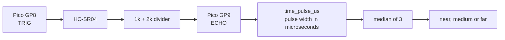

{:class="cover"}

---

By the end of this lesson you will be able to read an HC-SR04 on a Raspberry Pi Pico, filter its readings with a median of three, and turn each reading into the same `near`, `medium` or `far` label the simulator used.

---

This is the first lesson that runs on the **Pico**, in MicroPython. In training, `sense()` handed the robot a tidy label from a perfect model. On the real robot we have to produce the *same* labels from a real, noisy sensor. If the labels disagree, the Q-table we trained means nothing.

If you have not set up MicroPython on a Pico yet, start with the [MicroPython Robotics Projects](/learn/micropython_robotics/) course, whose ultrasonic lesson uses the same pins as here.

---

## Wiring

| HC-SR04 pin | Pico pin | Notes |
|---|---|---|
| VCC | 3.3 V for a 3.3 V sensor such as the HC-SR04P, or 5 V for a classic HC-SR04 | Check the sensor's markings |
| GND | GND | |
| TRIG | GP8 | Output from the Pico |
| ECHO | GP9 | Through the voltage divider below if the sensor runs at 5 V |
{:class="table table-single"}

A classic HC-SR04 runs at 5 V and its ECHO pin outputs 5 V, but the Pico's pins are only 3.3 V tolerant. A divider of 1k and 2k brings 5 V down to about 3.3 V:

```text
HC-SR04 ECHO ──┬── 1k ──── Pico GP9
               │
              2k
               │
              GND
```



> **Teachers**: the divider is the one place a wiring slip can damage a Pico, so check each group's ECHO wiring before power-up. A 3.3 V sensor needs no divider and is the safer choice for a class set.

---

## The complete sensor program

This program reads the sensor 20 times, filters each reading, and prints the distance and the band. Run it on the Pico in Thonny and wave your hand in front of the sensor. The thresholds are the ones from lesson 4 and the simulator: one grid cell was about 30 cm, so `near` is under 30 cm and `far` is 90 cm or more.

```python
from machine import Pin, time_pulse_us
from time import sleep_us, sleep_ms

TRIG = Pin(8, Pin.OUT)
ECHO = Pin(9, Pin.IN)

NEAR_CM = 30        # below this is "near"   (matches the simulator)
FAR_CM = 90         # this or more is "far"


def get_distance_cm():
    """Fire the sensor once. Returns centimetres, or -1.0 if no echo came back."""
    TRIG.low()
    sleep_us(2)
    TRIG.high()
    sleep_us(10)                          # a 10 microsecond trigger pulse
    TRIG.low()
    duration_us = time_pulse_us(ECHO, 1, 30000)   # wait up to 30 ms for the echo
    if duration_us < 0:
        return -1.0                       # timeout: no echo received
    return duration_us / 58.0             # sound travels about 1 cm per 58 us there and back


def get_distance_filtered():
    """Take three readings and return the middle one. Returns -1.0 if all failed."""
    readings = []
    for _ in range(3):
        d = get_distance_cm()
        if d > 0:
            readings.append(d)
        sleep_ms(20)                      # let the old echo die away
    if not readings:
        return -1.0
    readings.sort()
    return readings[len(readings) // 2]


def discretize_distance(distance_cm):
    """Map a reading to the same labels the simulator used."""
    if distance_cm < 0:
        return "near"                     # no echo: be cautious and assume something is close
    if distance_cm < NEAR_CM:
        return "near"
    if distance_cm < FAR_CM:
        return "medium"
    return "far"


for _ in range(20):
    d = get_distance_filtered()
    print(f"{d:6.1f} cm  ->  {discretize_distance(d)}")
    sleep_ms(200)
```

Typical output as a hand moves towards the sensor (your numbers will differ):

```
 112.4 cm  ->  far
  81.0 cm  ->  medium
  44.7 cm  ->  medium
  22.3 cm  ->  near
```

**Why a median?** One bad reading, from a stray reflection or a dropout, is common. The median of three throws away the odd one out, and costs only about 60 ms. The `d > 0` test also drops failed readings before sorting.

**Why does `-1.0` map to "near"?** When no echo arrives, the sensor has not seen the world: maybe the surface soaked up the sound. Treating that as "something is close" is the cautious choice, at the price of the occasional needless turn.

---

## Why there is no heading or position

In simulation the robot knew where it was and which way it faced. The reflex policy from lesson 11 uses neither. Its whole state is the band, so there is nothing to track and no drift to worry about. That is a deliberate trade: less capable, but it works with only the parts on the robot.

---

## Try it Yourself

1. Hold a ruler or tape measure next to the sensor and check readings at 10, 25 and 60 cm. How far off are they? Note the error for each.
2. Move your hand slowly towards the sensor and write down the distances where the band flips from `far` to `medium` and `medium` to `near`. Do they match 90 and 30?
3. Change `NEAR_CM` to 40 and rerun. Does the label flicker less when you hold a hand near 30 cm?
4. Challenge: add a rule that only accepts a new band if it appears twice in a row, to stop flicker at the boundaries (this is called hysteresis).

## Common Issues

- **Problem**: Every reading is `-1.0`.
- **Solution**: Check TRIG is on GP8 and ECHO on GP9, power and ground are connected, and the sensor's voltage matches its wiring.
- **Why**: `time_pulse_us` returns a negative number when it times out, which means no pulse ever arrived.

- **Problem**: Readings jump between about 3 cm and 400 cm.
- **Solution**: Move the sensor to the very front of the chassis with a clear view, and keep wires out of its beam.
- **Why**: Echoes bouncing off the robot's own body or wires arrive early, and the median filter cannot fix a repeatable bounce.

- **Problem**: The band flickers between `near` and `medium` at a boundary.
- **Solution**: Increase the delay between reads and require two agreeing readings before changing state.
- **Why**: A reading that hovers near 30 cm flips across the threshold with a little noise.

- **Problem**: The distances are a few per cent off even though the wiring is right.
- **Solution**: Measure against a ruler and adjust the `58.0` constant slightly, or accept the error.
- **Why**: Sound travels faster in warm air, about 58.3 microseconds per centimetre round trip at 20 C and about 60 at 0 C, so the constant is only approximate. That is a few per cent, not enough to matter for three bands.

## Check your understanding


? Why must the real thresholds match the ones used in training?
- [ ] The Pico is faster that way
- [x] The Q-table was trained on those labels, so different cut-offs would mean different situations
- [ ] MicroPython requires it
> The table maps labels to actions. If a label means something else on the robot, the action is wrong.

? What does the median of three readings do?
- [x] Throws away a single outlier reading
- [ ] Makes the sensor see further
- [ ] Doubles the range
> If one of three readings is wild, the middle value is still sensible.

? Why do we use a voltage divider on ECHO for a 5 V HC-SR04?
- [ ] To slow the pulse down
- [x] The Pico's pins are 3.3 V devices and the sensor outputs 5 V
- [ ] To improve accuracy
> 1k and 2k resistors bring 5 V down to about 3.3 V, which protects GP9.


---

Next up: loading the Q-table on the Pico and running the whole sense, decide and drive loop.
