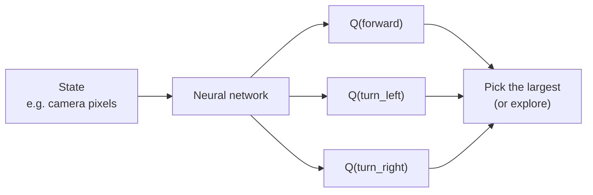

{:class="cover"}

---

By the end of this lesson you will be able to explain why a Q-table cannot scale to camera images, describe how a learned function replaces it, and say honestly what from this course carries over to real robots.

---

You have built something real: a robot running a policy it learned from experience. Tabular Q-learning is a complete, understandable solution when the state space is small enough for a dictionary. But what happens when it is not?

This lesson looks at where tables break down and what **deep reinforcement learning** does instead. We will not build a deep network here; that needs a proper framework. The aim is to understand what you would learn next.

---

## The scaling wall

Our grid world had 588 states. Now give the robot a camera instead of an ultrasonic sensor. Run this to see the size of the problem, and a first taste of the cure.

```python
import math

digits = int(4096 * math.log10(256)) + 1
print(f"A 64x64 greyscale camera image has a state space of 256^4096, a number with {digits} digits.")
print(f"Our 7x7 grid world has {7 * 7 * 4 * 3} states.")

# Table versus function: learn Q(forward) from distance readings
# Pretend experience: for each distance, the value of going forward is 3 * (d / 100) - 3
train_distances = [10, 20, 30, 40, 60, 70, 80, 90, 100]      # note: no 50 cm reading
true_q = lambda d: 3 * (d / 100) - 3

# 1. A table can only answer for distances it has seen
table = {d: true_q(d) for d in train_distances}

# 2. A tiny function q = w * x + b, nudged toward each example (gradient descent)
w, b, lr = 0.0, 0.0, 0.1
for _ in range(2000):
    for d in train_distances:
        x = d / 100
        error = (w * x + b) - true_q(d)
        w -= lr * error * x
        b -= lr * error

query = 50
print(f"\nAsked about {query} cm, which was never seen:")
print(f"  table says     {table.get(query, 0.0):+.2f}  (no row, so it guesses 0)")
print(f"  function says  {w * (query / 100) + b:+.2f}  (true value {true_q(query):+.2f})")
```

Output:

```
A 64x64 greyscale camera image has a state space of 256^4096, a number with 9865 digits.
Our 7x7 grid world has 588 states.

Asked about 50 cm, which was never seen:
  table says     +0.00  (no row, so it guesses 0)
  function says  -1.50  (true value -1.50)
```

A number with nearly 10,000 digits cannot be stored, and no robot could ever visit every such state. That is the wall. The second half shows the idea that gets around it: instead of one stored number per state, learn a **function** from state to value. A table has nothing to say about a 50 cm reading it never saw. The function answers sensibly, because similar inputs give similar outputs. We cheated here: the true relationship was a straight line, so a straight-line function fits it perfectly. Real problems are not that kind, which is why deep RL uses neural networks, flexible functions with millions of adjustable numbers.

---

## Deep Q-learning in one picture



This is a **Deep Q-Network (DQN)**. It takes a state and outputs one Q-value per action. It is trained with the very same target as lesson 9, in plain text: `target = reward + gamma * max(Q(next state))`. The loss is the squared gap between the network's prediction and that target, and gradient descent nudges the network's weights to shrink it. The idea is identical to what you wrote; only the storage is different.

Making that stable took extra tricks:

- **Experience replay**: store past steps in a buffer and train on random samples from it, which breaks the link between consecutive steps.
- **A target network**: a slow-moving copy of the network used to compute the target, so the target does not chase its own tail.
- **Convolutional layers**: layers designed for images that find useful visual features automatically.

DeepMind's 2013 paper showed this idea on a handful of Atari games, and their 2015 Nature paper (Mnih and colleagues) extended it to 49 games, reaching human-level or better scores on many of them, from raw screen pixels.

---

## The wider landscape

| Method | What it adds |
|---|---|
| Double DQN | Reduces Q-value overestimation |
| Dueling DQN | Separates "how good is this state" from "how much do the actions differ" |
| PPO | Learns a policy directly, and handles continuous actions such as motor torques |
| SAC | Off-policy learning with an entropy bonus, popular for continuous robot control |
| MuZero | Learns a model of the world and plans with it |
{:class="table table-single"}

For robot control with **continuous actions** (an exact motor torque rather than "turn left"), policy-gradient and actor-critic methods such as PPO and SAC are generally preferred over DQN.

---

## What carries over to real robots, and what does not

This is the honest part. A Q-table on a toy grid is **not** how a real robot learns to walk.

**What carries over:** the agent-environment loop, rewards and the trouble with reward hacking, exploration versus exploitation, the Bellman target, the need to test for the sim-to-real gap, and the habit of adding a hard safety override.

**What does not:**

- Real robot tasks have continuous states and actions, so a table is out.
- Learning from scratch on real hardware is slow and can break things. Researchers who teach legged robots to walk typically train in fast simulation with many parallel copies and heavy randomisation of the physics (a grown-up version of the noise we added in lesson 11), then transfer the result.
- Our tiny reflex policy is no cleverer than a hand-written rule. Learning pays off when the rules are too hard to write, not for a three-line `if`.

> **Note:** training a deep network on a Pico is not practical. Running a very small trained network on a microcontroller is possible with specialised tools, but that is beyond this course.

---

## Where to go next

The sibling course, [Reinforcement Learning with Gymnasium](/learn/gymnasium/), takes the same BurgerBot grid world onto the standard Gymnasium environment API and the Stable-Baselines3 library, so you can swap in neural-network agents. A good "hello world" for deep RL after that is the `CartPole` balancing task. You will also want NumPy (see the [Pandas and NumPy](/learn/pandas_and_numpy/) course) and, later, a framework such as PyTorch.

---

## Try it Yourself

1. In the program, change `query` to 5 and then 120. Both are outside the training range. How good is the function there, and is a table any better?
2. Change `true_q` to something curved, such as `lambda d: 3 * ((d / 100) ** 2) - 3`, and rerun. The straight line can no longer fit it perfectly. What does that tell you about why we need networks?
3. Write down three robot tasks and mark each "table is fine" or "needs a learned function". Explain your choices.
4. Challenge: read the first page of the 2015 Nature DQN paper. What did the authors claim was new?

## Common Issues

- **Problem**: A deep RL tutorial looks nothing like this course's code.
- **Solution**: Look for the same four ideas: a state, an action, a reward and a Bellman-style target.
- **Why**: The frameworks add networks, batches and replay buffers around an update that is the one you already know.

- **Problem**: I want to train a deep network on my Pico.
- **Solution**: Train on a computer, and treat the microcontroller as a place to run a small finished model, if at all.
- **Why**: Training needs far more memory and arithmetic than a Pico has.

- **Problem**: Should I always use deep RL for a real robot?
- **Solution**: No. Use rules or a small table when they work, and a learned function only when they cannot.
- **Why**: Deep RL costs training time, compute and tuning, and is harder to verify as safe.

## Check your understanding


? Why can a Q-table not handle camera images?
- [ ] Python dictionaries cannot hold images
- [x] The number of possible states is astronomically large, far beyond any table
- [ ] Cameras are too slow
> A 64 by 64 greyscale image has 256 to the power 4096 possible states, which no table could store.

? What does a DQN network replace?
- [ ] The reward function
- [x] The Q-table, by predicting a Q-value for each action from the state
- [ ] The environment
> The Bellman target is the same, but the values come from a function instead of a lookup.

? Which carries over from this course to real robot learning?
- [x] Rewards, exploration and testing for the sim-to-real gap
- [ ] Storing every state in a dictionary
- [ ] A four-action grid
> The ideas carry over. The tabular grid does not.


---

Next up: the summary, and a few ideas for where to take your robot next.
