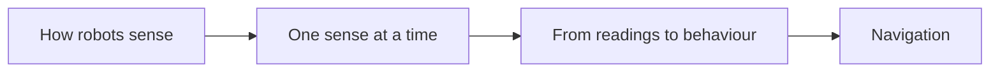

{:class="cover"}

---

Ahoy there makers! A robot with motors but no senses is just a toy car that can't see the wall. In this course we fix that. We take one small tracked robot and give it one sense at a time, until it can see, feel, speak, show a face and decide for itself what to do.

Watch the build video first, then come back and let's give it some senses.



---

## Overview

The robot is **Modulino SMARS**: the screwless SMARS chassis you may already know, with its brain swapped for an UnexpectedMaker FeatherS2 Neo and five Arduino Modulino modules clicked together with Qwiic cables. There is no soldering. Each module gives the robot one sense, and you'll learn each one in its own lesson.

The second half of the course lifts your eyes from a single robot to a whole room. We look at **wall following**, the classic way to get a robot through a maze, and then at the ideas behind **mapping and SLAM**, using Kev's Arduino Alvik maze project.

## Course Content

- **How robots sense**: the sense, think, act loop, the Modulino SMARS robot, Qwiic and I2C, and your first connection
- **One sense at a time**: distance, movement, sound, a light-up face, and the motors
- **From readings to behaviour**: thresholds, priorities, and a finished reactive robot
- **Navigation**: wall following, then mapping and SLAM with the Alvik maze project
- **Wrapping up**: troubleshooting and where to go next

## Key Results

After completing this course, you will:

- Explain the sense, think, act loop
- Connect Modulino sensors with Qwiic and find them with an I2C scan
- Read distance and movement in MicroPython, and handle a missing reading
- Drive a buzzer, an LED matrix face and two motors
- Turn readings into behaviour with thresholds and priorities
- Describe how wall following and SLAM work

## What you'll need

- A SMARS robot with its two N20 motors, or any small robot with two motors
- An UnexpectedMaker FeatherS2 Neo running MicroPython, or another board that has I2C
- Arduino Modulino Distance, Buzzer, Motors, LED Matrix and Movement, plus Qwiic cables
- A 9V battery for the motors and a LiPo battery for the board
- A computer with a MicroPython editor such as Thonny or [Snakie](https://www.snakie.org)
- Optional, for lessons 13 and 14: an Arduino Alvik and some cardboard walls

No hardware yet? The decision-making code in lessons 10, 11, 13 and 14 runs on its own with made-up readings, so you can follow the ideas first.

Before you start, these two courses help:

- [Robotics 101](/learn/robotics_101/)
- [Build a SMARS Robot](/learn/smars/)

## How the course works

**One robot, one sense per lesson.** Each lesson adds a sense, shows the code, and tells you what to try. By lesson 12 they all work together.

**Two kinds of code.** Hardware code imports the `modulino` library and needs the real robot. Decision code uses plain MicroPython and made-up readings, so it runs anywhere. We say which is which.

**The library comes from Arduino.** The `modulino` package is Arduino's own MicroPython library. We only use calls that Kev's [modulino_smars repository](https://github.com/kevinmcaleer/modulino_smars) uses. For anything else, check the official docs at [docs.arduino.cc](https://docs.arduino.cc/).

**Quizzes.** Four lessons end with a short quiz. Your score is kept in your browser.

**Mistakes are normal.** Every lesson has a Common Issues list. Lesson 15 gathers the big ones in one place.

Ready? Let's find out how a robot senses anything at all.
