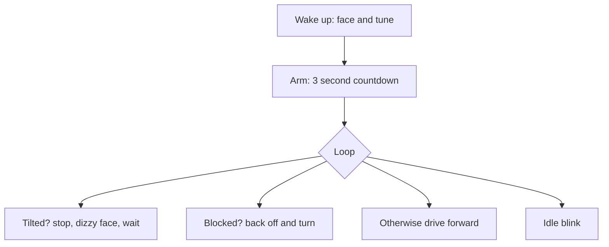

{:class="cover"}

---

This is the moment everything comes together. In this project, Modulino SMARS roams around, stops when something is in the way, backs off and turns, blinks when it's idle, and sits still with a startled face if you pick it up. It uses all five senses and the priority order from lesson 11.

It follows the demo from the video. Kev's finished version lives in the [modulino_smars repository](https://github.com/kevinmcaleer/modulino_smars), spread over several files. We're going to build one file you can read in one go.

## What you're building



## Before you run it

1. Run the scan from lesson 4 and check all five modules appear.
2. Test the motors with lesson 9 and fix your invert flags first.
3. Check your face is the right way up, and set `FLIP_X` and `FLIP_Y`.
4. Check which axis is pitch and which is roll on your robot. The program assumes Y is pitch and X is roll, as on Kev's robot.
5. Do the first run with the tracks off the ground.

## The program

Save this as `main.py` on the board. It's complete: every module, every helper and the main loop are here. `main.py` runs when the board powers up, which is why there is a countdown before the motors arm.

```python
from time import sleep_ms, ticks_ms, ticks_diff
from machine import I2C, Pin
from modulino import (
    ModulinoDistance,
    ModulinoBuzzer,
    ModulinoLEDMatrix,
    ModulinoMotors,
    ModulinoMovement,
)

# ---- Settings: change these for your robot ----
SCL_PIN = 9                 # FeatherS2 Neo I2C pins
SDA_PIN = 8
MATRIX_ADDRESS = 0x39

INVERT_LEFT = False         # flip if the robot spins instead of driving straight
INVERT_RIGHT = True
SPEED = 50                  # 0 to 100
REVERSE_MS = 200
TURN_MS = 600

STOP_DISTANCE_CM = 10
MAX_SENSIBLE_CM = 200
TILT_THRESHOLD_G = 0.35     # pitch is Y and roll is X on Kev's robot. Check yours.

FLIP_X = True               # both True if your face is upside down
FLIP_Y = True
ARM_SECONDS = 3
BLINK_EVERY_MS = 4200
BLINK_SHUT_MS = 120

# ---- Faces: # is a lit pixel ----
RESTING = (
    "............",
    ".####..####.",
    ".####..####.",
    ".####..####.",
    ".####..####.",
    "............",
    "............",
    "............",
)
BLINK = (
    "............",
    "............",
    "............",
    ".####..####.",
    "............",
    "............",
    "............",
    "............",
)
HAPPY = (
    "............",
    "..##....##..",
    ".#..#..#..#.",
    "............",
    ".#........#.",
    "..########..",
    "............",
    "............",
)
SURPRISED = (
    "............",
    ".####..####.",
    ".#..#..#..#.",
    ".#..#..#..#.",
    ".####..####.",
    "............",
    "............",
    "............",
)
ALERT = (
    "............",
    ".##########.",
    "..########..",
    "...######...",
    "............",
    "............",
    "............",
    "............",
)
DIZZY = (
    "............",
    ".#.#....#.#.",
    "..#......#..",
    ".#.#....#.#.",
    "............",
    "...######...",
    "............",
    "............",
)

STARTUP = ((523, 120), (659, 120), (784, 120), (1047, 260))

# ---- Hardware ----
i2c = I2C(0, scl=Pin(SCL_PIN), sda=Pin(SDA_PIN), freq=400_000)
distance = ModulinoDistance(i2c_bus=i2c)
buzzer = ModulinoBuzzer(i2c_bus=i2c)
matrix = ModulinoLEDMatrix(i2c_bus=i2c, address=MATRIX_ADDRESS)
motors = ModulinoMotors(i2c_bus=i2c)
movement = ModulinoMovement(i2c_bus=i2c)


# ---- See ----
def see():
    """Centimetres, or None when there is nothing usable."""
    try:
        d = distance.distance
    except (TypeError, OSError):
        return None
    if d is None or d > MAX_SENSIBLE_CM:
        return None
    return d


# ---- Measure ----
def tilt_direction():
    """'left', 'right', 'nose_up', 'nose_down', or None when level."""
    a = movement.acceleration
    if a.y > TILT_THRESHOLD_G:
        return "nose_down"
    if a.y < -TILT_THRESHOLD_G:
        return "nose_up"
    if a.x > TILT_THRESHOLD_G:
        return "right"
    if a.x < -TILT_THRESHOLD_G:
        return "left"
    return None


# ---- Show ----
def reverse(seq):
    """Reverse a tuple or string. MicroPython can't always slice with [::-1]."""
    return [seq[i] for i in range(len(seq) - 1, -1, -1)]


def show(face):
    rows = reverse(face) if FLIP_Y else face
    matrix.clear()
    for y, row in enumerate(rows):
        if FLIP_X:
            row = "".join(reverse(row))
        for x, cell in enumerate(row):
            if cell == "#":
                matrix.set_pixel(x, y)
    matrix.show()


# ---- Speak ----
def beep(freq, ms):
    buzzer.tone(freq, ms, blocking=False)


def play(melody):
    for freq, ms in melody:
        buzzer.tone(freq, ms, blocking=True)
        sleep_ms(20)
    buzzer.no_tone()


# ---- Move ----
def drive(left, right):
    """Each side from -100 to 100. Negative is backwards."""
    motors.invert_a = INVERT_LEFT != (left < 0)
    motors.invert_b = INVERT_RIGHT != (right < 0)
    motors.speed_a = min(100, abs(int(left)))
    motors.speed_b = min(100, abs(int(right)))


def stop():
    motors.stop()


# ---- Behaviours ----
def back_off():
    stop()
    show(SURPRISED)
    beep(440, 140)
    sleep_ms(250)
    show(ALERT)
    drive(-SPEED, -SPEED)
    sleep_ms(REVERSE_MS)
    drive(SPEED, -SPEED)          # spin to the right
    sleep_ms(TURN_MS)
    stop()
    show(RESTING)


def handle_tilt():
    stop()
    show(DIZZY)
    beep(1200, 80)
    while tilt_direction() is not None:   # wait to be put back down
        sleep_ms(120)
    show(HAPPY)
    beep(1400, 90)
    sleep_ms(350)
    show(RESTING)


def main():
    show(RESTING)
    show(SURPRISED)
    play(STARTUP)
    show(HAPPY)
    sleep_ms(400)
    show(RESTING)

    print("Arming motors in", ARM_SECONDS, "seconds. Ctrl-C to stay put.")
    for _ in range(ARM_SECONDS):
        show(ALERT)
        beep(660, 60)
        sleep_ms(150)
        show(RESTING)
        sleep_ms(850)

    last_blink = ticks_ms()
    shut_until = None

    try:
        while True:
            # 1. Measure: picked up or tipped? Safety comes first.
            if tilt_direction() is not None:
                handle_tilt()
                last_blink = ticks_ms()
                continue

            # 2. See: is anything in the way?
            d = see()
            if d is not None and d < STOP_DISTANCE_CM:
                back_off()
                last_blink = ticks_ms()
                continue

            # 3. Move: otherwise, carry on.
            drive(SPEED, SPEED)

            # 4. Show: an idle blink that never blocks the loop.
            now = ticks_ms()
            if shut_until is not None:
                if ticks_diff(now, shut_until) >= 0:
                    show(RESTING)
                    shut_until = None
            elif ticks_diff(now, last_blink) > BLINK_EVERY_MS:
                show(BLINK)
                shut_until = now + BLINK_SHUT_MS
                last_blink = now

            sleep_ms(50)
    except KeyboardInterrupt:
        print("Stopping.")
    finally:
        motors.release()
        buzzer.no_tone()
        matrix.clear().show()
        print("Motors released, buzzer quiet, panel clear.")


main()
```
{: .no-snakie }

This program needs Arduino's `modulino` library from lesson 4 and all five modules, so it can't be run on a bare board. Ctrl-C in the REPL stops it cleanly, and the `finally` block releases the motors and silences the buzzer.

## How it works

**Setup.** Every setting you might change is at the top. The five modules share one I2C bus, and the LED Matrix is given its address explicitly.

**Senses as small functions.** `see()` turns the sensor into a safe number or `None`. `tilt_direction()` turns the IMU into a word. `show()`, `beep()`, `play()` and `drive()` are the robot's actions. Each one is small enough to test alone with the lessons you've already done.

**The loop is the priority list.** The order is the order of importance: tilt, then obstacle, then drive. Everything else fits in the gaps.

**Nothing slow in the loop.** Beeps are non-blocking. The blink is two frames, drawn when it's due, using `ticks_ms()` and `ticks_diff()`. The only waits are inside the rare reactions, `back_off()` and `handle_tilt()`, where stopping first is the point.

**Always clean up.** The `finally` block releases the motors, silences the buzzer and clears the panel, even when something goes wrong.

## Differences from Kev's version

This version is simplified for learning. Kev's repository adds things such as attaching each module defensively so a loose cable doesn't stop the robot booting, drawing eyes from a Snakie `.spr` sprite, a motor setup wizard, a tilt mapping in `config.py`, and more expressions such as `LOOK_LEFT` and `LOOK_RIGHT`. Once this works, his code is a good next read.

## Try it Yourself

1. Change `STOP_DISTANCE_CM` to 20. How does the robot's behaviour change?
2. Draw your own `HAPPY` face and a `SAD` face.
3. Make the robot say `UH_OH` from lesson 7 when it backs off.
4. Challenge: use the hysteresis idea from lesson 10 so the robot only drives again when the distance is greater than 20 cm.
5. Challenge: use `motors.sensed_current` to notice a jammed track and stop with an alarm.

## Common Issues

**Problem**: The robot doesn't drive but everything else works.
**Solution**: Check the 9V battery is wired to `VIN` and `GND` on the Motors module.
**Why**: The motors have their own supply. Without it, only the logic is alive.

**Problem**: The robot spins on the spot.
**Solution**: Flip `INVERT_RIGHT`, or `INVERT_LEFT`, and test again.
**Why**: The two motors face opposite ways, so one side needs inverting.

**Problem**: The robot keeps backing off even in open space.
**Solution**: Print `see()` in the loop and look at the numbers.
**Why**: The sensor may be seeing the floor, a cable or the chassis. Mount it so it looks straight ahead.

**Problem**: It reports "left" when tipped right.
**Solution**: Swap the signs in `tilt_direction()`.
**Why**: How the Movement module is seated decides which way is positive.

**Problem**: It doesn't react to being lifted.
**Solution**: Lower `TILT_THRESHOLD_G` a little, and check Y really is pitch on your robot.
**Why**: If the axes are swapped, the program watches the wrong one.
