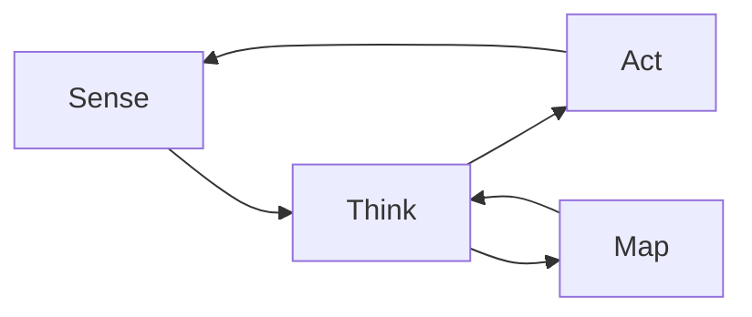

{:class="cover"}

---

You started with a tracked chassis that couldn't tell a wall from a wide open floor. You finished with a robot that sees, feels, speaks, pulls faces and decides what to do. You also learned how robots go beyond reacting, to following walls and building maps. That's a real leap.

## What you built

| Lesson | Sense or skill | What the robot gained |
|---|---|---|
| 5 | See | Distance in centimetres, and a safe way to handle `None` |
| 6 | Measure | Tilt, and an angle from integrating the gyroscope |
| 7 | Speak | Tones and tunes, without blocking |
| 8 | Show | A face on the LED matrix |
| 9 | Move | Driving, steering and current sensing |
| 10 | Think | Thresholds, hysteresis and states |
| 11 | Combine | A priority order for the senses |
| 12 | Project | A reactive robot with everything working together |
| 13 | Navigate | Wall following, and proportional control |
| 14 | Map | Maps, odometry drift and SLAM |
{:class="table table-single"}

## The ideas to keep

- **Sense, think, act.** Every robot runs this loop. The thinking is where the behaviour lives.
- **Name your bus.** On a board the library doesn't know, pass `i2c_bus=i2c`. The brain doesn't care who made the sensors.
- **Scan first.** The scan tells you whether a module is reachable before you suspect anything else.
- **Handle the empty reading.** `None` is a normal answer, not an error.
- **Use two thresholds.** Hysteresis stops flicker.
- **Put safety first.** The first rule that matches wins, so order your rules by importance.
- **Never block the loop.** A robot that is waiting is a robot that is blind.
- **Dead reckoning drifts.** Maps need a way to correct position errors. That is what SLAM is for.

## What's next

You have the senses. Now let's build on them.

- [Motors and Drivers](/learn/motors_and_drivers/) goes deeper on how robots move, so your behaviours get smoother.
- [Reinforcement Learning](/learn/reinforcement_learning/) lets a robot learn its own behaviour from rewards, instead of you writing every rule.
- [Learn ROS](/learn/learn_ros/) is the way into the mapping and navigation tools from lesson 14.
- [I2C and SPI](/learn/i2c_spi/) explains the buses underneath every sensor in this course.

Kev's code and write-ups are the best next read:

- The [modulino_smars repository](https://github.com/kevinmcaleer/modulino_smars) has the full robot, with sprites, a motor setup wizard and demos for every sense.
- The [alvik_maze repository](https://github.com/kevinmcaleer/alvik_maze) has the wall following, state machine and ROS2 code.

## A final challenge

Pick one sense and one behaviour you haven't built yet. Maybe the robot sings when it's happy, or it follows your hand at 15 cm, or it draws its own tiny map with a grid of readings. Build it, then send Kev a picture. The best way to learn robot senses is to give your robot a few more.

Happy making!
