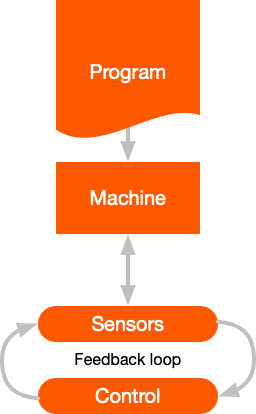

{:class="cover"}

---

By the end of this lesson you will be able to explain what makes a machine a robot, and name its four building blocks.

---

> *"A Robot is a machine, especially one programmable by a computer, capable of carrying out a complex series of actions automatically.*
> *Robots can be guided by an external control device or the control may be embedded within."*

## But what does this mean?

To understand that definition we need to look at the different parts of a robot:

* **Program** - A list of instructions for the machine - the complex series of actions
* **Machine** - The machine that processes the program and links to inputs - sensors, and outputs - controls
* **Sensors** - take measurements and provide readings to the machine
* **Controls** - moving parts that can be set by the machine

## A robot you already know

Think of a robot vacuum cleaner. Its **program** says "cover the floor and avoid the stairs". Its **machine** (a small computer) runs that program. Its **sensors** notice a wall, a chair leg or a drop. Its **controls** (the wheels and brushes) do the moving. Take away any one of the four and it struggles: without sensors it is blind, without a program it does nothing, and without controls it cannot act.

A simple toy car on a remote control is usually not called a robot. It has motors, but there is no program: a person makes every decision. A washing machine is closer, because it follows a program and reads sensors, but most people do not call it a robot. The definition also allows a robot to be guided by an external control device (a computer, say) as long as it is carrying out a program. The line is blurry, and people argue about it, so do not worry about being exact. Ask: does it sense, follow a program, and then act?

## Try it Yourself

1. Pick three machines in your home (a microwave, a toy, a thermostat). For each, list its program, sensors and controls, or write "none".
2. Which of your three is closest to a robot? Which is furthest away? Explain why.
3. Challenge: sketch a robot that waters a plant. What sensor does it need, and what is its control?

## Common Issues

- **Problem**: I cannot tell whether a machine counts as a robot.
- **Solution**: Check for all four parts: a program, a machine to run it, sensors and controls.
- **Why**: The definition says a robot carries out actions automatically from a program. A machine with no sensors or no program just follows a person's commands.

---

## Check your understanding


? Which part of a robot takes measurements and passes readings to the machine?
- [ ] Controls
- [x] Sensors
- [ ] The program
> Sensors measure the world (distance, light, temperature) and feed those readings to the machine so it can decide what to do.

? What is the program in a robot?
- [x] A list of instructions the machine carries out
- [ ] The battery that powers the motors
- [ ] The frame that holds everything together
> The program is the "complex series of actions" from the definition, written as instructions for the machine.

? A robot vacuum cleaner avoids a chair leg. Which part noticed the chair leg?
- [ ] The program
- [x] A sensor
- [ ] The wheels
> Sensors take measurements of the world and pass readings to the machine. The wheels are controls, and the program decides what to do next.

