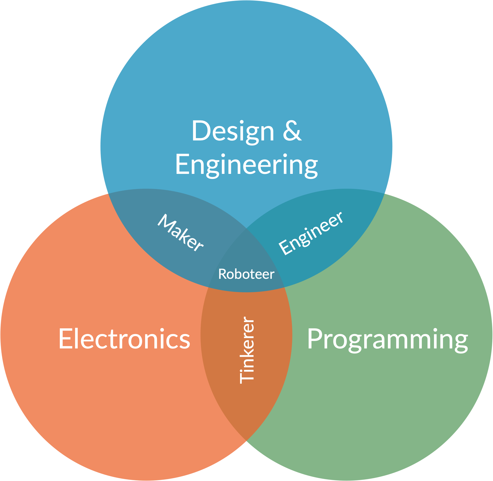
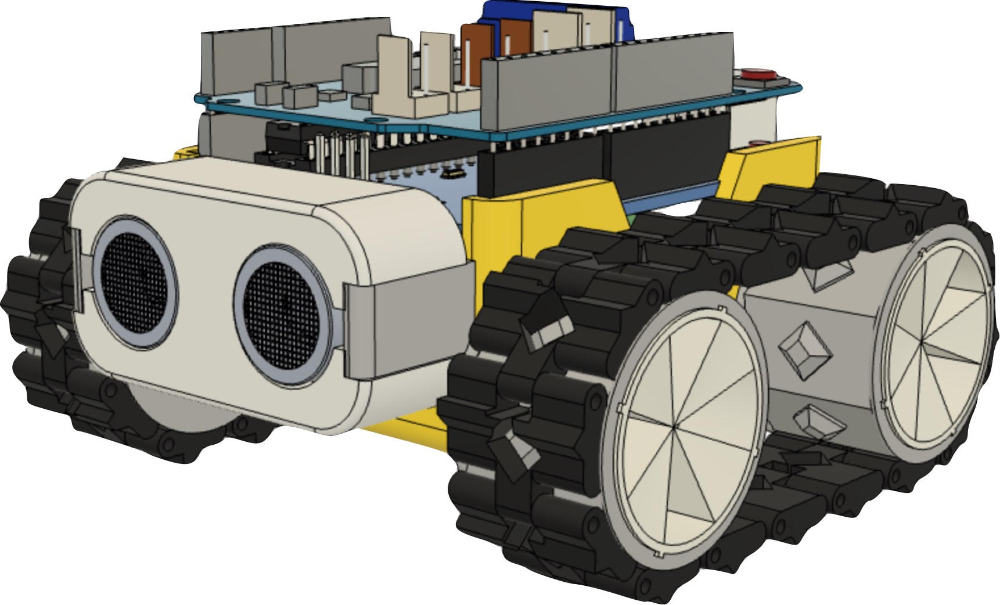
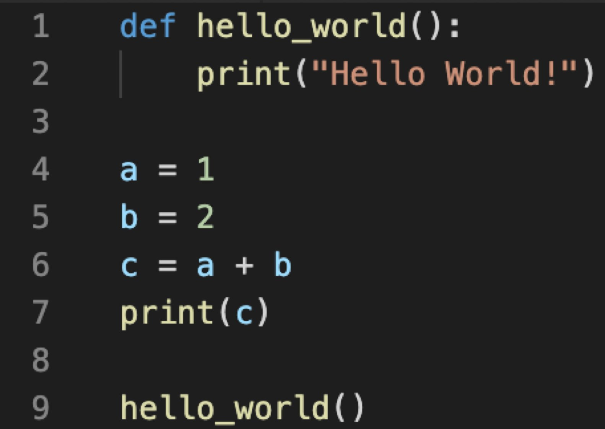

{:class="cover"}

---

By the end of this lesson you will be able to name the three skill areas behind every robot - design, programming and electronics - and give an example of each.

---

{:class="img-fluid w-50"}

[**Design**](#design--engineering) - Making the physical robot

[**Programming**](#programming) - Writing the code to control the robot

[**Electronics**](#electronics) - Send and receive signals to the sensors and motors 

---

## Design & Engineering

How to build a robot.

Building a robot requires:

- A design or blueprint
- Practical skills
- Materials & parts - wheels, filament, glue
- Tools & Machinery, a 3d printer
- Time, Patience and practice

SMARS is a 3D-printed robot, the designs can be found at:
<https://www.smarsfan.com>

{:class="img-fluid w-25"}

---

## Programming

**What is a program?**

- A program is a list of human-readable instructions for the computer to carry out
- A program is written in a computer language, such as Python, Javascript, C++
- Programs can also be constructed visually, using blocks in software such as Scratch

An example program, written in Python:

{:class="img-fluid w-25"}

---

## Electronics

How to wire up a robot
Electronics skills & Knowledge:

- How a circuit works
- Voltage, Current, Resistance
- Common components
- Batteries
- Connectors
- Protocols such as I2C, SPI, UART

SMARS uses off-the-shelf components, so is easy to wire up

{:class="img-fluid w-25"}

---

## Putting it together

Take a robot that stops before it bumps into a wall. **Design** gives it a body, a place to mount the distance sensor and wheels that grip. **Electronics** wires the sensor and motors to the brain and supplies power. **Programming** reads the sensor, decides "too close" and tells the motors to stop. If the robot crashes, you need all three skills to find out why: is the sensor loose (design), a wire off (electronics), or is the "too close" distance wrong (programming)?

You do not need to be good at all three before you start. Most makers begin with one and pick up the others as they build.

## Try it Yourself

1. Draw your own version of the Venn diagram. Put three robots you know (a robot vacuum, a toy, a robot from a film) in the area where you think their main skills overlap.
2. Write down a skill you already have (drawing, coding in Scratch, fixing bikes). Which of the three areas does it belong to?
3. Challenge: choose one skill area and list five things you would like to learn in it.

## Common Issues

- **Problem**: I feel I need to learn everything before I can build a robot.
- **Solution**: Start with a kit such as SMARS, where the design and the wiring are already worked out, and learn the rest a step at a time.
- **Why**: Robots are built from small, separate skills. A kit lets you practise one while the others are done for you.

> **Teachers**: Building robots brings in real hazards, covered properly in the follow-on courses: 3D printers have hot parts and moving parts, soldering irons are hot enough to burn, and craft knives and drills cut. This lesson only talks about them. If you go on to build, plan adult supervision, eye protection and a tidy bench, and check your school's rules for 3D printers and soldering.

## Check your understanding


? Which three skill areas come together when you build a robot?
- [ ] Drawing, music and maths
- [x] Design, programming and electronics
- [ ] Welding, painting and soldering
> Design builds the body, programming gives it instructions, and electronics connects the brain to its sensors and motors.

? Which of these is an electronics protocol a robot might use to talk to a sensor?
- [ ] HTML
- [x] I2C
- [ ] PLA
> I2C (along with SPI and UART) is a common way for a microcontroller to talk to sensors and other chips. PLA is a 3D printing filament!

? A robot keeps bumping into walls even though its sensor works. Which skill area do you check first for the "too close" decision?
- [ ] Design, because of the shape of the body
- [x] Programming, because the code decides what to do with the sensor reading
- [ ] Electronics, because of the battery
> Programming is the area that writes the instructions, including what to do when the sensor reading says something is close.

