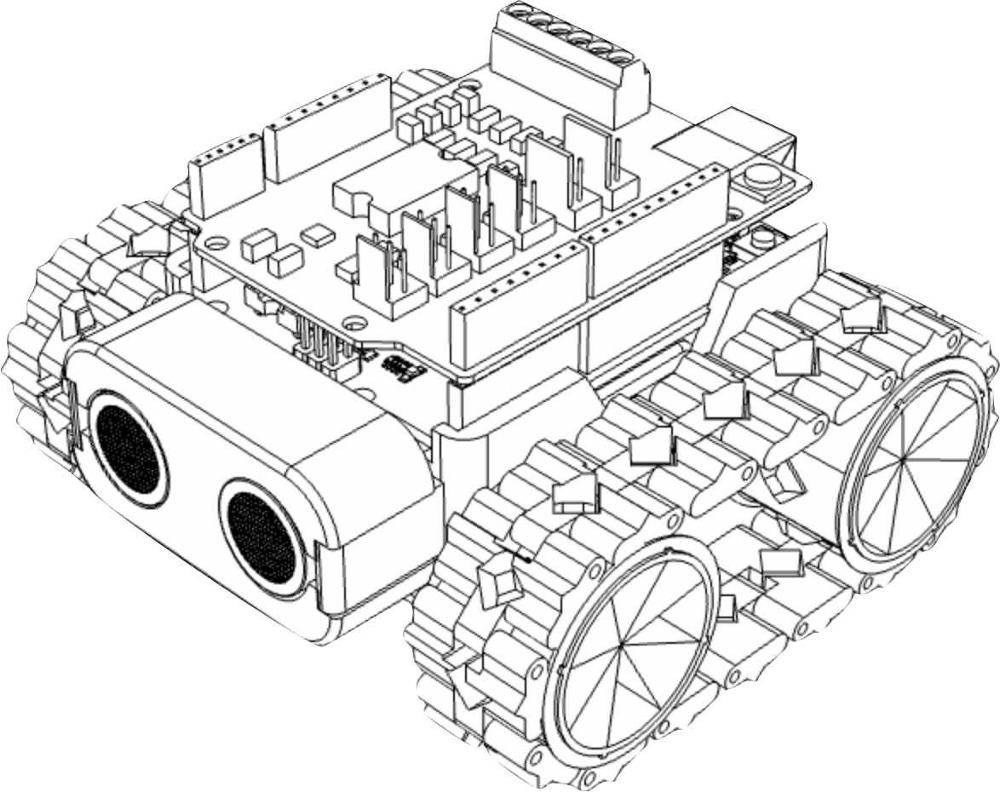
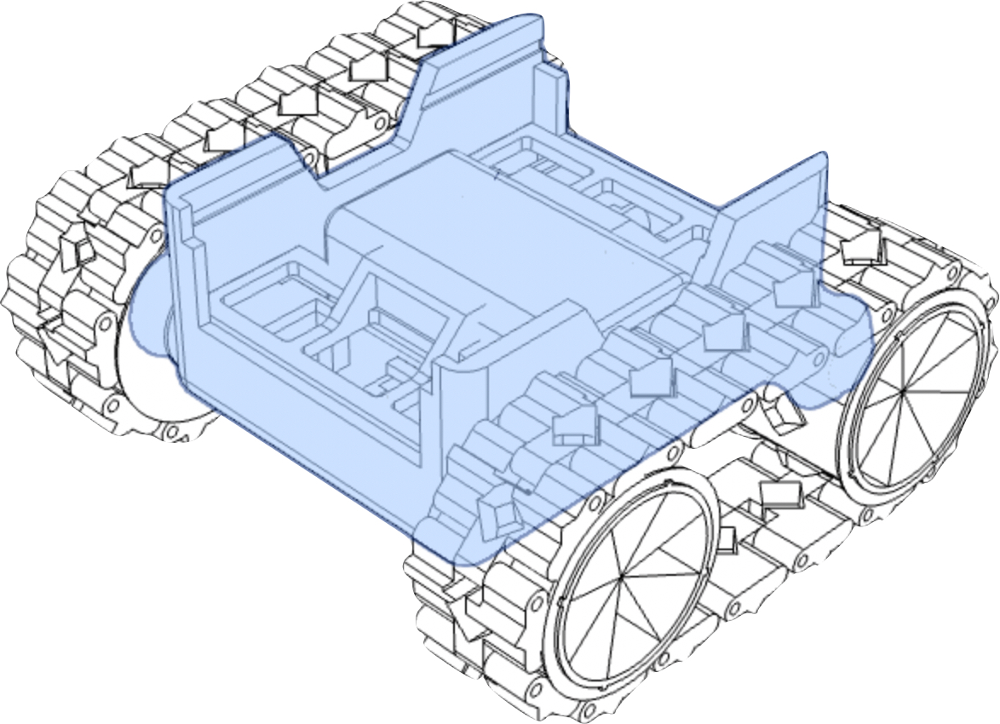
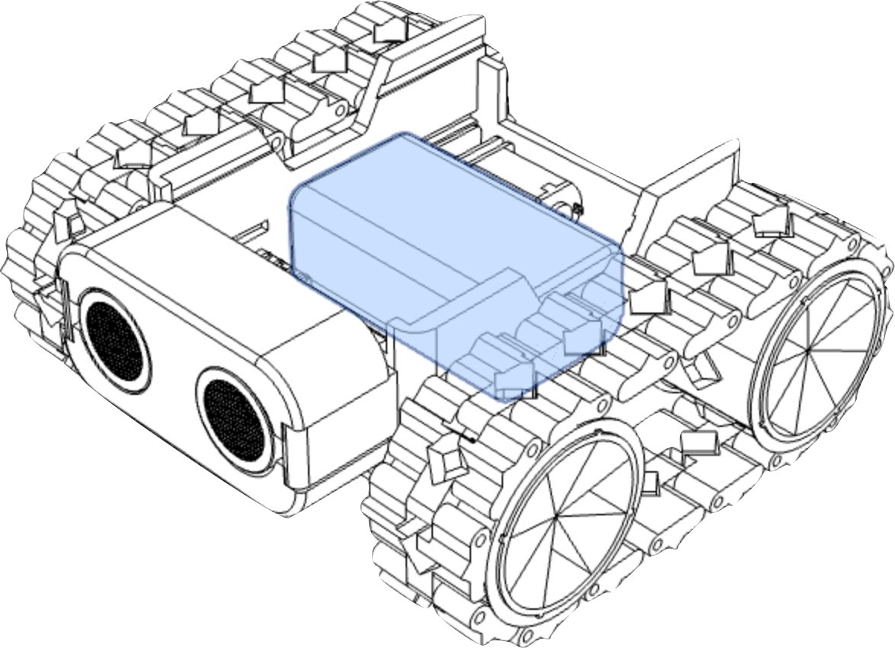
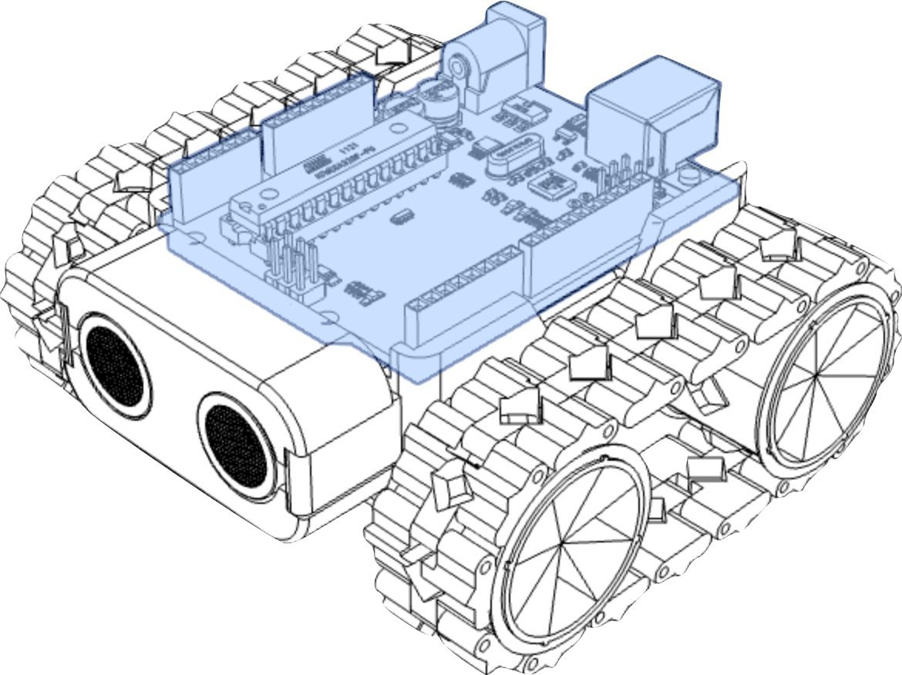
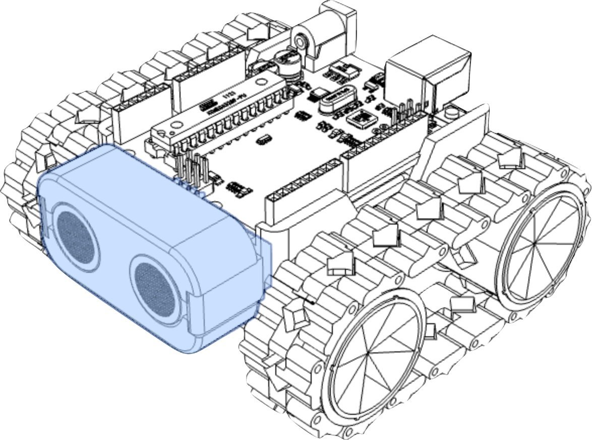
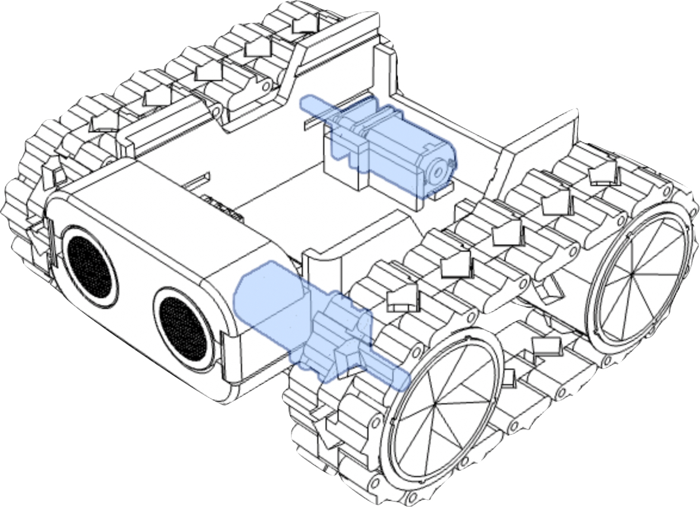
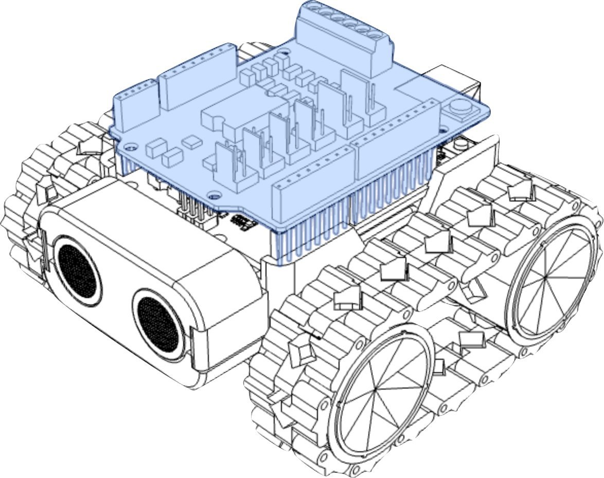
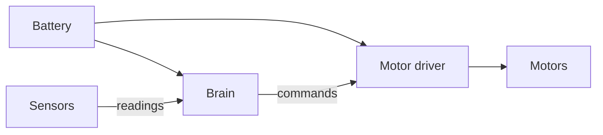

{:class="cover"}

---

By the end of this lesson you will be able to name the main parts of a robot and say what each one does.

---

Robots are made up of lots of different parts, for example:

- A [brain](#the-brain-processor) (Processor)
- A [body](#the-body) (Chassis)
- A [power source, or battery](#the-battery)
- [Sensors](#the-sensors)
- [Motors](#the-motors) (Or [Actuators](/resources/glossary#actuator))
- [Motor driver](#the-motorshield)

{:class="img-fluid w-25"}

---

### The Body

Houses all the parts

Robots need somewhere to house the different parts, and keep dust and dirt out of the inside of the robot:

- The Brain
- The Power source
- The Motors
- The Sensors

{:class="img-fluid w-25"}

---

### The Battery

Provides power, when the robot is not connected to an external power supply.

Robots need a battery to power the electronics including:

- **The Brain**, so it can ‘think’ and run programs
- **The Motors**, so it can move and react
- **The Sensors**, so it can feel, see and hear

SMARS is powered by a 9V battery

{:class="img-fluid w-25"}

---

### The Brain (Processor)

Runs programs, connects to sensors and motors

- Most robots have a computer or micro-controller to perform the instructions from the program
- The ‘brain’ could just be a simple circuit, without a central processing unit (CPU)
- Common microcontrollers include:
  - BBC micro:bit
  - Raspberry Pi Pico
  - Arduino Uno
  - NodeMCU (ESP8266)

  SMARS uses an Arduino Uno for its brain

{:class="img-fluid w-25"}

---

### The Sensors

Provides information about the outside world to the Robot:

- Robots need sensors to detect, measure and provide input to the brain so it can make decisions
- Common sensors include:
  - Switches and buttons
  - Range finders
  - Temperature, Humidity sensors
  - Infrared & Ultrasonic sensors
  - Lasers
  - Cameras
  - Microphones

  SMARS uses an [ultrasonic range](/resources/glossary#ultrasonic) finder to ‘see’

{:class="img-fluid w-25"}

---

### The Motors

Enable the robot to move around

- Robots use outputs, such as Motors to move around and interact with their environment
- Motors rotate at a set speed and direction
- Turning the motors in the same direction moves the robot forward or backward
- Turning the motors in opposite directions rotates the robot

SMARS uses two motors to move about

{:class="img-fluid w-25"}

---

### The Motorshield

Also known as a motor driver; it enables the robot to power the motors:

- A Motorshield switches the battery's power to the motors, under the brain's control - the motors need much more current than the brain's pins can supply
- Motorshields can also bring extra outputs such as a buzzer
- The motorshield sits on top of the Arduino and the connector pins push into the header pins on the Arduino

SMARS uses a motorshield to power and control the motors

{:class="img-fluid w-25"}

---

## How the parts work together

The battery feeds the brain, the sensors and, through the motor driver, the motors. The sensors send readings to the brain, and the brain sends commands to the motor driver, which switches the motors.

The body holds the whole lot together. On SMARS, the body is the 3D-printed chassis with the tracks.

## Try it Yourself

1. Look at a toy or gadget with a battery. Find the part that is its battery, brain, sensors and motor, if it has them.
2. Sketch a two-wheeled robot from above. Mark which way each motor turns to drive forward, turn left, and spin on the spot.
3. Challenge: choose a sensor from the list in this lesson and a job for it, such as "stop when something is close". Describe what the brain should do when the sensor reports it.

## Common Issues

- **Problem**: The brain runs, but the motors do not move.
- **Solution**: Check that the motor driver is powered, and connected to the brain and the motors.
- **Why**: The brain's pins cannot supply enough current to turn a motor, so the motors only move when the driver switches power from the battery.

- **Problem**: A robot with two motors drives in a circle instead of straight.
- **Solution**: Check that both motors turn the same way for forward, and that both are getting the same power.
- **Why**: Turning the motors in opposite directions rotates the robot, and unequal power makes it curve.

> **Teachers**: Keep batteries away from metal objects that can join the two terminals together: a shorted battery gets hot quickly. Do not mix old and new batteries, and charge rechargeable cells only with a matching charger. In the SMARS course, a soldering iron is used to attach wires to the motors, so plan supervision and ventilation for that session, and check your school's rules on 3D printers and soldering.

## Check your understanding


? Why does a robot need a motor driver (motorshield)?
- [ ] To store the program
- [x] Motors need much more power than the brain can supply directly
- [ ] To measure distance
> The brain's pins can only supply a tiny current. The motor driver switches the bigger current the motors need.

? How does a two-wheeled robot like SMARS turn on the spot?
- [ ] By turning both motors in the same direction
- [x] By turning the motors in opposite directions
- [ ] By stopping both motors
> Same direction moves it forward or backward. Opposite directions spin it around.

? What does SMARS use to "see"?
- [ ] A camera
- [ ] A microphone
- [x] An ultrasonic range finder
> The ultrasonic sensor sends out a pulse of sound and times the echo to work out how far away things are.

? Which part provides the electricity for the brain, sensors and motors when the robot is not plugged in?
- [ ] The body
- [x] The battery
- [ ] The sensors
> The battery powers the brain, the motors and the sensors, so the robot can move around without being plugged in.

