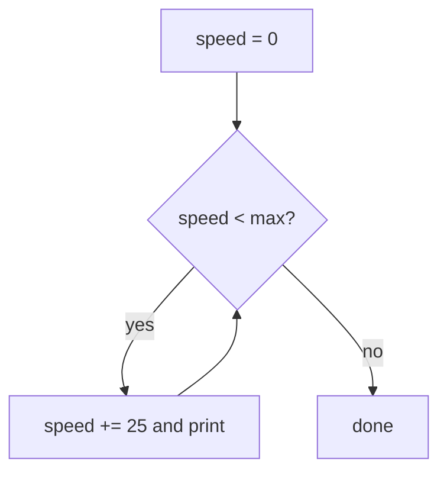

{:class="cover"}

---

By the end of this lesson you will be able to declare variables, choose basic types, and write functions, `if` and loops in Rust.

---

## A speed controller to start with

Let's build a tiny program that ramps a robot's speed up in steps and says how fast it is going. Save this as `src/main.rs` in a new Cargo project and run it with `cargo run`:

```rust
fn describe_speed(speed: i32) -> &'static str {
    if speed == 0 {
        "stopped"
    } else if speed < 50 {
        "crawling"
    } else {
        "cruising"
    }
}

fn main() {
    let max_speed: i32 = 100; // never changes, so no `mut`
    let mut speed = 0; // changes, so it needs `mut`

    while speed < max_speed {
        speed += 25;
        println!("speed {} is {}", speed, describe_speed(speed));
    }

    let distance_cm = 42.5; // the compiler infers f64
    let battery_ok = true;
    let sensor_id: u8 = 3;
    println!("sensor {} sees {} cm, battery ok: {}", sensor_id, distance_cm, battery_ok);

    // Shadowing: reuse a name for a new value, even of a new type
    let reading = "512";
    let reading: i32 = reading.parse().unwrap();
    println!("reading plus one is {}", reading + 1);

    for sweep in 0..3 {
        println!("sweep {}", sweep);
    }
}
```

It prints:

```text
speed 25 is crawling
speed 50 is cruising
speed 75 is cruising
speed 100 is cruising
sensor 3 sees 42.5 cm, battery ok: true
reading plus one is 513
sweep 0
sweep 1
sweep 2
```

## Variables are immutable by default

**What it does:** `let` creates a variable. Once set, it cannot change unless you write `let mut`.

**Real-world robot example:** `max_speed` is a limit that should never change, so it has no `mut`. `speed` changes every loop, so it does.

**Why this matters:** If a value cannot change, no other part of your robot code can change it by accident.

**Common mistake:** forgetting `mut`. This fails to compile:

<!-- code-check: skip -->
```rust
let speed = 0;
speed += 25;
```

The compiler says:

```text
error[E0384]: cannot assign twice to immutable variable `speed`
  |
2 |     let speed = 0;
  |         ----- first assignment to `speed`
3 |     speed += 25;
  |     ^^^^^^^^^^^ cannot assign twice to immutable variable
  |
help: consider making this binding mutable
```

The fix is in the message: `let mut speed = 0;`.

## Types

Rust is statically typed, but it can usually work out the type from the value, so you do not always have to write it.

| Type | What it holds | Robot example |
| --- | --- | --- |
| `i32` | Whole number, positive or negative | Motor speed from -100 to 100 |
| `u8` | Whole number 0 to 255 | Servo angle, sensor ID |
| `f32`, `f64` | Decimal number | Distance in cm |
| `bool` | `true` or `false` | Battery OK? |
| `&str` | A piece of text | A status message |
{:class="table table-single"}

You can write `let sensor_id: u8 = 3;` to be explicit. Rust never converts between number types behind your back: adding an `i32` to an `f32` is an error, and you must convert with `as`, for example `speed as f32`.

## Functions and control flow

Functions list their parameter types and return type: `fn describe_speed(speed: i32) -> &'static str`. The last expression, with no semicolon, is the value returned. In `describe_speed`, `if` is an expression too, so each branch produces the text that comes back.

Conditions need no brackets, but the braces are required. Loops are `while condition`, `for x in 0..3` (0, 1, 2) and `for x in 0..=3` (0, 1, 2, 3). Python needs indentation here. Rust needs braces. Indentation is only for readability, and `cargo fmt` tidies it up (lesson 9).



## Try it Yourself

1. Change the step from 25 to 10 and run again. How many lines print now?
2. Add a speed band `speed < 90` called `"fast"` to `describe_speed`.
3. Add a `let mut battery = 100;` and make the loop subtract 5 each time. Print it with the speed.
4. Challenge: write a function `fn is_obstacle(distance_cm: f32) -> bool` that returns true when the distance is under 20.0, and call it from `main`.

## Common Issues

- **Problem**: `mismatched types: expected i32, found f64` (or similar).
- **Solution**: Make the types agree. Write `5.0` for decimals, or convert with `as`.
- **Why**: Rust does not mix number types silently, because a hidden conversion in a motor calculation could hide a bug.

- **Problem**: A function returns `()` when you wanted a number.
- **Solution**: Remove the semicolon from the last line, or write `return value;`.
- **Why**: A line ending in `;` is a statement, which produces no value. The last line without it is the value returned.

## Check your understanding


? What does a plain `let x = 5;` give you?
- [ ] A variable you can change
- [x] A variable that cannot be changed
- [ ] A constant shared by the whole program
> Variables are immutable by default. Add `mut` to allow changes.

? Which loop runs for the values 0, 1 and 2?
- [ ] `for i in 0..=3`
- [x] `for i in 0..3`
- [ ] `while i == 3`
> `0..3` stops before 3. `0..=3` includes 3.

? What makes a function return a value?
- [ ] A `print!` call
- [x] Its last expression, written without a semicolon
- [ ] The `mut` keyword
> A trailing semicolon turns an expression into a statement with no value.

