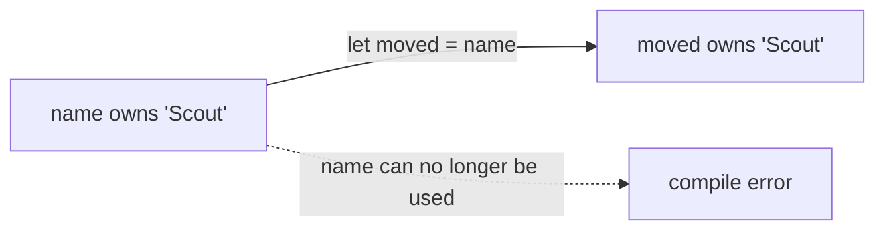

{:class="cover"}

---

By the end of this lesson you will be able to explain the three ownership rules, and use `&` and `&mut` to lend a value without giving it away.

---

## Who owns the data?

Ownership is the idea that makes Rust different. Think of a robot's log file. If you hand the only copy to a friend, you no longer have it. Rust treats data the same way. The rules are:

1. Every value has one **owner**, a variable.
2. There can only be one owner at a time.
3. When the owner goes out of scope, the value is dropped (its memory is freed).

The compiler checks these rules while compiling, so they cost nothing when your program runs.

Here is a complete program that shows ownership, borrowing and a lifetime:

```rust
fn describe(name: &String) -> usize {
    println!("describing {}", name);
    name.len()
}

fn add_entry(log: &mut String, entry: &str) {
    log.push_str(entry);
    log.push('\n');
}

fn longest<'a>(a: &'a str, b: &'a str) -> &'a str {
    if a.len() >= b.len() { a } else { b }
}

fn main() {
    let name = String::from("Scout");
    let length = describe(&name); // borrow: we still own `name`
    println!("{} has {} letters", name, length);

    let mut log = String::new();
    add_entry(&mut log, "boot");
    add_entry(&mut log, "wheels ok");
    print!("{}", log);

    let moved = name; // ownership moves to `moved`
    println!("now owned by moved: {}", moved);

    println!("longer name: {}", longest("Scout", "Rover"));
}
```

Output:

```text
describing Scout
Scout has 5 letters
boot
wheels ok
now owned by moved: Scout
longer name: Scout
```



## Moving

`let moved = name;` does not copy the text. It **moves** it: `moved` is now the owner and `name` is finished. Small fixed-size values such as numbers and booleans are the exception: they are simply copied, so `let b = a;` leaves `a` usable.

Using a moved value is the first error every Rust learner meets:

<!-- code-check: skip -->
```rust
let name = String::from("Scout");
let moved = name;
println!("{} and {}", name, moved);
```

```text
error[E0382]: borrow of moved value: `name`
  |
2 |     let name = String::from("Scout");
  |         ---- move occurs because `name` has type `String`, which does not implement the `Copy` trait
3 |     let moved = name;
  |                 ---- value moved here
4 |     println!("{} and {}", name, moved);
  |                           ^^^^ value borrowed here after move
```

**Why this matters:** two owners of the same memory would both try to free it, which is a classic bug in C. Rust rules it out at compile time.

## Borrowing

Often you just want to look at a value, not own it. A **reference**, written `&`, borrows it. In `describe(&name)` the function looks at the text and gives it back untouched, so `name` is still ours afterwards.

To change a borrowed value, take a **mutable reference** with `&mut`, as `add_entry(&mut log, ...)` does. The borrowing rules are:

- Any number of `&` references **or** exactly one `&mut`, never both at once.
- References must always point at something that still exists.

Why? If two parts of your code could change the same sensor reading at once, you would get confusing bugs. Rust stops that before it exists.

## Lifetimes in one minute

A lifetime says how long a reference is valid. Usually the compiler works it out. The `'a` in `longest<'a>` tells it that the returned reference lives no longer than the two it was given. You will not write many lifetimes early on, but when you see `'a`, read it as "these references are linked".

## Try it Yourself

1. Run the program, then change `describe(&name)` to `describe(name)`. What does the compiler say, and why?
2. Create the move error on purpose, read it, and fix it with `.clone()` as the compiler suggests.
3. Write `fn shout(text: &mut String)` that adds `"!"` to the end of the text, and call it on a `let mut` string.
4. Challenge: try to hold two `&mut` references to the same string at once, and read the error.

## Common Issues

- **Problem**: `borrow of moved value`.
- **Solution**: Borrow with `&` instead of passing the value, or use `.clone()` if you really need a second copy.
- **Why**: Passing a `String` by value moves ownership into the function, so the caller cannot use it afterwards.

- **Problem**: `cannot borrow as mutable` when you try to change something.
- **Solution**: Declare it `let mut` and pass `&mut value`.
- **Why**: Borrowing mutably needs the original to be mutable too.

- **Problem**: Cloning everything to silence errors.
- **Solution**: Try borrowing first and clone only when two owners are genuinely needed.
- **Why**: Clones copy data, which wastes memory and time, and on a microcontroller memory is scarce.

## Check your understanding


? What happens to a `String` after `let b = a;`?
- [ ] Both `a` and `b` own it
- [x] Ownership moves to `b`, and `a` can no longer be used
- [ ] It is deleted
> A move transfers ownership. The old variable is no longer valid.

? Which borrows are allowed at the same time?
- [x] Many `&` references, or exactly one `&mut`
- [ ] One `&` and one `&mut`
- [ ] Any number of `&mut`
> Rust allows many readers or one writer, never both.

? When is a value dropped?
- [ ] When the program exits
- [x] When its owner goes out of scope
- [ ] When a garbage collector next runs
> There is no garbage collector. Dropping happens at a known point.

