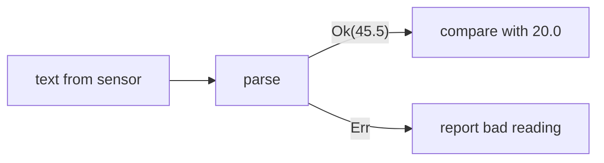

{:class="cover"}

---

By the end of this lesson you will be able to use `Option` and `Result` to handle missing or bad values, and use `?` to pass errors up to the caller.

---

## When a sensor sends rubbish

Sensors fail. A cable is loose and the reading is empty, or a serial line sends garbage text. Python raises an exception, which can surprise you at runtime. Rust makes the possible failure part of the function's type, so you cannot forget it. Here is a complete program that reads distance values from text:

```rust
use std::num::ParseFloatError;

fn parse_distance(text: &str) -> Result<f32, ParseFloatError> {
    text.trim().parse::<f32>()
}

fn safe_to_drive(text: &str) -> Result<bool, ParseFloatError> {
    let distance = parse_distance(text)?; // on Err, return it straight away
    Ok(distance > 20.0)
}

fn first_reading(readings: &[f32]) -> Option<f32> {
    readings.first().copied()
}

fn main() {
    for text in ["45.5", "12", "oops"] {
        match safe_to_drive(text) {
            Ok(true) => println!("{:>5}: clear ahead", text),
            Ok(false) => println!("{:>5}: obstacle, stop", text),
            Err(e) => println!("{:>5}: bad reading ({})", text, e),
        }
    }

    let empty: [f32; 0] = [];
    println!("{:?}", first_reading(&[30.0, 31.0]));
    println!("{:?}", first_reading(&empty));

    if let Some(distance) = first_reading(&[18.5]) {
        println!("first distance {}", distance);
    }

    let fallback = first_reading(&empty).unwrap_or(0.0);
    println!("fallback {}", fallback);
}
```

Output:

```text
 45.5: clear ahead
   12: obstacle, stop
 oops: bad reading (invalid float literal)
Some(30.0)
None
first distance 18.5
fallback 0
```

## Option: something or nothing

`Option<T>` is either `Some(value)` or `None`. It replaces the null values of other languages. `first_reading` returns `None` for an empty list, so the caller must decide what to do. You can unpack it with `match`, with `if let Some(x) = ...`, or give a default with `unwrap_or`.

## Result: worked or failed

`Result<T, E>` is either `Ok(value)` or `Err(error)`. `parse::<f32>()` returns a `Result`, because the text might not be a number. `match` on it, as `main` does, to handle each case.



## The question mark

Writing `match` after every call gets long. The `?` operator means: if this is `Ok`, give me the value; if it is `Err`, return that error from my function right now. `safe_to_drive` uses it in one short line. Note that `?` only works inside a function that itself returns a `Result` or `Option`.

## unwrap: use with care

`.unwrap()` means "give me the value, or crash". It is fine in quick experiments, but not in robot firmware:

<!-- code-check: skip -->
```rust
let reading: f32 = "oops".parse().unwrap();
```

```text
thread 'main' panicked at src/main.rs:2:39:
called `Result::unwrap()` on an `Err` value: ParseFloatError { kind: Invalid }
```

A panic stops your program. On a robot that could mean motors stuck on. Prefer `match`, `?` or `unwrap_or`.

## Try it Yourself

1. Add a fourth test string to the loop, such as `"-3.2"` or an empty string, and predict the output before running.
2. Write `fn battery_level(text: &str) -> Result<u8, std::num::ParseIntError>` that parses a number like `"87"`.
3. Make `safe_to_drive` return `Err` for a negative distance using your own `String` error message.
4. Challenge: make `main` return `Result<(), Box<dyn std::error::Error>>` and use `?` on `parse_distance` there.

## Common Issues

- **Problem**: `the ? operator can only be used in a function that returns Result or Option`.
- **Solution**: Change the function's return type to a `Result`, or `match` inside it instead.
- **Why**: `?` returns early with the error, so the function needs a return type that can hold one.

- **Problem**: Your program panics with `called Result::unwrap() on an Err value`.
- **Solution**: Replace `unwrap()` with `match`, `if let`, `?` or `unwrap_or`.
- **Why**: `unwrap` turns every error into a crash.

- **Problem**: Mixed error types stop `?` from compiling.
- **Solution**: Return `Box<dyn std::error::Error>` as the error type for quick programs.
- **Why**: `?` needs the error to convert into the function's declared error type.

## Check your understanding


? What does `Option<f32>` represent?
- [ ] A float that may be large
- [x] Either `Some(a float)` or `None`
- [ ] A float that is always valid
> `Option` replaces null with an explicit "nothing" case.

? What does `?` do when it meets an `Err`?
- [x] Returns that error from the current function
- [ ] Ignores it
- [ ] Prints it and carries on
> `?` returns early with the error.

? Why is `unwrap()` risky in robot code?
- [ ] It is slow
- [x] It panics and stops the program if the value is an error or `None`
- [ ] It changes the type
> A panic halts the program, possibly leaving motors running.

