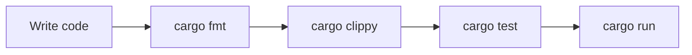

{:class="cover"}

---

By the end of this lesson you will be able to run `cargo fmt`, `cargo clippy` and `cargo test`, and know where to look for crates and help.

---

## The toolbox that comes with Rust

Rust ships with a set of tools that all work through `cargo`. Rather than just list them, let's use three on a small robot function.

| Tool | Command | What it does |
| --- | --- | --- |
| rustfmt | `cargo fmt` | Rewrites your code in the standard layout |
| Clippy | `cargo clippy` | Warns about code that works but could be better |
| Test runner | `cargo test` | Runs your unit tests |
| rust-analyzer | (in your editor) | Completion, inline errors and go-to-definition |
{:class="table table-single"}

rustfmt, Clippy and the test runner are installed by rustup in a default install. rust-analyzer is a language server that Visual Studio Code and many other editors can use. It replaced the older RLS, which is no longer maintained.

## rustfmt: one standard layout

Messy code like this still compiles:

<!-- code-check: skip -->
```rust
fn main(){
let   speed=50 ;
    if speed>10{println!("go");}
}
```

Run `cargo fmt` and it becomes:

```rust
fn main() {
    let speed = 50;
    if speed > 10 {
        println!("go");
    }
}
```

Every Rust project looks alike, so reading other people's code is easy.

## Clippy: a second pair of eyes

This program works, but it is not idiomatic:

<!-- code-check: skip -->
```rust
fn main() {
    let readings = vec![10, 20, 30];
    let mut total = 0;
    for i in 0..readings.len() {
        total += readings[i];
    }
    println!("{}", total);
}
```

`cargo clippy` warns:

```text
warning: the loop variable `i` is only used to index `readings`
warning: useless use of `vec!`
```

It suggests looping over the items directly and using an array. The warnings explain themselves, and many come with a ready-made fix.

## Unit tests

A test is a function marked `#[test]`. Put tests in a module at the bottom of the file. This complete program has a speed limiter with two tests:

```rust
fn clamp_speed(speed: i32) -> i32 {
    speed.clamp(0, 100)
}

fn main() {
    println!("{}", clamp_speed(140));
}

#[cfg(test)]
mod tests {
    use super::*;

    #[test]
    fn too_fast_is_limited() {
        assert_eq!(clamp_speed(140), 100);
    }

    #[test]
    fn negative_becomes_zero() {
        assert_eq!(clamp_speed(-5), 0);
    }
}
```

Run `cargo test` and you see:

```text
running 2 tests
..
test result: ok. 2 passed; 0 failed; 0 ignored; 0 measured; 0 filtered out
```



**Why this matters:** tests run on your computer, so you can check your robot's maths and logic without any hardware, then trust it when you move it to a board.

## Crates and community

Libraries are called **crates**. Find them at [crates.io](https://crates.io/) and read their documentation at [docs.rs](https://docs.rs/). Good places to learn and ask:

- [The Rust Programming Language](https://doc.rust-lang.org/book/), often called "the book"
- [Rust by Example](https://doc.rust-lang.org/rust-by-example/)
- [Rust Users Forum](https://users.rust-lang.org/)
- [The Embedded Rust Book](https://docs.rust-embedded.org/book/) for microcontrollers

## Try it Yourself

1. Make a project with the messy `fn main(){...}` above and run `cargo fmt`. Watch the file change.
2. Add a third test to the example, such as `assert_eq!(clamp_speed(50), 50);`, and run `cargo test`.
3. Break a test on purpose by changing the expected value, and read the failure message.
4. Challenge: run `cargo clippy` on one of your earlier lesson programs and fix every warning.

## Common Issues

- **Problem**: `no such command: clippy` or `no such command: fmt`.
- **Solution**: Run `rustup component add clippy rustfmt`.
- **Why**: Some minimal installs leave these components out.

- **Problem**: `cargo test` shows no output from your `println!`.
- **Solution**: Run `cargo test -- --nocapture`.
- **Why**: The test runner hides printed output from passing tests by default.

## Check your understanding


? Which command rewrites your code in the standard layout?
- [x] `cargo fmt`
- [ ] `cargo clippy`
- [ ] `cargo test`
> rustfmt, run through `cargo fmt`, formats code.

? What marks a function as a unit test?
- [ ] The name starts with `test_`
- [x] The `#[test]` attribute
- [ ] Putting it in `main`
> Tests are marked with `#[test]` and run by `cargo test`.

? Where do you read the documentation for a crate?
- [ ] crates.io only
- [x] docs.rs
- [ ] Inside `Cargo.toml`
> docs.rs builds the documentation for every published crate.

