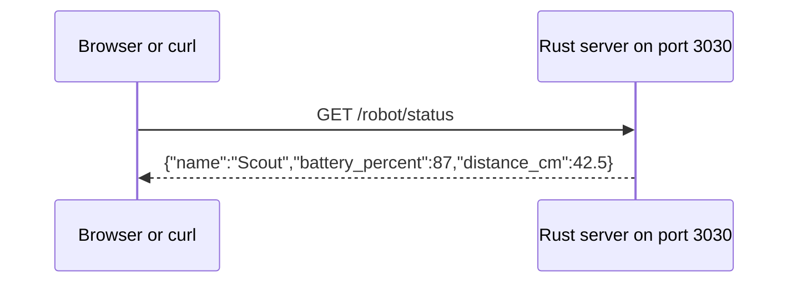

{:class="cover"}

---

By the end of this lesson you will be able to build and run a Rust web server with two routes, one of which returns JSON, and test it with `curl`.

---

## What we are building

Many robots expose a tiny web service so a phone or another computer can ask how they are doing. We will build one that answers two requests:

- `GET /health` replies `OK`
- `GET /robot/status` replies with the robot's name, battery and distance sensor as JSON



We use three crates: **warp** for routing, **tokio** to run asynchronous code, and **serde** to turn a struct into JSON. This project uses `async` code, which lets one program wait on many connections at once. You do not need to understand it fully yet: `#[tokio::main]` and `.await` are the only pieces to copy.

## Step 1: create the project

```bash
cargo new rust_web_app
cd rust_web_app
cargo add warp --features server
cargo add tokio --features full
cargo add serde --features derive
```

`cargo add` edits `Cargo.toml` for you. At the time of writing it gives you:

```toml
[dependencies]
serde = { version = "1", features = ["derive"] }
tokio = { version = "1", features = ["full"] }
warp = { version = "0.4", features = ["server"] }
```

Warp 0.4 needs its `server` feature turned on, or `warp::serve` will not exist. Older tutorials for warp 0.3 leave this out.

## Step 2: write the routes

Create `src/server.rs`:

```rust
use serde::Serialize;
use warp::Filter;

#[derive(Serialize)]
struct RobotStatus {
    name: &'static str,
    battery_percent: u8,
    distance_cm: f32,
}

pub fn routes() -> impl Filter<Extract = (impl warp::Reply,), Error = warp::Rejection> + Clone {
    let health = warp::path!("health").and(warp::get()).map(|| "OK");

    let status = warp::path!("robot" / "status").and(warp::get()).map(|| {
        warp::reply::json(&RobotStatus {
            name: "Scout",
            battery_percent: 87,
            distance_cm: 42.5,
        })
    });

    health.or(status)
}
```

A warp **filter** matches part of a request. `path!("health")` matches that path, `.and(warp::get())` requires the GET method, and `.map(...)` builds the reply. `.or` combines two routes. `#[derive(Serialize)]` teaches serde to write the struct as JSON.

## Step 3: start the server

Replace `src/main.rs` with:

```rust
mod server;

#[tokio::main]
async fn main() {
    let routes = server::routes();
    println!("Listening on http://127.0.0.1:3030");
    warp::serve(routes).run(([127, 0, 0, 1], 3030)).await;
}
```

`mod server;` pulls in the other file. The address `127.0.0.1` means "this computer only", which is the safe choice while testing.

## Step 4: run and test

```bash
cargo run
```

The first build downloads and compiles the crates, so it takes a little while. When it says `Listening on http://127.0.0.1:3030`, open a second terminal:

```bash
curl http://127.0.0.1:3030/health
curl http://127.0.0.1:3030/robot/status
```

You should see:

```text
OK
{"name":"Scout","battery_percent":87,"distance_cm":42.5}
```

You can also visit those addresses in a browser. Any other path, such as `/nope`, returns a `404 Not Found`. Stop the server with Ctrl+C.

## Why this matters

The same ownership rules that protect single programs protect servers handling many requests at once. And because it compiles to one small program, you can copy it to a Raspberry Pi and run it there.

> **Teachers**: the first `cargo run` downloads and compiles about fifty crates, which needs internet access and takes a minute or more per machine. On a school network where many learners build at once, this can be slow or blocked. Prepare by building once and sharing the project folder, or by asking IT to allow crates.io. The server only listens on `127.0.0.1`, so learners cannot reach each other's servers. Keep it that way in a classroom.

## Try it Yourself

1. Visit `/robot/status` in your browser and change the battery value in the code. Rebuild and check it changed.
2. Add a third route `/robot/name` that returns just the robot's name as plain text.
3. Add a `bool` field `online` to `RobotStatus` and return it as part of the JSON.
4. Challenge: change `distance_cm` to be a number that changes on each request, for example by counting requests with an `Arc<Mutex<u32>>` from lesson 8.

## Common Issues

- **Problem**: `cannot find function serve in crate warp`.
- **Solution**: Add the `server` feature: `warp = { version = "0.4", features = ["server"] }`.
- **Why**: Warp 0.4 made its server code an optional feature.

- **Problem**: `Address already in use`.
- **Solution**: Stop the earlier copy of the server with Ctrl+C, or change `3030` to another port.
- **Why**: Only one program can listen on a port at a time.

- **Problem**: `curl: (7) Failed to connect`.
- **Solution**: Check the server is still running and that you used the same port.
- **Why**: Nothing is listening until `cargo run` has finished building and printed its message.

## Check your understanding


? What does `#[derive(Serialize)]` let you do?
- [ ] Run the struct on a thread
- [x] Turn the struct into JSON
- [ ] Make the struct immutable
> serde's `Serialize` lets `warp::reply::json` write the struct as JSON.

? Why does the server listen on `127.0.0.1`?
- [x] That address means only this computer can connect
- [ ] It is the fastest address
- [ ] It makes the server public
> `127.0.0.1` is the loopback address, which keeps testing private.

? What does `cargo add tokio --features full` do?
- [ ] Installs Tokio on your whole system
- [x] Adds Tokio, with all its features, to `Cargo.toml`
- [ ] Runs your program
> `cargo add` edits the `[dependencies]` section for you.

