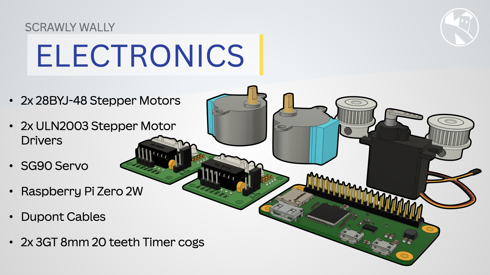
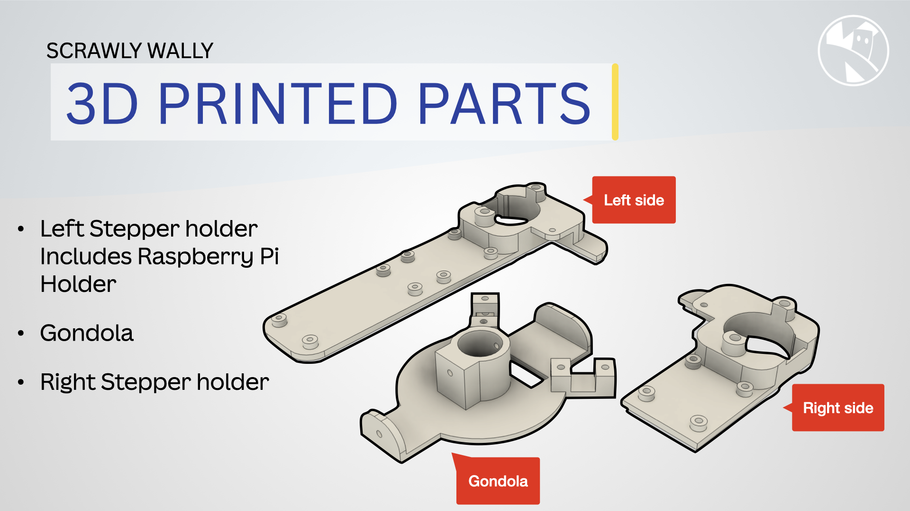

{:class="cover"}

---

By the end of this lesson you will be able to list every part Scrawly Wally needs, print the three plastic parts, and work out how much belt your own board needs.

Let's gather the parts before we start building. Scrawly Wally is made of just a few things: a Raspberry Pi, two stepper motors with their drivers, a servo, some timing belt and three 3D printed parts.

{:class="w-100 rounded-3 card-shadow card-hover"}

## The parts list

| Item | What it does | Quantity |
| --- | --- | --- |
| Raspberry Pi Zero 2 W | The brain: runs your Python and drives the pins | 1 |
| 28BYJ-48 stepper motor | Turns a cog a precise number of steps | 2 |
| ULN2003 stepper driver board | Lets the Pi's small pins switch the motor's coils | 2 |
| SG90 micro servo | Lifts the pen off the wall and lowers it again | 1 |
| 3GT 20 tooth timing cog | Grips the belt and turns it. Kev's list says 8 mm, so check it fits the motor shaft and your belt | 2 |
| 3GT timing belt | Carries the gondola. Length depends on your board (see below) | 2 lengths |
| Marker pen | The thing that does the drawing | 1 |
| Power supply for the Pi | Powers the Pi and, through it, the drivers and servo | 1 |
| Dupont jumper wires | Connect Pi pins to the driver boards | 1 pack |
| Screws, zip ties or hot glue | Fix the prints, the Pi and the servo (lesson 3 says which) | as needed |
{:class="table table-single"}

Kev's original list also priced each part in dollars. Prices move around, so check current prices when you shop rather than trusting a table from 2024.

**Why these parts?** A 28BYJ-48 stepper moves in tiny, countable steps, so the Pi can work out where the pen is just by counting. A cheap hobby servo is plenty strong for lifting a marker. The Pi Zero 2 W is small enough to sit on the left motor mount.

> **Teachers**: the plastic parts are the slow bit. Ask for the three STL files to be printed a week ahead, and have a spare gondola, since it takes the knocks. A group of four can share one robot: one builds each side, one the gondola, one the wiring.

## 3D printed parts

{:class="w-100 rounded-3 card-shadow card-hover"}

Download and print these three files:

- [`gondola.stl`](assets/gondola.stl): holds the pen and the servo, and clamps the belt
- [`left_side.stl`](assets/left_side.stl): the left motor mount, which also carries the Pi and one driver
- [`right_side.stl`](assets/right_side.stl): the right motor mount, which carries the other driver

**Check the pen fits.** The gondola has a round socket for the marker. Pens vary, so measure the barrel of yours against the socket before you print the whole job, or be ready to pad the gap with a little tape.

## How much belt do I need?

Each side needs to reach the furthest corner of your drawing area, plus a little spare for the tails. You can work out the longest run with Pythagoras. For a 90 cm by 60 cm board, the longest run is the diagonal:

```python
import math

width_mm = 900
height_mm = 600
longest = math.sqrt(width_mm ** 2 + height_mm ** 2)
print(f"Longest run: {longest:.0f} mm")
```

That prints `Longest run: 1082 mm`, so for that board allow at least 1.1 metres per side, and more for the tails. Put your own board size in and run it.

## Try it Yourself

1. Measure your board's width and height in millimetres and run the belt program with those numbers.
2. Look at the electronics photo and tick off each item against your parts. Which parts do you need two of, and which just one?
3. Challenge: the gondola socket is round. Measure three different pens and find which fits without tape.

## Common Issues

- **Problem**: The cog does not fit the motor shaft.
- **Solution**: Check the bore of the cog against the shaft before assembling, and file or shim only as a last resort.
- **Why**: The 28BYJ-48 has a small flatted shaft, and cogs are sold with different bore sizes.

- **Problem**: The pen wobbles in the gondola socket.
- **Solution**: Wrap a layer or two of tape around the barrel, or use a pen with a thicker barrel.
- **Why**: A loose pen moves between strokes, which blurs the drawing.

## Check your understanding


? Why do we use stepper motors for the belts?
- [ ] They are the fastest motors you can buy
- [x] They move in countable steps, so the Pi can track the pen by counting
- [ ] They do not need a driver board
> The Pi works out where the gondola is by counting steps, which is why steppers suit a plotter.

? What does the servo do?
- [ ] Moves the gondola left and right
- [x] Lifts the pen off the wall and lowers it again
- [ ] Powers the Pi
> The two steppers move the gondola. The servo only lifts and lowers the pen.

? How can you work out the longest belt run for your board?
- [ ] Add the width and height together
- [x] Use Pythagoras on the board's width and height to get the diagonal
- [ ] Double the board's width
> The furthest the pen can be from a cog is the diagonal of the board, and Pythagoras gives it.


Parts ready? Now we can start building.
