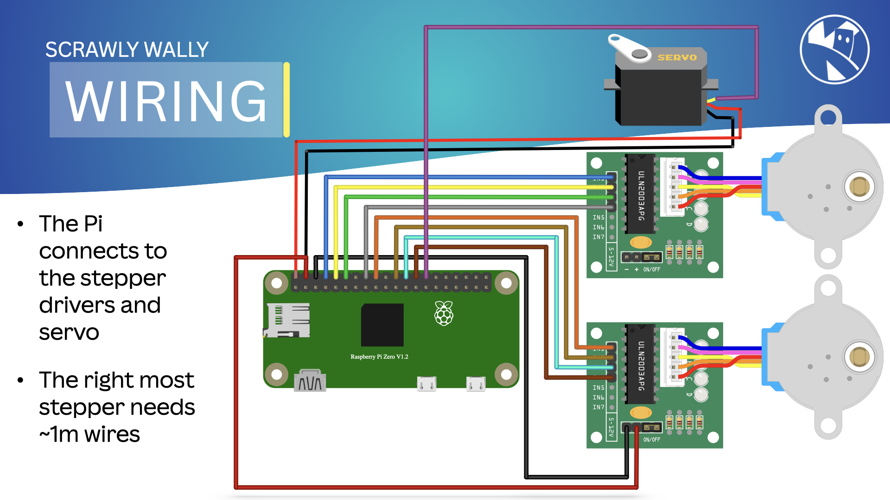
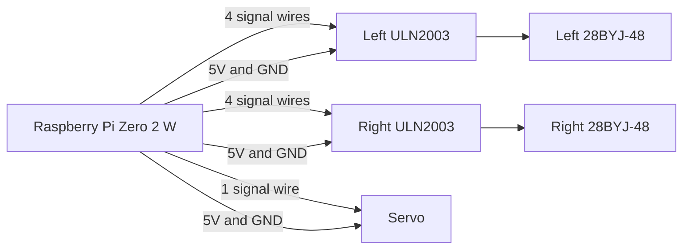

{:class="cover"}

---

By the end of this lesson you will be able to wire both stepper drivers, the servo and the power to the Pi, and say why each connection is there.

Time for the wires. There aren't many connections, but each one matters, so we'll go slowly and check as we go. Kev's picture below shows the whole job, and the table after it lists every pin.

{:class="w-100 img-fluid rounded-3 card-shadow card-hover"}

The diagram is also in the course files if you want to zoom in: [`scrawly_wally_wiring_bb.svg`](assets/scrawly_wally_wiring_bb.svg), and the editable Fritzing file [`scrawly_wally_wiring.fzz`](assets/scrawly_wally_wiring.fzz).

## What connects to what

Each stepper has four coils, and each driver board has four inputs, `IN1` to `IN4`, one per coil. The Pi switches those four inputs on and off in a pattern, and the ULN2003 chip on the driver handles the extra current the coils need. The servo needs only one signal wire, because its own electronics do the rest.

## Pin connections

These are the Raspberry Pi pins, by their GPIO (BCM) number, with the physical pin on the 40-pin header beside each one. They match Kev's Fritzing diagram.

| Connection | GPIO (BCM) | Physical pin |
| --- | --- | --- |
| Left driver `IN1` | GPIO 14 | 8 |
| Left driver `IN2` | GPIO 15 | 10 |
| Left driver `IN3` | GPIO 18 | 12 |
| Left driver `IN4` | GPIO 23 | 16 |
| Right driver `IN1` | GPIO 24 | 18 |
| Right driver `IN2` | GPIO 25 | 22 |
| Right driver `IN3` | GPIO 8 | 24 |
| Right driver `IN4` | GPIO 7 | 26 |
| Servo signal | GPIO 1 | 28 |
| 5V power for drivers and servo | | 4 |
| Ground for drivers and servo | | 6 |
{:class="table table-single"}

**Plug the left side first**, then the right. The right-hand driver is at the far side of the board, so Kev notes that it needs wires about a metre long. Use a long cable and don't stretch a short one across the board.

## Power: the part to check twice

The drivers and the servo take their power from the Pi's 5V and ground pins, so everything shares one supply and one ground. Check three things before you power up:

- **The motor voltage.** The usual 28BYJ-48 is a 5 volt motor. The ULN2003 board is printed with a wider range, so don't connect a bigger supply than the motor is rated for. Read the label on your motor.
- **The supply.** The Pi, two motors and a servo all draw from the same source, so use a good Pi power supply, not a weak phone charger.
- **The polarity.** Red is positive and black is ground. Check each one against the diagram before you plug in.

## A note on the pins

Some of these pins have other jobs on a Pi. GPIO 14 and 15 are the serial port, GPIO 7 and 8 are used by the SPI interface and GPIO 1 by the HAT ID EEPROM. They work as ordinary outputs while those interfaces are switched off, which is why we leave serial, SPI and I2C turned off in the next lesson.

If you ever need to move a wire to a different pin, change the matching pin number in your code too, because the program and the wiring have to agree.

> **Teachers**: a wrong wire on the 5V pin can damage the Pi, so have learners wire with the Pi unplugged and have an adult check the wiring before it is powered. ULN2003 boards have no current limit to set, unlike some stepper drivers, so the motors draw what they draw and the safeguard is the supply and your checking. The motors and driver chips can get warm, so don't leave them energised while nobody is watching. Keep the one-metre right-hand wires tidy and away from the gondola's path. If your kit is shared, label each wire at the Pi end.

## Try it Yourself

1. Without looking, say which GPIO pin drives the servo and which four drive the left motor. Then check against the table.
2. Using the Raspberry Pi pinout, find physical pin 4 and pin 6 on your Pi and say which is 5V and which is ground.
3. Challenge: swap the left driver's `IN2` and `IN3` wires and predict what the motor will do, then try it when you reach lesson 7. Put them back afterwards.

## Common Issues

- **Problem**: A motor buzzes and shakes but does not turn.
- **Solution**: Check all four `IN` wires are in the right order and on the right pins.
- **Why**: The coils must be energised in the right order. A swapped pair makes the rotor tug back and forth.

- **Problem**: The Pi restarts when the motors or servo move.
- **Solution**: Use a better power supply and a short, thick power lead.
- **Why**: The motors pull a lot of current when they start, which can dip the supply below what the Pi needs.

- **Problem**: A driver board's lights do not come on.
- **Solution**: Check its power pins, and the little jumper that switches the board's power on.
- **Why**: The driver is only powered if both its power wires and its on/off jumper are in place.

## Check your understanding


? How many signal wires does each stepper driver need from the Pi?
- [ ] One
- [ ] Two
- [x] Four, one for each of `IN1` to `IN4`
> Each input drives one coil of the motor.

? Where do the drivers and servo get their power in this build?
- [ ] From a separate battery
- [x] From the Pi's 5V and ground pins
- [ ] From the servo signal wire
> Kev's diagram takes 5V and ground from the Pi, so everything shares one supply.

? Why do we leave serial, SPI and I2C switched off?
- [ ] They make the Pi slower
- [x] Some of our pins, such as GPIO 14, 15, 7, 8 and 1, would otherwise be busy with those interfaces
- [ ] The servo does not work with them
> Those pins double as the serial, SPI and ID EEPROM pins, so we keep them free to use as outputs.


All wired? Next we set up the Pi itself.
