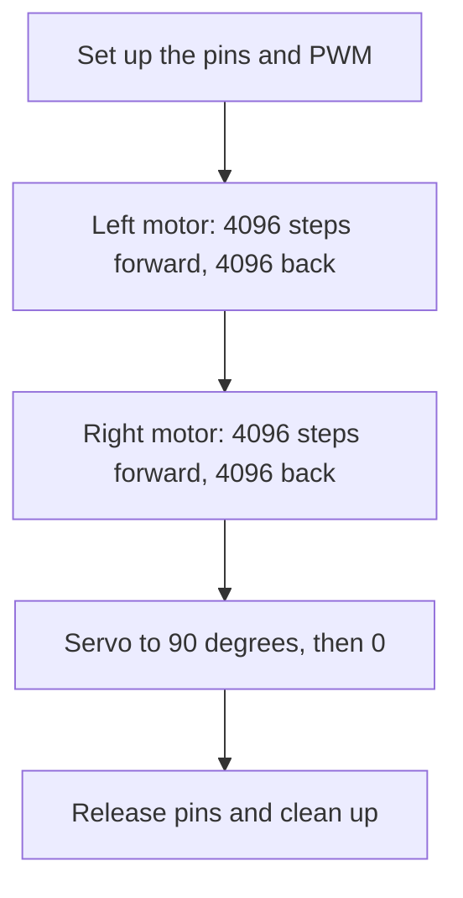

{:class="cover"}

---

By the end of this lesson you will be able to step each motor a chosen number of steps in either direction, move the pen servo up and down, and explain how the Pi does it.

Let's make things move! Before we draw anything, we'll test each part on its own. A test program saves a lot of head scratching later, because if the pen draws a wonky square you'll already know the motors and servo work.

## How a stepper turns

A 28BYJ-48 has four coils. To make it turn, the Pi switches them on in a repeating pattern, and each change nudges the rotor on by one step. The pattern Kev uses has eight phases, which is called **half-stepping**, and it gives smoother, finer movement than four.

| Phase | IN1 | IN2 | IN3 | IN4 |
| --- | --- | --- | --- | --- |
| 0 | 1 | 0 | 0 | 1 |
| 1 | 1 | 0 | 0 | 0 |
| 2 | 1 | 1 | 0 | 0 |
| 3 | 0 | 1 | 0 | 0 |
| 4 | 0 | 1 | 1 | 0 |
| 5 | 0 | 0 | 1 | 0 |
| 6 | 0 | 0 | 1 | 1 |
| 7 | 0 | 0 | 0 | 1 |
{:class="table table-single"}

Go down the table and the motor turns one way. Go up and it turns the other way. Each row is one half-step.

A 28BYJ-48 has a gearbox, so the cog turns much more slowly than the coils. It is usually quoted as 4096 half-steps for one full turn of the cog. Real motors vary a little, which is why we calibrate in lesson 8 and don't trust the number blindly.

## The test program

Save this on the Pi as `motor_test.py`. The pin numbers are the ones from the wiring lesson, so if you changed a wire, change the number here too.

```python
import time
import RPi.GPIO as GPIO

LEFT_PINS = [14, 15, 18, 23]    # BCM numbers: IN1 to IN4 of the left driver
RIGHT_PINS = [24, 25, 8, 7]     # IN1 to IN4 of the right driver
SERVO_PIN = 1

HALF_STEPS = [
    [1, 0, 0, 1],
    [1, 0, 0, 0],
    [1, 1, 0, 0],
    [0, 1, 0, 0],
    [0, 1, 1, 0],
    [0, 0, 1, 0],
    [0, 0, 1, 1],
    [0, 0, 0, 1],
]

GPIO.setmode(GPIO.BCM)
GPIO.setwarnings(False)
for pin in LEFT_PINS + RIGHT_PINS + [SERVO_PIN]:
    GPIO.setup(pin, GPIO.OUT)
    GPIO.output(pin, False)

pwm = GPIO.PWM(SERVO_PIN, 50)    # servos expect a 50 Hz signal
pwm.start(0)


def turn(pins, steps, direction=1, delay=0.002):
    """Half-step one motor. direction is 1 or -1; delay is seconds per step."""
    phase = 0
    for _ in range(steps):
        phase = (phase + direction) % 8
        for pin, level in zip(pins, HALF_STEPS[phase]):
            GPIO.output(pin, level)
        time.sleep(delay)
    for pin in pins:                 # let go, so the coils don't sit hot
        GPIO.output(pin, False)


def set_servo_angle(angle):
    pwm.ChangeDutyCycle(angle / 18 + 2)
    time.sleep(0.5)
    pwm.ChangeDutyCycle(0)           # stop sending pulses so it doesn't twitch


try:
    print("Left motor, one turn forward then back")
    turn(LEFT_PINS, 4096, 1)
    turn(LEFT_PINS, 4096, -1)
    print("Right motor, one turn forward then back")
    turn(RIGHT_PINS, 4096, 1)
    turn(RIGHT_PINS, 4096, -1)
    print("Pen down, then up")
    set_servo_angle(90)
    time.sleep(1)
    set_servo_angle(0)
finally:
    pwm.stop()
    GPIO.cleanup()
    print("Done")
```

Run it with `python3 motor_test.py`. It takes about 40 seconds. Each motor should do a full turn one way, then back, and then the servo should swing and return.



**Things to notice:**

- `delay=0.002` is the time between steps. Make it smaller and the motor goes faster, until it can't keep up and stalls.
- After each move, the program switches all four coil pins off. A stepper left powered sits warm and wastes power, and nothing is pushing the gondola, so we let go.
- The servo uses **PWM** (pulse width modulation) at 50 Hz. The formula `angle / 18 + 2` turns an angle into a duty cycle, a share of each 20 ms pulse. It's a rough rule of thumb, so treat 0 and 90 as starting points and find the real pen-up and pen-down angles for your gondola by experiment.
- The `try`/`finally` makes sure the pins are tidied up even if you press Ctrl+C.

Note: which way is "forward" depends on how you wired and mounted each motor, and the left and right motors are mirror images. Work out which direction lengthens each belt, because we'll need to know that in lesson 9.

> **Teachers**: this is the first moment the robot moves, so check the gondola can't fall or catch on anything first, and run the test with the belts off the cogs or the gondola resting on a desk. Motors and driver chips get warm in use, so don't leave a program running unattended. Let each group test one motor at a time, so the noise and the debugging stay manageable.

## Try it Yourself

1. Change `4096` to `2048` for the left motor. How far does the cog turn now?
2. Change `delay` from `0.002` to `0.001`, then to `0.004`. What happens to the speed, and what happens to the sound?
3. Find the pen-up and pen-down angles for your gondola by trying values from 0 to 90 in `set_servo_angle`, and write them down.
4. Challenge: write a function `move_both(left_steps, right_steps)` that moves both motors in the same loop, one step each. Compare it with moving them one after the other.

## Common Issues

- **Problem**: The motor buzzes but doesn't turn.
- **Solution**: Check the wiring order and raise `delay` to `0.003`.
- **Why**: Swapped wires break the coil pattern, and too short a delay stops the rotor keeping up.

- **Problem**: The servo twitches or jitters when it is still.
- **Solution**: Keep `pwm.ChangeDutyCycle(0)` after each move, as the program does.
- **Why**: RPi.GPIO makes the PWM signal in software, so a long-running signal can wobble. Switching the signal off after the move stops it.

- **Problem**: `RuntimeError: This module can only be run on a Raspberry Pi!` or `ModuleNotFoundError`.
- **Solution**: Run the program on the Pi, and check lesson 6's install step.
- **Why**: `RPi.GPIO` only works on a Raspberry Pi.

- **Problem**: The servo or a motor does nothing and GPIO 1 or 14 seems dead.
- **Solution**: Check serial, SPI and I2C are off (lesson 5).
- **Why**: Those interfaces take the pins for themselves.

## Check your understanding


? What is half-stepping?
- [ ] Turning the motor at half power
- [x] Energising the coils in an eight-phase pattern for finer, smoother steps
- [ ] Moving the gondola half a millimetre
> Kev's pattern has eight phases, and each is one half-step.

? Why does the program switch all four coil pins off after each move?
- [ ] To reset the Pi
- [x] So the motor and driver don't stay energised and warm when nothing needs holding
- [ ] To make the servo move
> A powered stepper wastes energy and warms up, so we let go.

? Why should you treat 0 and 90 degrees as starting points for the servo?
- [ ] Servos can only go to those angles
- [x] The angle formula is a rule of thumb, so your pen needs its own pen-up and pen-down values
- [ ] PWM only works at 50 Hz
> The real positions depend on your servo and gondola, so find them by experiment.


Everything moves. Next we'll work out where it should move to.
