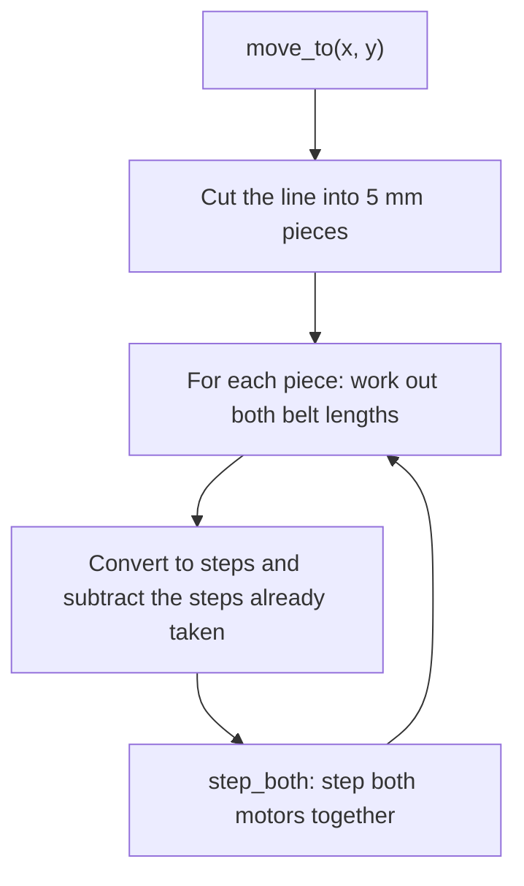

{:class="cover"}

---

By the end of this lesson you will be able to run a complete program that draws a square, first as a dry run on any computer and then on your robot.

This is the big moment. Everything we've built comes together in one program: the pins from lesson 4, the stepping from lesson 7 and the belt-length maths from lesson 8. We'll check it on a computer first, so that when the robot finally moves, you already know the numbers are right.

## How the program works



Two ideas matter here.

**Short pieces make straight lines.** In lesson 8 we saw that two motors running steadily draw a curve. So `move_to` cuts every line into pieces of `SEGMENT_MM` (5 mm), works out the belt lengths at the end of each piece, and steps the motors the small difference. Over 5 mm the curve is so small that the line looks straight.

**Both motors finish together.** `step_both` spreads the steps of the slower motor evenly through the steps of the faster one, so the two stay in step with each other, and the pen moves smoothly towards its target, not in an L-shape.

The program also keeps count: each `Motor` remembers its `length_steps` relative to where the pen started, so rounding errors don't pile up from one piece to the next.

## The program

Save this as `plot_square.py`. It starts with `DRY_RUN = True`, which swaps the real pin library for a stand-in that does nothing, so it runs on any computer with Python 3.

```python
"""plot_square.py - draw a square with Scrawly Wally.

DRY_RUN = True pretends to drive the pins, so you can run this on any
computer first and check the numbers. Set it to False on the Pi to draw.
"""
import math
import time

DRY_RUN = True

# ---- Measure and set these for YOUR robot -------------------------------
BOARD_W = 900.0           # mm between the two cog centres
START = (450.0, 300.0)    # mm: where you hung the pen before running
STEPS_PER_MM = 68.27      # 4096 half-steps per turn / 60 mm of belt per turn
LEFT_SIGN = 1             # flip to -1 if the left cog winds the wrong way
RIGHT_SIGN = -1           # the right motor is a mirror image of the left
STEP_DELAY = 0.002        # seconds per tick: raise it if a motor stalls
SEGMENT_MM = 5.0          # straight lines are cut into pieces this long

LEFT_PINS = [14, 15, 18, 23]     # BCM numbers, from the wiring lesson
RIGHT_PINS = [24, 25, 8, 7]
SERVO_PIN = 1
PEN_UP_ANGLE = 0          # calibrate these on your own gondola
PEN_DOWN_ANGLE = 90
# --------------------------------------------------------------------------

HALF_STEPS = [
    [1, 0, 0, 1], [1, 0, 0, 0], [1, 1, 0, 0], [0, 1, 0, 0],
    [0, 1, 1, 0], [0, 0, 1, 0], [0, 0, 1, 1], [0, 0, 0, 1],
]

if DRY_RUN:
    class GPIO:
        """Stand-in that does nothing, so the maths can be tested anywhere."""
        BCM = OUT = 0
        setmode = setwarnings = cleanup = staticmethod(lambda *a: None)
        setup = output = staticmethod(lambda *a, **k: None)

        class PWM:
            def __init__(self, pin, freq): pass
            def start(self, duty): pass
            def ChangeDutyCycle(self, duty): pass
            def stop(self): pass
else:
    import RPi.GPIO as GPIO


class Motor:
    def __init__(self, pins, sign):
        self.pins, self.sign = pins, sign
        self.phase = 0
        self.length_steps = 0      # belt length, in steps, relative to START
        self.moved = 0             # every step taken, in either direction
        for pin in pins:
            GPIO.setup(pin, GPIO.OUT)

    def step(self, direction):
        """direction +1 lengthens the belt, -1 shortens it."""
        self.phase = (self.phase + direction * self.sign) % 8
        for pin, level in zip(self.pins, HALF_STEPS[self.phase]):
            GPIO.output(pin, level)
        self.length_steps += direction
        self.moved += 1

    def release(self):
        for pin in self.pins:
            GPIO.output(pin, 0)


class Pen:
    def __init__(self, pin):
        self.pin = pin
        GPIO.setup(pin, GPIO.OUT)
        self.pwm = GPIO.PWM(pin, 50)
        self.pwm.start(0)
        self.is_down = False

    def _angle(self, angle):
        self.pwm.ChangeDutyCycle(angle / 18 + 2)
        if not DRY_RUN:
            time.sleep(0.5)
        self.pwm.ChangeDutyCycle(0)    # stop twitching once it is there

    def up(self):
        self._angle(PEN_UP_ANGLE)
        self.is_down = False

    def down(self):
        self._angle(PEN_DOWN_ANGLE)
        self.is_down = True


def string_lengths(x, y):
    return math.hypot(x, y), math.hypot(BOARD_W - x, y)


GPIO.setmode(GPIO.BCM)
GPIO.setwarnings(False)
left = Motor(LEFT_PINS, LEFT_SIGN)
right = Motor(RIGHT_PINS, RIGHT_SIGN)
pen = Pen(SERVO_PIN)

start_left, start_right = string_lengths(*START)
pen_x, pen_y = START
ticks = 0


def step_both(d_left, d_right):
    """Move both motors together so they finish at the same moment."""
    global ticks
    n = max(abs(d_left), abs(d_right))
    err_l = err_r = 0
    for _ in range(n):
        err_l += abs(d_left)
        err_r += abs(d_right)
        if err_l >= n:
            err_l -= n
            left.step(1 if d_left > 0 else -1)
        if err_r >= n:
            err_r -= n
            right.step(1 if d_right > 0 else -1)
        ticks += 1
        if not DRY_RUN:
            time.sleep(STEP_DELAY)


def move_to(x, y):
    """Move the pen to (x, y) in a straight line on the wall."""
    global pen_x, pen_y
    distance = math.hypot(x - pen_x, y - pen_y)
    pieces = max(1, math.ceil(distance / SEGMENT_MM))
    x0, y0 = pen_x, pen_y
    for i in range(1, pieces + 1):
        px = x0 + (x - x0) * i / pieces
        py = y0 + (y - y0) * i / pieces
        want_l, want_r = string_lengths(px, py)
        goal_l = round((want_l - start_left) * STEPS_PER_MM)
        goal_r = round((want_r - start_right) * STEPS_PER_MM)
        step_both(goal_l - left.length_steps, goal_r - right.length_steps)
    pen_x, pen_y = x, y


def draw_square(x, y, size):
    pen.up()
    move_to(x, y)
    pen.down()
    for corner in [(x + size, y), (x + size, y + size), (x, y + size), (x, y)]:
        move_to(*corner)
    pen.up()


try:
    pen.up()
    draw_square(350, 200, 200)
    move_to(*START)
finally:
    left.release()
    right.release()
    GPIO.cleanup()

print(f"left moved {left.moved} steps, right moved {right.moved} steps, net {left.length_steps:+d} and {right.length_steps:+d}")
print(f"pen ended at ({pen_x:.0f}, {pen_y:.0f}), about {ticks * STEP_DELAY:.0f} s of stepping at {STEP_DELAY} s per tick")
```

Run it with `python3 plot_square.py`. In dry-run mode it prints how many steps each motor took, and that the pen ended where it began. When we ran it, it printed:

```text
left moved 56620 steps, right moved 43878 steps, net +0 and +0
pen ended at (450, 300), about 119 s of stepping at 0.002 s per tick
```

The `net +0` result is the useful check: the pen went round a square and came home, so the belts ended up exactly the length they started. (Your numbers will match these if you keep the same settings.)

## Set up your robot

Before you set `DRY_RUN = False` and run it on the Pi:

1. **Match the numbers to your robot.** Put your measured `BOARD_W` and calibrated `STEPS_PER_MM` from lesson 8 into the settings at the top.
2. **Tell it where the pen starts.** The Pi can't see the pen. `START` must be the pen's real position when you run, measured from the left cog (x across, y down). Measure it, don't guess.
3. **Set the pen angles.** Put in the `PEN_UP_ANGLE` and `PEN_DOWN_ANGLE` you found in lesson 7.
4. **Check the direction.** Run a small test first: replace the drawing lines with `move_to(450, 350)`, keep the pen up, and watch. That move is straight down, so both belts should lengthen equally. If the pen rises, flip both `LEFT_SIGN` and `RIGHT_SIGN`. If it swings sideways, flip just one.
5. **Test with the pen up**, then try the square.

When the test goes straight down and the square draws, you've made a drawing robot. The square is 200 mm on a side, and its corner sits at (350, 200) on the board.

## Try it Yourself

1. Run the program in dry-run mode and then change the square's size from 200 to 100. How does the number of steps change?
2. Change `SEGMENT_MM` from 5 to 50 and run it again. The net result should still be zero, so why might the drawn lines look worse?
3. Add a function `draw_rectangle(x, y, width, height)` that draws a rectangle, and call it in place of `draw_square`.
4. Challenge: draw a triangle by calling `move_to` three times, and draw a house shape with a square and a roof.

## Common Issues

- **Problem**: The square comes out squashed or rotated.
- **Solution**: Check `BOARD_W` and `START` against real measurements, and check the pen was at `START` when you ran.
- **Why**: The robot trusts those numbers completely. A pen that isn't where `START` says gives a drawing that is shifted and distorted.

- **Problem**: The pen moves the wrong way.
- **Solution**: Flip `LEFT_SIGN` and `RIGHT_SIGN` as described above.
- **Why**: The motors are mirror images, so the same pattern turns them opposite ways.

- **Problem**: A motor stalls or buzzes.
- **Solution**: Raise `STEP_DELAY` to 0.003 or 0.004 and check the belt isn't binding.
- **Why**: Stepping too fast outruns the rotor, which stalls and loses steps, and the drawing drifts.

- **Problem**: The pen scratches or leaves ink when it should be up.
- **Solution**: Adjust `PEN_UP_ANGLE` and `PEN_DOWN_ANGLE`.
- **Why**: Every gondola and pen holds differently, so the angles need setting by experiment.

- **Problem**: The gondola slides down when the program ends.
- **Solution**: Remove the `left.release()` and `right.release()` lines for a while, or fix the grub screws.
- **Why**: Releasing the coils removes the motor's hold, so a slipping cog or an easily turned gearbox lets the gondola sag.

> **Teachers**: do the dry run with the whole class, since it needs no kit, and only let the robot run once the numbers agree. A running plotter should always be watched, with hands and heads away from the gondola, and the Pi's power at hand to pull. A fine-tipped marker on a classroom whiteboard is easiest to clean up, and a test drawing takes a couple of minutes of stepping, so plan for that in the lesson timing.

## Check your understanding


? Why does `move_to` cut each line into short pieces?
- [ ] To make the motors quieter
- [x] Because two steadily running motors draw a curve, and short pieces make the curve close to straight
- [ ] Because the pen can only draw 5 mm at a time
> Lesson 8 showed a steady-motor move can be 83 mm off the straight line.

? What does `DRY_RUN = True` do?
- [ ] Runs the robot faster
- [x] Swaps the pin library for a stand-in, so the maths can be checked without hardware
- [ ] Switches the servo off
> The stand-in accepts every pin call and does nothing.

? Why must `START` be measured?
- [ ] The Pi can see the pen and needs a hint
- [x] The Pi has no way to know where the pen really is, so every move is worked out from `START`
- [ ] It sets the pen colour
> Steppers have no sensor for position, so the program trusts `START`.


Your robot can draw a square. Next we'll make it draw pictures.
