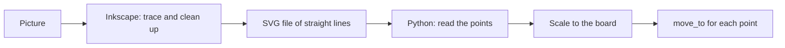

{:class="cover"}

---

By the end of this lesson you will be able to turn a picture into an SVG, read its lines with Python, and scale them to fit your board.

A square is a fine start, but we want to draw pictures. A plotter can't draw a photograph, because it only knows how to draw lines. So we turn the picture into **vectors**: shapes described by lines and points, which a pen can follow.



## Step 1: make an SVG in Inkscape

Inkscape is a free vector graphics editor. Install it on your **computer** and not on the Pi, because the Zero 2 W has only 512 MB of memory and Inkscape is a big program. On a Linux computer you can use `sudo apt-get install inkscape`, and on Windows or macOS you can download it from the Inkscape website.

1. Open your picture in Inkscape. A simple, high-contrast picture such as a logo or a cartoon works best.
2. Choose **Path > Trace Bitmap**, pick a setting and apply it. This turns the picture into outlines.
3. Delete the original picture, so you're left with only the traced shapes.
4. Select the paths and choose **Extensions > Modify Path > Flatten Beziers**. Inkscape draws curves as Bezier curves, and flattening turns every curve into short straight lines, which are easier for our program to follow.
5. Save the file as an SVG.

## Step 2: read the SVG with Python

The program below reads an SVG made of straight lines and prints the strokes it finds, scaled to fit a box on your board. It uses only Python's standard library, so there's nothing to install, and it runs on your computer or the Pi. It understands `<polyline>`, `<polygon>` and `<path>` using the `M`, `L`, `H`, `V` and `Z` commands, and refuses a path that still has curves.

```python
"""svg_to_points.py - turn an SVG made of straight lines into wall coordinates.

Usage:  python3 svg_to_points.py drawing.svg
Handles <polyline>, <polygon> and <path> with M, L, H, V and Z commands.
"""
import re
import sys
import xml.etree.ElementTree as ET

BOX = (300.0, 200.0, 300.0, 200.0)   # left, top, width, height of the drawing area, in mm


def numbers(text):
    return [float(n) for n in re.findall(r"-?\d*\.?\d+(?:e-?\d+)?", text)]


def parse_path(d):
    """Return a list of strokes, each a list of (x, y) points."""
    strokes, current = [], []
    x = y = 0.0
    for command, args in re.findall(r"([MmLlHhVvZz])([^MmLlHhVvZz]*)", d):
        nums = numbers(args)
        rel = command.islower()
        letter = command.upper()
        if letter == "Z":
            if current:
                current.append(current[0])
                strokes.append(current)
                current = []
            continue
        if letter in "ML":
            for i in range(0, len(nums) - 1, 2):
                nx, ny = nums[i], nums[i + 1]
                x, y = (x + nx, y + ny) if rel else (nx, ny)
                if letter == "M" and i == 0:
                    if len(current) > 1:
                        strokes.append(current)
                    current = []
                current.append((x, y))
        elif letter == "H":
            for nx in nums:
                x = x + nx if rel else nx
                current.append((x, y))
        elif letter == "V":
            for ny in nums:
                y = y + ny if rel else ny
                current.append((x, y))
    if len(current) > 1:
        strokes.append(current)
    return strokes


def read_svg(filename):
    strokes = []
    for element in ET.parse(filename).iter():
        tag = element.tag.split("}")[-1]
        if tag == "path":
            d = element.get("d", "")
            if re.search(r"[CcSsQqTtAa]", d):
                sys.exit("This path has curves. In Inkscape use Extensions > "
                         "Modify Path > Flatten Beziers, then save again.")
            strokes += parse_path(d)
        elif tag in ("polyline", "polygon"):
            nums = numbers(element.get("points", ""))
            points = list(zip(nums[0::2], nums[1::2]))
            if tag == "polygon" and points:
                points.append(points[0])
            strokes.append(points)
    return strokes


def fit_to_box(strokes, box=BOX):
    left, top, width, height = box
    xs = [p[0] for s in strokes for p in s]
    ys = [p[1] for s in strokes for p in s]
    scale = min(width / (max(xs) - min(xs) or 1), height / (max(ys) - min(ys) or 1))
    return [[(left + (px - min(xs)) * scale, top + (py - min(ys)) * scale) for px, py in s]
            for s in strokes]


if __name__ == "__main__":
    wall_strokes = fit_to_box(read_svg(sys.argv[1]))
    for number, stroke in enumerate(wall_strokes, 1):
        print(f"stroke {number}: {len(stroke)} points, first ({stroke[0][0]:.1f}, {stroke[0][1]:.1f}), "
              f"last ({stroke[-1][0]:.1f}, {stroke[-1][1]:.1f})")
```

Try it with this tiny house. Save it as `house.svg`:

```xml
<svg xmlns="http://www.w3.org/2000/svg" width="100" height="100" viewBox="0 0 100 100">
  <path d="M 10,90 L 10,50 L 50,10 L 90,50 L 90,90 Z" fill="none" stroke="black"/>
  <path d="M 40 90 V 60 h 20 v 30" fill="none" stroke="black"/>
</svg>
```

Run `python3 svg_to_points.py house.svg`. It prints:

```text
stroke 1: 6 points, first (300.0, 400.0), last (300.0, 400.0)
stroke 2: 4 points, first (375.0, 400.0), last (425.0, 400.0)
```

The house outline is stroke 1, and it ends where it started, because `Z` closes the shape. The door is stroke 2. The program scaled the 100-unit house to fit a box 300 mm wide and 200 mm tall at (300, 200), and kept its proportions, so the house is 200 mm square and the door's base starts at 375 mm.

`BOX` at the top of the program is the part of your board to draw in: left, top, width and height in millimetres. Change it to suit your own board.

## Step 3: draw the strokes

Each stroke becomes one pen-down line: lift the pen, move to the first point, lower the pen, follow the rest of the points and lift again. Add this function to `plot_square.py` from lesson 9, below `draw_square`:

```python
def draw_strokes(strokes):
    for stroke in strokes:
        pen.up()
        move_to(*stroke[0])
        pen.down()
        for point in stroke[1:]:
            move_to(*point)
        pen.up()
```
{: .no-snakie }

Then, in place of the `draw_square(350, 200, 200)` line, use your strokes. Put `from svg_to_points import read_svg, fit_to_box` at the top of the file, keep `svg_to_points.py` in the same folder, and call:

```python
draw_strokes(fit_to_box(read_svg("house.svg")))
```
{: .no-snakie }

We tried this in dry-run mode with the house above and it finished with `net 0` on both motors, so the belts came back to their starting lengths. Always do the dry run first.

## Try it Yourself

1. Run the reader on the house and check the numbers by hand: why does stroke 2 start at x = 375?
2. Change `BOX` to a smaller drawing area and run again. What happens to the points?
3. Draw your own simple shape in Inkscape with the **Pen tool**, using only straight segments. Save it as an SVG, read it with the program and look at the strokes it finds.
4. Challenge: run your own drawing as a dry run and read the time estimate it prints. How could you make the drawing quicker without changing its look?

## Common Issues

- **Problem**: The program stops with `This path has curves`.
- **Solution**: In Inkscape, choose **Extensions > Modify Path > Flatten Beziers** and save again.
- **Why**: Curves use commands such as `C` and `A` that this small reader doesn't follow, and flattening turns them into straight lines.

- **Problem**: The drawing is the wrong size or in the wrong place.
- **Solution**: Check `BOX`. It's in millimetres on your board, measured from the left cog.
- **Why**: The program scales the whole drawing to fit the box you give it.

- **Problem**: Parts of the drawing are shifted or the wrong size compared with each other.
- **Solution**: In Inkscape, ungroup everything (**Object > Ungroup**) before saving.
- **Why**: Inkscape can attach a `transform` to a group. This small reader ignores those transforms, so grouped shapes can land in the wrong place.

- **Problem**: The drawing takes a very long time.
- **Solution**: Simplify the picture, or use a simpler trace.
- **Why**: A busy trace has thousands of tiny lines, and the pen has to follow each one.

> **Teachers**: this lesson works with no robot at all: learners can design in Inkscape, read the file and run a dry run. Inkscape is a large download, so install it ahead on school machines. Choose pictures that learners are allowed to use, such as their own drawings or logos, and keep a first design small so that the plot is over in a few minutes.

## Check your understanding


? What is a vector drawing?
- [ ] A photo with many pixels
- [x] A picture made of shapes described by lines and points
- [ ] A picture the robot has already drawn
> Vectors are lines and points, which is what a plotter can follow.

? Why do we flatten Bezier curves in Inkscape?
- [ ] To make the file smaller on screen
- [x] So the curves become short straight lines that our reader can follow
- [ ] To change the colours
> Our reader handles straight-line commands only.

? What does `fit_to_box` do?
- [ ] Draws the picture on the wall
- [x] Scales and moves the points to fit the area of the board you chose, keeping the proportions
- [ ] Deletes small strokes
> It maps the drawing into `BOX` in millimetres.


Now you can draw pictures. Let's wrap up.
