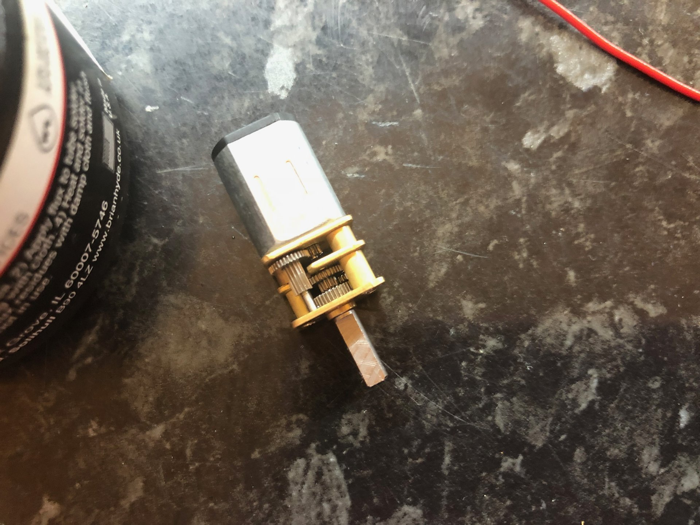
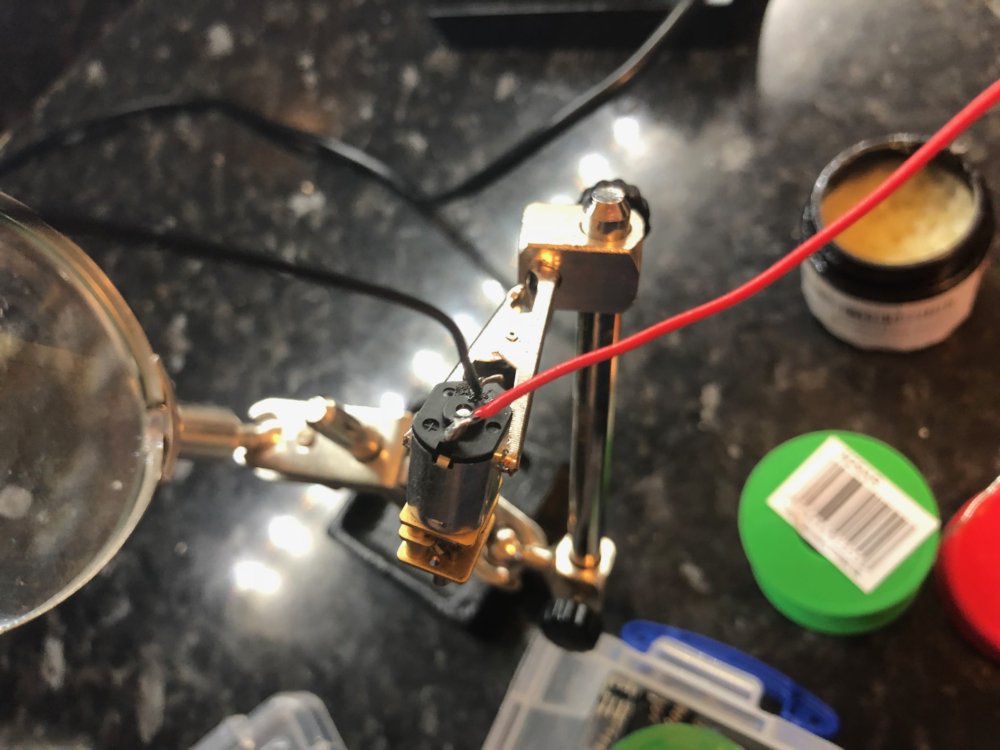

{:class="cover"}

---

By the end of this lesson you will be able to solder a red and a black wire onto each N20 motor and make the joints strong and tidy.

## Watch the video

The assembly video covers soldering and putting the robot together (lessons 2 to 7).



---

## Why we solder the motors

The N20 motors arrive with two tiny metal contacts and no cables. To plug them into the motor shield we need wires, and a soldered joint is the most reliable way to attach them. It is also the part of this build that beginners worry about most, so let's take it slowly. Two motors, four joints, and you are done.

## Preparation

Prep the motor by:

- putting some flux on the contacts
- putting flux on the wires

Flux is a cleaning agent that helps solder flow and stick. Without it the solder tends to ball up and sit on top of the metal instead of joining it.

---

## Motor

{:class="img-fluid w-50"}

---

## Solder wires to motors

- solder a 15cm red wire to the positive terminal
- solder a 15cm black wire to the negative terminal

Using red for positive and black for negative is a habit worth keeping for the whole robot. Later, when you connect the motors, you will always know which wire is which.

A good joint looks smooth and shiny, with the solder flowing around both the contact and the wire. A dull, lumpy blob usually means the joint did not get hot enough.

---

{:class="img-fluid w-50"}

> ## Safety first
>
> Soldering irons get hot enough to burn you instantly. Use a stand, work in a ventilated area, and wash your hands after handling solder.

After soldering, twist the red and black wires to secure them further. It also makes the wires easier to manage.

> **Teachers**: Soldering needs close supervision. Work one learner per iron, with stands, good ventilation and eye protection to hand, and have a first-aid plan for burns. Many classrooms prefer to solder the motors in advance, or have an adult do the joints while learners prepare the wires. The motors and wire are cheap, so allow a few spares for practice.

## Try it Yourself

1. Practise on some spare wire first: tin the end of a wire (melt a little solder onto it) until it is shiny.
2. Solder both motors, then compare the two. Are the joints equally shiny?
3. Challenge: gently tug each wire. A good joint will not move. If one does, reheat and redo it.

## Common Issues

- **Problem**: The solder forms a ball and will not stick to the contact.
- **Solution**: Add a little flux, and hold the iron on the contact for a moment so that it heats before you feed in the solder.
- **Why**: Solder only flows onto metal that is clean and hot. Flux cleans it, and heating the contact (not the solder) makes it flow.

- **Problem**: A wire comes off when you fit the motor later.
- **Solution**: Reheat the joint and add a touch more solder, then twist the pair of wires to take the strain.
- **Why**: The motor contacts are tiny and delicate. Twisting the wires spreads the pull so it does not tug on the joint.

## Check your understanding


? Why do we put flux on the contacts and wires?
- [ ] It makes the motors spin faster
- [x] It helps the solder flow and stick properly
- [ ] It cools the iron
> Flux cleans the metal so the solder flows onto it instead of balling up.

? Which colour wire goes on the positive terminal?
- [ ] Black
- [x] Red
> Red for positive and black for negative keeps the wiring easy to follow.

? Why do we twist the red and black wires together after soldering?
- [x] It secures them further and makes them easier to manage
- [ ] It makes the motor run backwards
- [ ] It reduces the battery voltage
> A twisted pair is tidier and puts less strain on the delicate joints.

