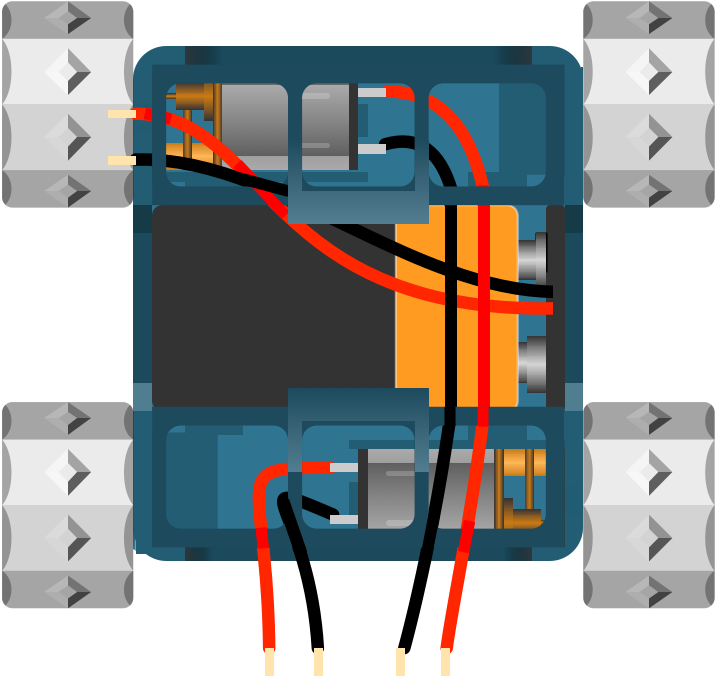
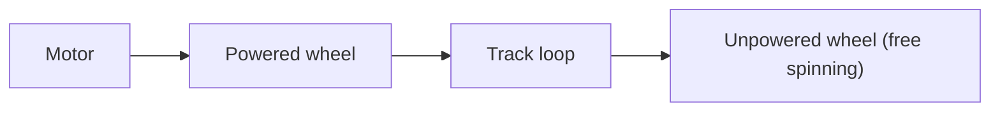

{:class="cover"}

---

By the end of this lesson you will be able to tell the powered and unpowered wheels apart and fit all four.

## Attach Wheels

There are two types of wheel - `Powered` and `Unpowered`. The powered wheels are driven by the motors, whereas the unpowered wheels are free spinning. The unpowered wheels push onto the lugs on the chassis (a little bit of force is required). It is also a good idea to make sure the lugs and the unpowered wheels don't have any rough edges so that they can turn without effort.  

{:class="img-fluid w-50"}

## Two kinds of wheel, one drive train

SMARS has four wheels, two on each side. On each side, one wheel is powered by its motor and the other just spins freely. The tracks (lesson 11) loop around both wheels, so when the powered wheel turns, the track moves and drags the unpowered wheel round with it.

This is also how SMARS steers. The two motors run independently, so if one side is stopped or reversed while the other drives, the robot turns. You will see that in lesson 13.

## Fitting tips

1. Push each powered wheel onto the motor on its side.
2. Push each unpowered wheel onto its lug on the chassis. It needs a little force, so push firmly and evenly.
3. Spin each wheel with a fingertip. Every wheel should turn without catching.
4. If a wheel drags, remove it and clean off any rough edges with fine sandpaper or a craft knife.

A free spinning wheel matters more than it looks. Every bit of friction here is something the small motors have to fight against, so a smooth wheel means a faster, more reliable robot.

## Try it Yourself

1. Spin the unpowered wheel. How many turns does it make from one flick?
2. Compare the unpowered wheel with the powered wheel. What looks different about them?
3. Challenge: with the tracks off, push the chassis along the desk. Do all four wheels turn easily?

## Common Issues

- **Problem**: An unpowered wheel is stiff or rubs on the chassis.
- **Solution**: Remove it and smooth any rough edges on the wheel and the lug.
- **Why**: Printed plastic often has small ridges. A stiff wheel adds friction, which the small motors have to overcome.

- **Problem**: A powered wheel wobbles or slips on the motor.
- **Solution**: Push it fully home on the motor, and check you have used a powered wheel there, not an unpowered one.
- **Why**: The two wheel types are different parts, so the wrong one will not grip the motor.

## Check your understanding


? What's the difference between the powered and unpowered wheels?
- [x] Powered wheels are driven by the motors, unpowered wheels spin freely
- [ ] Powered wheels have batteries inside them
- [ ] There is no difference
> The unpowered wheels push onto the lugs on the chassis and just turn with the tracks.

? What should you do if an unpowered wheel is stiff?
- [ ] Add more force
- [x] Remove rough edges from the lugs and the wheel
- [ ] Swap the motor
> Rough edges add friction, so smooth them off so the wheel can turn without effort.

? How many powered wheels does SMARS have in total?
- [ ] One
- [x] Two
- [ ] Four
> One on each side, driven by its own motor.

